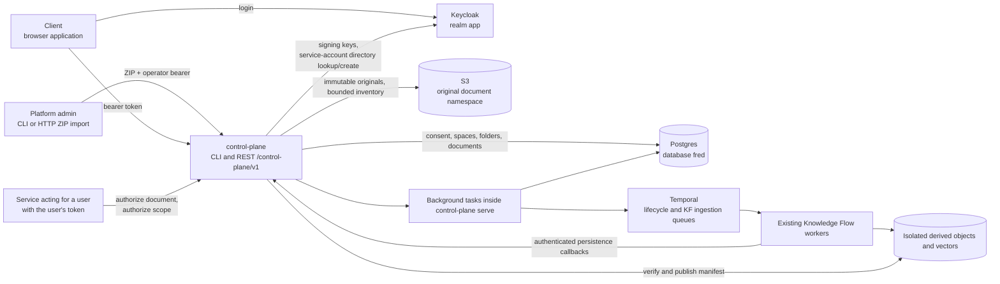
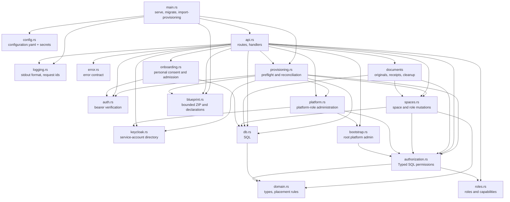
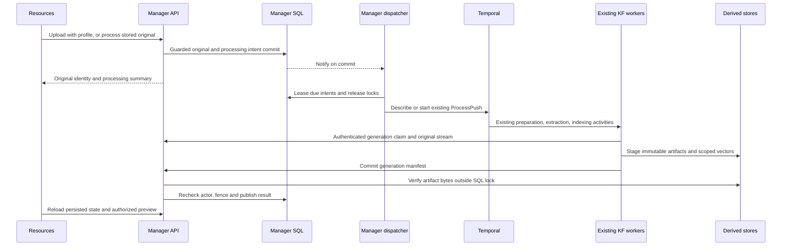

# Reference: control-plane runtime

This is the component-level reference behind the domain chapters. Its sequences
and choices apply to manager; they are not a topology or execution contract for
all Fred components. Start with [User journeys](02.1-user-journeys.md) and
[Security](03-security.md).

## Dependencies

| Partner | What control-plane uses | Contract |
| --- | --- | --- |
| Keycloak | Access tokens, signing keys (JWKS), user lookup/creation with its own service account | [security](03-security.md), Authentication |
| Postgres | Its tables in the `fred` database | [model and contracts](A2-manager-contracts.md), Schema |
| S3 | Conditional Put, verified Get, Delete and paginated List | [original storage](#original-storage) |
| Temporal | Manager-owned lifecycle and delivery of existing KF ProcessPush | [lifecycle](#space-deletion-lifecycle) |
| Clients | Public configuration and health; authenticated onboarding and business routes | [HTTP surface](A2-manager-contracts.md#control-plane-http-surface) and [authentication](A6-security.md#authentication) |
| Services acting for a user | `/authorize/document`, `/authorize/scope` | [runtime reference](A1-manager-runtime.md), Search scope |

## control-plane

A library crate (`src/lib.rs`) with a thin binary (`src/main.rs`): integration tests
drive the library against real Postgres.

| Module | Owns | Rule it enforces |
| --- | --- | --- |
| `api` | HTTP surface, context validation and Control Plane permission checks | handlers stay thin; mutations live in `spaces` and `platform` |
| `auth` | `CurrentUser` extractor, JWKS cache | [security](03-security.md) |
| `spaces` | immutable SQL placement, space/role mutations, memberships, search scope, folder creation and local write authorization | platform/organization locks and SQL transactions (I4, I5, I23) |
| `onboarding` | versioned consent, admitted/own-human extractors | acceptance is independent of roles and memberships (I19) |
| `bootstrap` | the one-time root grant | two steps under the bootstrap lock (I9) |
| `domain` | `Space`, `Folder`, `Document`, roles, parent rules | pure functions, unit-tested (I1, I7) |
| `db` | content and space SQL | placement columns written by inserts only (I2) |
| `processing` | durable acceptance, dispatch, stage fences, manifests, previews and cleanup | current actor authority and isolated publication (I26) |
| `documents` | bounded transfers, upload journal, quotas, reads and autonomous object cleanup | verified publication and preserved originals (I25) |
| `authorization` | Direct grants and typed permissions | PostgreSQL is the sole role store; callers use Control Plane decisions |
| `logging` | output format, request span, completion event | [logging](A3-manager-operations.md#logging) (I11, I13) |
| `error` | status codes, `{"code": ..., "detail": ...}` bodies | [errors](A3-manager-operations.md#errors) |

`roles` defines typed platform roles and scoped capabilities. `platform` serializes
role mutations with bootstrap. `keycloak` owns one shared HTTP client and a synchronized
service-token cache. `api::routes` serves every HTTP route with the shared `AppState`,
without prefix or outer layers; `api::router` adds the base URL, CORS and request
logging. The HTTP API has no Temporal client.

The same `utoipa-axum` registrations build the runtime routers and OpenAPI paths.
`utoipa::ToSchema` derives request/response schemas from the Rust DTOs. The binary's
`generate-openapi` command runs before configuration and logging initialization;
it emits the canonical `/control-plane/v1` contract without constructing service state.
The frontend generates `controlPlaneOpenApi.ts` through its standard RTK codegen
tool and registers the slice in the shared Redux store. A handwritten enhancement
encodes provisioning and original-upload binary arguments as FormData; paths, methods and
response types remain generated.
The bootstrap, personal-space and import
endpoints disable automatic retry on 401 because expiry can follow committed
effects; the shared base query still refreshes before each explicit attempt.

`blueprint::Bundle` validates the bounded ZIP and normalizes declarations without exposing credentials
through Debug or serialization. HTTP and CLI parse on a blocking worker without
filesystem extraction. `Importer` performs read-only preflight, per-identity
mutations, then additive space/role reconciliation. The binary connects without SQL
schema migration, and does not initialize Temporal for import.

## Frontend provisioning

`ProvisioningPage` consumes the generated import mutation through its FormData
adapter. `useManagerPlatformAdmin` shares the manager `/me` RTK query between
the existing navigation and page guard. It does not infer manager authority from
control-plane roles. The page uses the shared `PageHeader`, `FileDropzone` and
`Button` components and the mutation's pending, error and completed-report state.
`App`, the existing router, `MainLayout` and `Sidebar` compose this journey.
`GcuGuard` reads manager onboarding and gates `BootstrapGuard` and admitted routes;
the same layout keeps the account menu available before admission without protected
queries. For ordinary users, the existing Home widgets, routes, sidebar modes and
styles remain mounted.
Home navigation consumes manager `/me/spaces` for team names/roles and personal
opening, preserving the existing search/sort presentation. Organization data appears
only in the profile. Selection opens the usual `/team/<UUID>/agents` destination.
There is no synthetic Python team or permission mapping. Non-migrated service
consumers keep their original calls, including task polling and announcements;
service failure does not remove routes. Theme presentation uses startup configuration.

## Frontend organization owneristration

`ManagerArea`, after consent and bootstrap, resolves current `/me` authority.
Platform admins enter `/admin/organizations`; business URLs redirect there even
when the person also has organization/team roles. Organizations and Provisioning
share the existing administration navigation. The boundary permits the same
standalone profile/legal/release routes, skips business announcements/task/charter
consumers, and disables Python avatar/patch-history enrichment in the account menu.
Ordinary users retain the original business subtree. Normal background authority
refresh preserves mounted forms; a failed request remains blocked during retry,
until a successful response replaces it. Focus revalidates authority.

`OrganizationsPage` reuses `AdminTeamsPage` layout styles and the shared table,
header, input and button components. Its generated registry query distinguishes
loading, empty and failed responses without displaying stale rows. Cursor history
provides Previous/Next without a fabricated total. Creation accepts a name and exact
existing owner/admin usernames, prevents concurrent submissions, reports errors
without replay, ignores completion after unmount and refreshes the first page on success.

## Frontend account pages

The admitted sidebar enables Profile in the existing `UserProfile` menu. The
router mounts `UserSettingsPage`, accepted `GcuPageContent`, `GdprPage` and
`ReleaseNotesPage` under `GcuGuard` and `BootstrapGuard`. These are the shared
pages and controls, outside the sidebar and with no second manager renderer. The profile reads identity
from the browser session and effective platform roles from the generated `/me`
query shared with navigation, and its organization from `/me/spaces`. It hides cached roles during refresh, on error or
when the response belongs to another authenticated subject. With authentication
disabled, it matches manager's fixed mock subject `admin`.

Display preferences use the application context and i18n after startup loads
`GET /users/me/preferences` through the generated Rust client.
`user_preferences.rs` serves GET/PATCH with `OwnUser` before consent, deriving
the subject from verified identity and refusing service accounts and asserted
query subjects. Table `users_preferences` stores one row per subject;
the optional UUID identity snapshot cannot own it. An atomic SQL upsert changes
only supplied columns; explicit null restores defaults. Theme IDs stay opaque
and syntax-validated. Missing rows/read failures use defaults; old personal
browser values never initialize or populate the database. Pane widths and trace
expansion remain browser-local. The focused integration cases live in
`tests/support/user_preferences.rs`.
Legal content and static release notes use their existing markdown loaders.
The consultation route mounts the accepted content without the acceptance
mutation wrapper. The profile renders initials and mounts no Python bootstrap
or avatar subscription.

## Frontend resource browsing

The existing Resources components consume bounded manager directory pages and
current write decisions through the generated client. Their presentation remains
shared with the separate knowledge-base consumer, whose service contract is
unchanged. Manager folder identities never cross into knowledge-flow tag requests.
The actor-scoped import controller retains active files across navigation and
resolves durable receipts before retry. Account changes clear held files and
partition generated-client caches; same-account token refresh preserves identity.
The individual download helper handles the binary response with one bounded Blob.
The [content chapter](05-documents.md) defines this boundary and lifecycle.

## Content access

Control Plane resolves the caller's unique organization and the target's placement,
then evaluates the typed permission against direct SQL grants. Ambiguous attachment
returns 409. Unknown or foreign targets return 404, retired targets 409, and missing
rights 403. Folder, original-content and document-metadata routes share this rule.

## Search scope

`POST /authorize/scope` accepts a personal bearer or a trusted workload bearer with
verified `person`, `run`, `agent` assertions. It returns `{space_id, space_ids}`.
The anchor must be accessible. Each included ancestor must independently be readable;
children and siblings are excluded, and a personal space has no ancestors.
`levels` only narrows the corpus. The explicit anchor remains available for separate
conversation/attachment checks even when the corpus is empty.
Knowledge Flow requests this scope once per incoming documentary operation, then
checks actual publication, lifecycle, generation and attachment provenance locally.

## Memberships

`GET /me/spaces` lists every space where the caller holds a direct role or one
descending from an ancestor, with its path and managing `organization_id`. `roles` holds the effective roles and
`inherited_roles` those held only through an ancestor. Manager reads the caller's
direct roles, each directly granted space's `parent` (or a personal space's
`organization`) link, then the children of each organization and team where the
caller holds a descending role. It does not use `ListObjects`, whose server-side
result limit truncates silently. The computed roles serve display only; every
decision remains an explicit permission check (I20).

## Role and space mutations

[`spaces.rs`](../../apps/control-plane/src/spaces.rs) and
[`platform.rs`](../../apps/control-plane/src/platform.rs) acquire SQL advisory locks
before evaluating authority and changing direct grants. The authorization check and
mutation use the same transaction. Platform locks precede organization locks where
both are needed. The hierarchy and initial grants commit together on creation.
Last-admin/owner and direct-parent-membership constraints are checked under these locks.
Personal-space reuse restores no grants.

## Platform admin bootstrap

[`bootstrap.rs`](../../apps/control-plane/src/bootstrap.rs) verifies the caller's
personal admission and deployment secret, then grants the platform role and records
completion atomically under the platform lock. Later attempts return 409; changing
the deployment secret does not reopen bootstrap.

## Document metadata and folder mutations

The API reads published metadata, answers authorization probes and creates originals
through the folder upload route below. Metadata and binary reads check the owning
space's current authority. Document IDs are not Knowledge Flow identifiers.

Resources reads one mixed `/spaces/{id}/entries` directory. Upload conflict recovery
uses that same paginated endpoint and matches folder names exactly. Folder mutations,
uploads and processing starts invalidate its client cache; window focus refreshes it.
Only pages with pending/running processing refresh on a three-second cadence while
visible. The server bounds literal substring search to 255 characters and uses
separate root/child predicates for both count and page within one SQL snapshot.

Folder rename/delete locate the immutable owning space, acquire its organization
lock and authorize, then reread the folder through the held transaction (I22).
A deletion that commits while a caller waits causes 404 without a fabricated success.
The lock remains held through SQL commit; the authority remains transaction-local.

## Original storage

`documents::Storage` shares one configured S3 client and bounded transfer permits.
The SQL `document_upload` journal records attempts; `document` contains published
originals only. `document_storage` records one namespace binding, inventory cursor
and maintenance lease, independently of individual request retention.

Authority is evaluated from SQL grants at each admission/publication boundary,
using the transaction holding the relevant organization lock.

Publication failure leaves cleanup work in SQL. API reconciliation claims a bounded
batch, expires abandoned reservations under their organization locks and deletes
failed objects outside locks. A persisted prefix scan filters input keys, rechecks
SQL and requires the matching `fred-installation` metadata before deleting
unreferenced originals, including late writes after a previous cleanup. Outputs
and foreign objects are preserved; an inaccessible original defers its own cleanup.
Competing
replicas share the lease; a contended organization is deferred without starving
other candidates. The loop neither publishes documents nor calls processing services.

## Platform administration and self checks

`GET /me` returns effective platform roles, including the roles implied by platform
admin. `GET /users/platform-roles` returns direct grants only, to platform admins.
`PUT` and `DELETE /users/{user}/platform-roles/{role}` acquire the bootstrap/platform
lock and recheck the caller's platform-admin permission. Any platform admin grants or
revokes platform admins; revoking the last one is refused with 409. Granting requires
a Keycloak subject that exists in the configured directory; revoking a stale direct
grant does not require the identity to still exist (I15).

Platform roles use canonical names `platform_admin`, `platform_observer`,
`feature_manager` and `prompt_editor`; no other name is accepted.
Deleting an absent direct grant returns 404, even when the role is effective through platform admin.

An organization's `organization_admin` is granted and revoked by platform admins, under the
platform and organization locks; owner on a team or project is
refused with 409, as is revoking an organization's last owner (I14). Before granting,
manager verifies the subject with its Keycloak service account in the same realm
and requires raw subject mapping. Missing or unavailable identity verification
prevents the write; revocation does not depend on the directory. The
organization's admins are granted by its owners or admins; every other space role by
the space's admins (I21).

`POST /authorize/platform` accepts `{ "permission": "list_all_teams" }`;
`POST /authorize/space` accepts `{ "space_id": "<uuid>", "permission": "run_evaluations" }`.
Both return `{ "allowed": true|false }` for the verified person, including trusted delegation. The typed
capabilities are defined in `roles.rs` and the model in [model and contracts](A2-manager-contracts.md). Space probes return false for missing, foreign or retired spaces.

`GET /admin/teams` requires `can_list_all_teams` and returns at most 100 non-personal
team metadata records ordered by UUID, with placement from the same SQL query.
`?after=<uuid>` continues after the last id; it confers no content access.

`GET /admin/organizations` requires platform administration and selects active organization
rows with a UUID keyset and 101-row SQL lookahead. It returns at most 100 `items` and
an optional `next_cursor`, without directory enumeration.
`POST /admin/organizations` requires the same authority and personal admission. It
resolves exact existing owner/admin usernames in the configured matching Keycloak
realm before locking SQL. Under the platform lock it checks name availability,
rechecks caller authority and validates each nominee's attachment. The space and
its initial owner/admin direct roles commit atomically.
`GET /admin/organizations/{id}` and `PATCH /admin/organizations/{id}` require the same
authority and answer the organization with its direct owners and admins as user
summaries, read with two holder Reads on that organization only; the registry stays
free of roster reads. `PATCH` takes any of `name`, `admin_username` and
`owner_username`, validated and resolved as for creation. Under the platform and
organization locks it rechecks caller ownership, re-reads the row, rechecks
retirement, keeps names unique, reads both rosters and makes each named account the
sole direct holder of its role, checking the new holder's attachment. The rename,
grants and revocations commit together in the same SQL transaction. The response is built from the row and rosters read under the locks;
a directory failure after commit returns id-only summaries rather than an error.
A missing or non-organization id answers 404.

**Pending decision (review of #3319).** This `PATCH` is a platform-admin path to an
organization's governance roles that grant and revoke do not offer: it needs
neither the caller's attachment to the organization nor `Manage`/`AdministerOrganization`
on it, and replacing the admin revokes admins the organization's owners appointed.
The alternative under review limits `PATCH` to the name and owner, leaving admins
to the organization's own governance.

Team creation requires management of the parent organization, project creation
management of the parent team. The nominated admin must hold a direct content
role on the parent, and no sibling may have the same name. The caller receives no
implicit role.

## Authenticated provisioning import

The importer validates the blueprint and directory identities before reconciliation.
Every write boundary checks current platform authority. Keycloak operations remain
external effects authorized at dispatch; each SQL reconciliation transaction commits
placement and roles together. Replay preserves committed identities, space IDs and
undeclared roles. No permission service or second role store participates.

## Design rationale

One SQL source owns placement, direct grants and template policy. A typed Rust
matrix evaluates the fixed organization/team/project hierarchy without a generic
graph interpreter. Personal spaces remain isolated. Python consumes authority
through Control Plane and retains identity, turn-lifetime and local data checks.
SQL advisory locks serialize decisions with role revocation and retirement.

## Folder mutations from Resources

Creation, rename and deletion use the same organization write boundary. Placement
lookup precedes the transaction; the organization lock, current context and
transaction-local Write permission check precede the mutation. `authorized_write` uses
`pg_try_advisory_xact_lock` in a fresh transaction per attempt. A busy attempt rolls
back before a 50 ms sleep without a connection; a five-second deadline bounds
acquisition, including connection checkout after placement lookup. Expiry returns
503 with `dependency_unavailable`, as SQL lock timeouts do. The successful
transaction retains its lock through commit. The same acquisition boundary applies
to upload reservation/publication, processing admission and final indexing
publication. Role and lifecycle lock acquisition remains blocking. Existing folders
are reread under that lock. Recursive deletion is one atomic operation and fails if a document
or pending upload references any included folder. No per-folder authorization or Temporal dispatch
occurs. The original dialogs prevent duplicate submission and discard completion
after navigation; pending deletions of the same UUID share one request.

## Space deletion lifecycle

`lifecycle::policy` validates configuration and resolves retention without effects.
`lifecycle::store` accepts authenticated requests and owns durable receipts.
`lifecycle::cleanup` executes one bounded SQL cleanup batch; `lifecycle::worker`
registers the deterministic `SpaceDeletionSweep` workflow and its activities.
Lifecycle tasks share the initialized application state of `control-plane serve`;
they do not apply SQL migrations.

Authority is evaluated from SQL grants at each admission/publication boundary,
using the transaction holding the relevant organization lock.

Acceptance reads the SQL hierarchy under platform then organization locks.
Cleanup removes rows in separate bounded transactions; role grants follow the
space foreign key.
Each candidate receives at most one batch per activity attempt, with three attempts
and 60-second start-to-close / 240-second schedule-to-close limits. A separate
activity records exhausted attempts; failure does not abort other candidates.
Each activity also observes cancellation and has a 50-second local deadline.
Worker PostgreSQL statements are bounded at 45 seconds and lock waits at 5 seconds;
cleanup sets those limits before taking its transaction locks. SIGTERM/SIGINT starts
a two-second graceful period, then cancels remaining activity futures. Server-side
SQL limits bound outstanding statements even when their Rust future is dropped.
Candidate selection advances its visit time so a failing candidate cannot monopolize
a limited sweep.

Space identifiers and durable receipts survive failed cleanup transactions.
Role rows are removed with their owning SQL space; hierarchy foreign keys retain
parents until their children are gone. Workflow history carries operation IDs,
not credentials or canonical grants.

## Document processing

`processing::Processing` shares manager SQL and original storage, with its own
strict workload authenticator and derived S3 client. `document_processing` is both
the attempt journal and delivery outbox; it has a different lifetime from upload
receipts and retains generations, policy, result counts and dispatch leases.
`document_storage` binds the derived namespace to the installation.

The Python export supplies the existing workflow JSON schema and profile policy.
Rust validates and serializes that contract; workflow/activity names, argument
shapes and registrations remain unchanged. Activity adapters select separate
persistence only for manager sources. Queue routing and extraction supervision
remain in the existing worker. The supervised background tasks establish their Temporal connections independently of HTTP serving.
