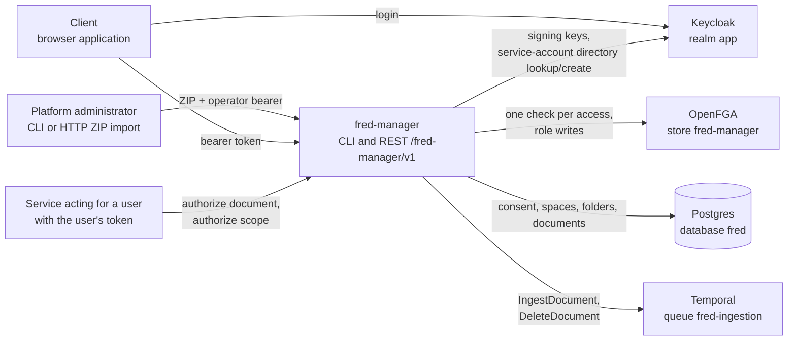
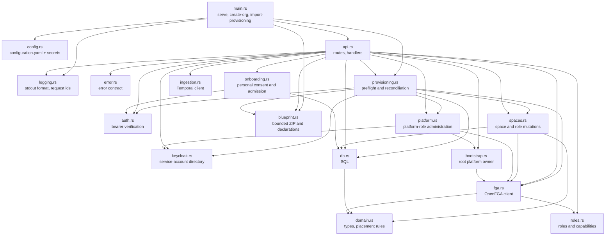
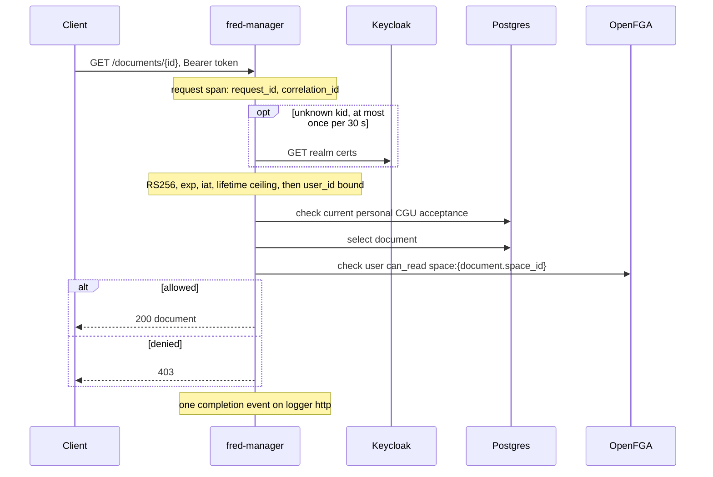
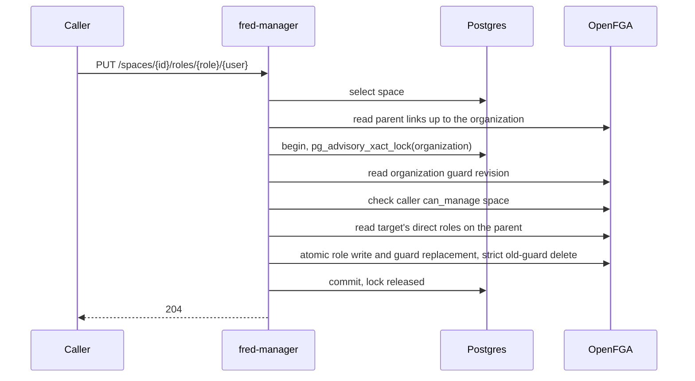
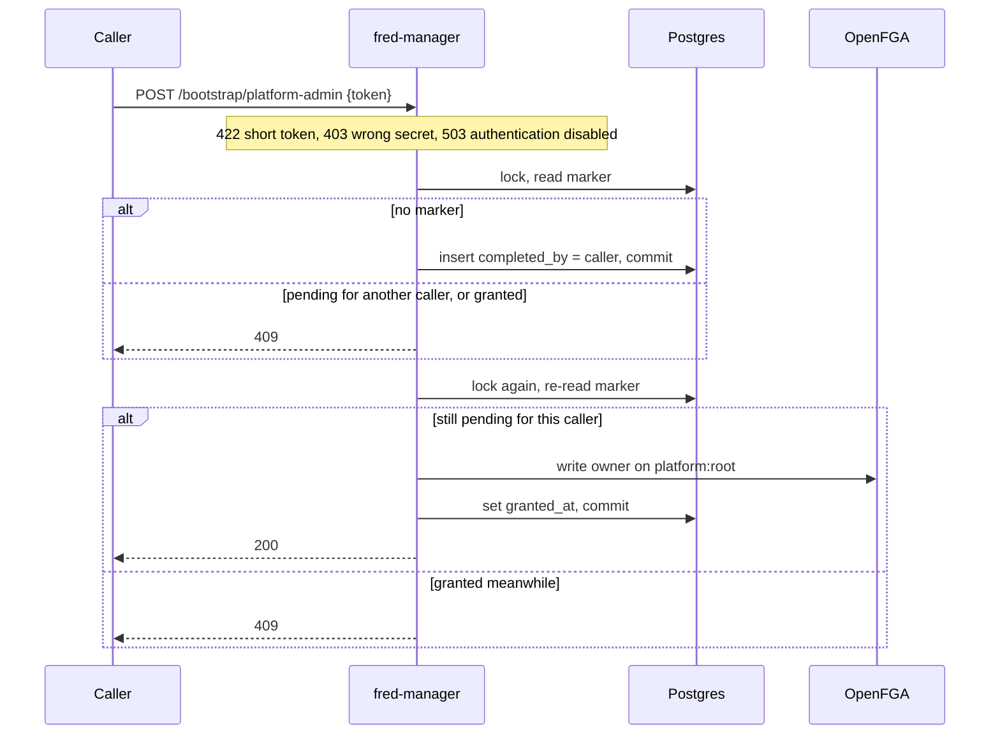
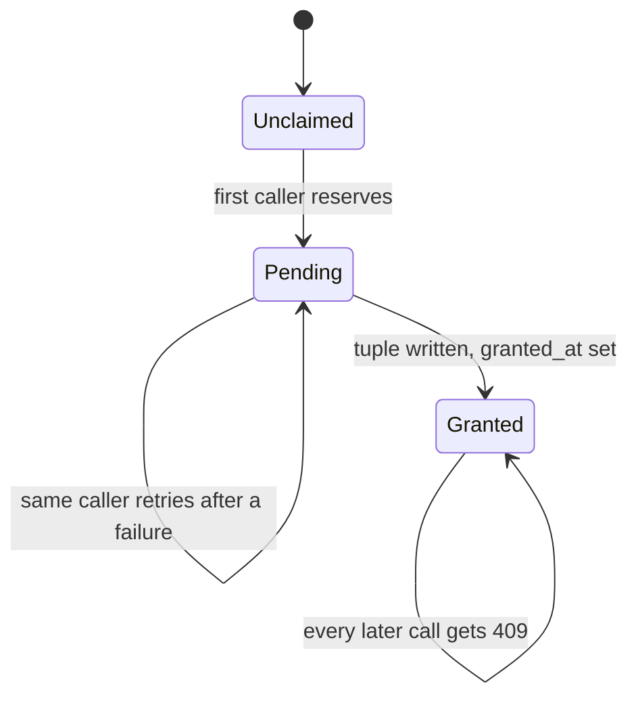
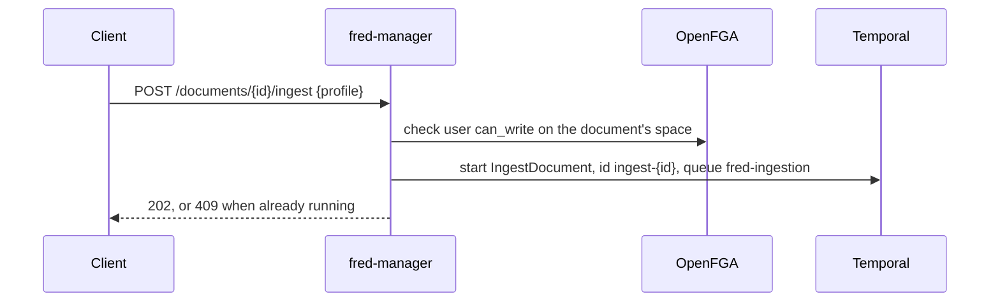
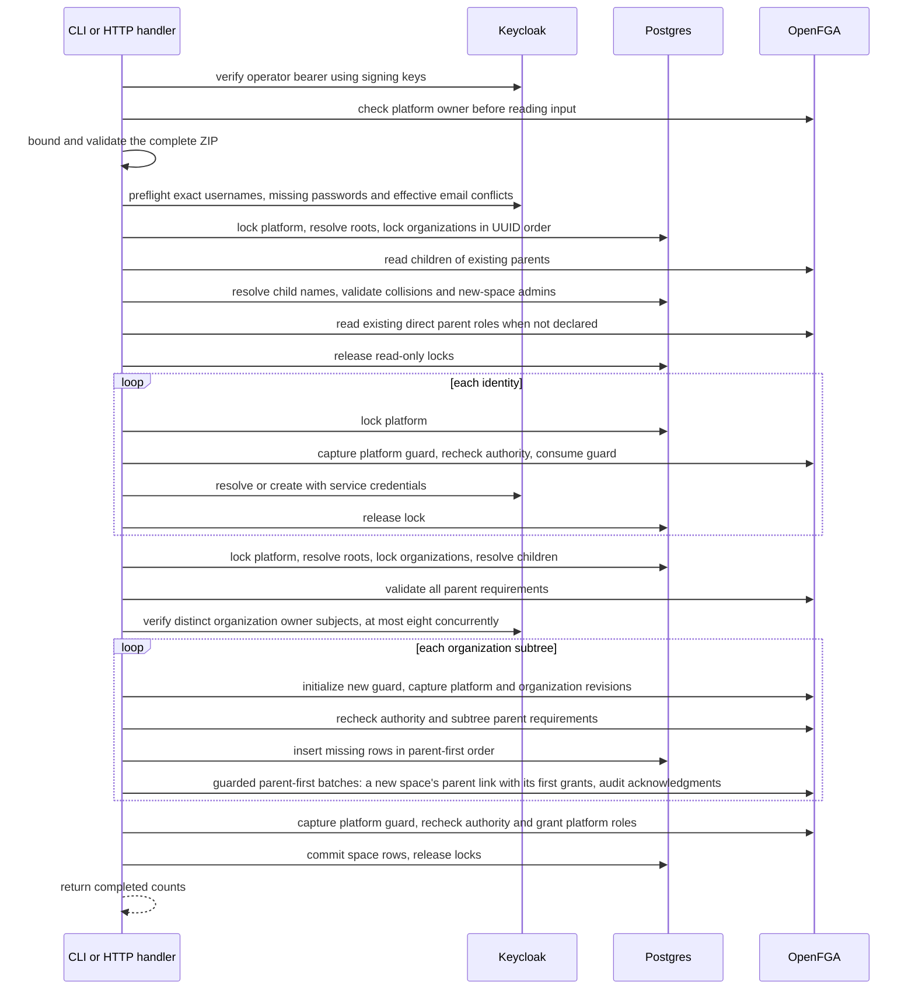

# Reference: manager runtime

This is the component-level reference behind the domain chapters. Its sequences
and choices apply to manager; they are not a topology or execution contract for
all Fred components. Start with [User journeys](02-user-journeys.md) and
[Security](03-security.md).

## Dependencies

| Partner | What fred-manager uses | Contract |
| --- | --- | --- |
| Keycloak | Access tokens, signing keys (JWKS), user lookup/creation with its own service account | [security](03-security.md), Authentication |
| OpenFGA | `check`, `write`, `read` on its own store | [model and contracts](A2-manager-contracts.md), OpenFGA model |
| Postgres | Its tables in the `fred` database | [model and contracts](A2-manager-contracts.md), Schema |
| Temporal | Starting `IngestDocument` and `DeleteDocument` | [runtime reference](A1-manager-runtime.md), Ingestion submission |
| Clients | Public configuration and health; authenticated onboarding and business routes | [HTTP surface](A2-manager-contracts.md#fred-manager-http-surface) and [authentication](03-security.md#authentication) |
| Services acting for a user | `/authorize/document`, `/authorize/scope` | [runtime reference](A1-manager-runtime.md), Search scope |

## fred-manager

A library crate (`src/lib.rs`) with a thin binary (`src/main.rs`): integration tests
drive the library against real Postgres and OpenFGA.

| Module | Owns | Rule it enforces |
| --- | --- | --- |
| `api` | HTTP surface, one OpenFGA check per content access | handlers stay thin; mutations live in `spaces` and `platform` |
| `auth` | `CurrentUser` extractor, JWKS cache | [security](03-security.md) |
| `spaces` | placement from OpenFGA links, space/role mutations, memberships, search scope, folder creation and local write authorization | organization lock plus atomic guard (I4, I5) |
| `onboarding` | versioned consent, admitted/own-human extractors | acceptance is independent of roles and memberships (I19) |
| `bootstrap` | the one-time root grant | two steps under the bootstrap lock (I9) |
| `domain` | `Space`, `Folder`, `Document`, roles, parent rules | pure functions, unit-tested (I1, I7) |
| `db` | content and space SQL | placement columns written by inserts only (I2) |
| `fga` | pinned store/model, check, role and link reads, guarded write; empty-store publication | roles and the space tree stay in OpenFGA; SQL publishes only the store/model binding |
| `ingestion` | `IngestDocument`, `DeleteDocument` submission | one workflow id per document and operation |
| `logging` | output format, request span, completion event | [logging](A3-manager-operations.md#logging) (I11, I13) |
| `error` | status codes, `{"detail": ...}` bodies | [errors](A3-manager-operations.md#errors) |

`roles` defines typed platform roles and scoped capabilities. `platform` serializes
role mutations with bootstrap. `keycloak` owns one shared HTTP client and a synchronized
service-token cache. `api::governance_router` groups identity, platform administration
space listing, ZIP import and self-capability routes independently of the Temporal client.

The same `utoipa-axum` registrations build the runtime routers and OpenAPI paths.
`utoipa::ToSchema` derives request/response schemas from the Rust DTOs. The binary's
`generate-openapi` command runs before configuration and logging initialization;
it emits the canonical `/fred-manager/v1` contract without constructing service state.
The frontend generates `fredManagerOpenApi.ts` through its standard RTK codegen
tool and registers the slice in the shared Redux store. A handwritten enhancement
encodes the import's generated binary argument as FormData; paths, methods and
response types remain generated.
The generation target corrects the code generator's required-body typing for the
optional ingestion request and fails if that upstream output changes. The bootstrap and import
endpoints disable automatic retry on 401 because expiry can follow committed
effects; the shared base query still refreshes before each explicit attempt.

`blueprint::Bundle` validates the bounded ZIP and normalizes declarations without exposing credentials
through Debug or serialization. HTTP and CLI parse on a blocking worker without
filesystem extraction. `Importer` performs read-only preflight, per-identity
mutations, then additive space/role reconciliation. The binary connects without SQL
migration or FGA model synchronization, and does not initialize Temporal for import.

## Frontend provisioning

`ProvisioningPage` consumes the generated import mutation through its FormData
adapter. `useManagerPlatformAdmin` shares the manager `/me` RTK query between
the existing navigation and page guard. It does not infer manager authority from
control-plane roles. The page uses the shared `PageHeader`, `FileDropzone` and
`Button` components and the mutation's pending, error and completed-report state.
`App`, the existing router, `MainLayout` and `Sidebar` compose this journey.
`GcuGuard` reads manager onboarding and gates `BootstrapGuard` and admitted routes;
the same layout keeps the account menu available before admission without protected
queries. Home and its navigation consume generated `/me/spaces` data directly.
Selecting a membership displays its hierarchy and effective roles on Home,
distinguishing those inherited from an ancestor. There is
no synthetic Python team or permission mapping. Unsupported routes redirect home;
agent widgets, task polling, announcements and Python bootstrap consumers are not
mounted. Theme presentation uses configuration loaded at startup.

## Content access

One OpenFGA check on the space that owns the content, whatever the content is: a
document, its metadata, a page of a folder.

## Search scope

A service acting for a user calls with that user's own token. The scope is the space
and its ancestors, organization first, never its descendants (I7): from a team, a
project's content is out of scope. A personal space's scope is itself. An optional
`levels` list keeps only the organization, team or project levels it names; it never
adds a space. The caller filters indexed content with `space_id` in the returned ids,
and narrows to a folder with a `folder_path` prefix.

## Memberships

`GET /me/spaces` lists every space where the caller holds a direct role or one
descending from an ancestor, with its path. `roles` holds the effective roles and
`inherited_roles` those held only through an ancestor. Manager reads the caller's
direct roles, each directly granted space's `parent` (or a personal space's
`organization`) link, then the children of each organization and team where the
caller holds a descending role. It does not use `ListObjects`, whose server-side
result limit truncates silently. The computed roles serve display only; every
decision remains a Check (I20).

## Role and space mutations

`grant`, `revoke`, `create_space` and `create_personal_space` take a transaction-scoped
advisory lock keyed by the organization, capture its guard revision, then check and
write under it (I4, I5). The organization comes from the space's immutable links,
read before locking. SQL locks order live callers; OpenFGA guard consumption
rejects stale remote writes that outlive their caller or transaction.

Creation writes the new space's `parent` link (or a personal space's `organization`
link) in the same Write as its initial grants, after checking that no committed
sibling has the same name, or that the owner has no personal space in that
organization. Children whose SQL row never committed are ignored.

Revocation also reads the target's roles and the space's children under the lock
(and, for an organization, the personal spaces it manages), and refuses with 409
when the target would keep a role there without a direct content role here. Removing the last administrator of a non-personal space is refused with 409 (I14).
Removing a role never grants a replacement content role. A personal space is managed from its organization: an organization admin may
revoke its owner's roles, nobody may grant any (I6).

## Root platform-admin bootstrap

Two proofs: the caller's verified bearer and the deploy-time secret
(`app.bootstrap_token_env_var`, compared in constant time). Two transactions under one
advisory lock (I9).

## Ingestion submission

`POST /documents` registers a document and returns its `storage_prefix`
(`<space_id>/<document_id>/`) and `source_key` (`<prefix>source`). Workflow ids are
`ingest-<document_id>` and `delete-<document_id>`: a second ingestion while one runs
answers 409.

| Workflow | Input |
| --- | --- |
| `IngestDocument` | `document_id`, `space_id`, `folder_path`, `storage_prefix`, `source_key`, `mime`, `profile` (default `medium`), `requested_by` |
| `DeleteDocument` | `document_id`, `space_id`, `storage_prefix` |

Document and folder mutations locate the immutable owning space, acquire its
organization lock and authorize, then reread the object through the held transaction
(I22). If deletion commits while a caller waits, that caller returns 404 without
SQL mutation or Temporal submission. The lock remains held through submission and
SQL commit. The extra existence read does not add an OpenFGA call.

Deletion submits `DeleteDocument {document_id, space_id, storage_prefix}` before
deleting the row, so a failure leaves a retryable document rather than orphaned chunks.

## Platform administration and self checks

`GET /me` returns effective platform roles, including the roles implied by platform
owner. `GET /users/platform-roles` returns direct grants only, to platform owners.
`PUT` and `DELETE /users/{user}/platform-roles/{role}` acquire the bootstrap/platform
lock and recheck the caller's platform-owner permission. Any platform owner grants or
revokes platform owners; revoking the last one is refused with 409. Granting requires
a Keycloak subject that exists in the configured directory; revoking a stale direct
grant does not require the identity to still exist (I15).

Platform roles use canonical names `platform_owner`, `platform_observer`,
`feature_manager` and `prompt_editor`; mutation paths also accept `owner` and `observer`.
Deleting an absent direct grant returns 404, even when the role is effective through owner.

An organization's `owner` is granted and revoked by platform owners, under the
platform lock and guard as well as the organization's; owner on a team or project is
refused with 409, as is revoking an organization's last owner (I14). Before granting,
manager verifies the subject with its Keycloak service account in the same realm
and requires raw subject mapping. Missing or unavailable identity verification
prevents the write; revocation does not depend on the directory. The
organization's admins are granted by its owners or admins; every other space role by
the space's admins (I21).

`POST /authorize/platform` accepts `{ "permission": "list_all_teams" }`;
`POST /authorize/space` accepts `{ "space_id": "<uuid>", "permission": "run_evaluations" }`.
Both return `{ "allowed": true|false }` for the authenticated caller only. The typed
capabilities are defined in `roles.rs` and the model in [model and contracts](A2-manager-contracts.md). Space checks first
resolve the space, returning 404 for an unknown id.

`GET /admin/teams` requires `can_list_all_teams` and returns at most 100 non-personal
team metadata records ordered by UUID, each placed by one concurrent `parent` Read.
`?after=<uuid>` continues after the last id; it confers no content access.

Team creation requires management of the parent organization, project creation
management of the parent team. The nominated administrator must hold a direct content
role on the parent, and no sibling may have the same name. The caller receives no
implicit role.

## Authenticated provisioning import

`fred-manager import-provisioning <bundle.zip> --token-file <path>` verifies the
operator bearer, connects to SQL without migrating and verifies migration
versions/checksums. It loads the published FGA store/model and checks platform owner.
Multipart `POST /import-export/import` checks the authenticated caller's platform
owner authority before reading exactly one `file` field. Both parse the same ZIP
on a blocking worker and invoke `Importer`. A new organization requires a declared
owner and admin.

Predictable bundle, passwordless-identity, email-conflict, missing new-space-admin and parent-access
errors fail whole-bundle preflight before provisioning writes (I18). Directory
traversal holds no mutation lock. Child names are read only after acquiring all
organization locks. Reconciliation retains those locks and the platform lock through
SQL commit. It captures revisions before rechecking authority and parent access,
then carries acknowledged revisions through batches of at most 96 link and space-role
tuples plus four guard operations (I4, I5). A subtree with no role writes consumes its guard
explicitly. Organization owners are checked once per distinct subject before subtree
publication, in batches of at most eight concurrent directory lookups. Platform
grants use the platform guard and recheck identity existence.

Organizations resolve by root name, teams by organization/name, projects by team/name,
among the committed children linked to the parent in OpenFGA. Personal spaces are not
children and take no part in name resolution. Existing committed IDs are reused;
incompatible-kind collisions are refused. Bundle references only identify declarations within that input.
Exact username lookup is paginated and rejects ambiguous/inexact replies; a creation
conflict triggers a fresh lookup. Existing profiles and credentials are preserved.

Reconciliation is additive (I17): undeclared roles remain and requested grants are
repaired. Renaming a declaration identifies a different space. Identities and
acknowledged FGA grants can survive a failed SQL transaction; there is no distributed
rollback. New rows commit after their initial grants, and rolled-back UUIDs are never
reused. The CLI exits nonzero on failure; HTTP returns safe phase/count information.
HTTP 200 means reconciliation completes, not merely that an upload is accepted.

Local folder/document mutations capture the organization guard, authorize, consume
the guard and commit SQL under the same organization lock. Placement reads use the
held SQL connection. Temporal submission holds that lock through dispatch; its
remote effects have the dispatch boundary described by I5 in [invariants](09-quality.md#invariants).

## Design rationale

| Id | Decision | Because | Consequence |
| --- | --- | --- | --- |
| D1 | The space tree lives only in OpenFGA as immutable `parent` links; editor, admin and analyst descend, member does not. | One authority answers who may do what where, including roles reaching descendants. | One Check per access, evaluated through at most two parents; placement and structure operations read links (I20). |
| D2 | Organization > team > project; a personal space is a one-member team without parent. | One model for every container; a personal space stays private to its owner. | Personal spaces inherit nothing and have their own management rule (I6). |
| D3 | Folders carry no rights. | Rights per folder bring back traversal and per-item lists. | Access granularity is the space. |
| D4 | Placement is immutable; a move is a re-import. | Storage keys and indexed content carry placement. | Renames are free; a move costs a re-ingestion. |
| D5 | A space's search scope is its ancestors and itself; levels only narrow it. | Content of a project stays out of its team's scope. | A project reads its team's and organization's content unless the caller removes those levels. |
| D6 | Admin roles grant no content access. | Governing is not reading. | An admin who reads also holds a content role. |
| D7 | Organization mutations hold a Postgres advisory lock and consume an OpenFGA guard captured before checks. | SQL locks alone cannot stop a remote write after cancellation. | Live callers serialize; stale remote writes fail atomically. |
| D8 | Root bootstrap in two steps under one lock: reservation committed, then grant and completion. | No double promotion, no reopening. | A failed grant can only be finished by its claimant. |
| D9 | Configuration, secrets and log output follow Fred's service conventions. | One way to operate every Fred service. | `sourceLocation.function` holds the module path. |
| D10 | Shared infrastructure, own OpenFGA store. | No dedicated infrastructure to run. | Table names are unique in `fred`; `fred-manager` is the logical store name; SQL pins its active store/model IDs. |
| D11 | Deployed with fred's chart as a separate release. | One chart for every Fred service. | The release references the chart without its `values.schema.json` ([operations reference](A3-manager-operations.md)). |
| D12 | Owner is technical, on the platform and on organizations; admin, editor, analyst and member are business roles on every space. Admin and content roles remain orthogonal; a child role requires a direct parent content role. | Technical and business administration were confused under one word. | An organization owner names admins and reads nothing; analyst is a content role; revocation never adds a fallback role. |
| D13 | Platform mutations and organization-owner changes share the bootstrap lock, acquired before the organization lock. | Platform revocation must serialize with dependent writes. | A revoked platform owner cannot finish a waiting mutation; the platform and each organization keep an owner. |
| D14 | Directory operations use a dedicated service client and raw Keycloak subjects in the same realm as callers. | Caller tokens do not carry directory administration privileges. | Grants validate identity existence; revocation tolerates deleted identities. |
| D15 | Import uses authenticated, read-only initialization and a distinct Keycloak service identity. | Service-client credentials must not substitute for Fred operator authority. | Bootstrap and compatible schema/model initialization precede import; Temporal is not involved. |
| D16 | Provisioning is additive and replayable, with identity phases separate from the space transaction. | Keycloak, SQL and OpenFGA do not share a transaction. | Partial effects remain; replay preserves committed IDs and repairs grants. Rolled-back space IDs are not reused. |
| D17 | Strict guard deletion and role changes share one OpenFGA Write. | A consumed revision rejects stale decisions without copying the role set. | One guard Read and two additional tuple operations per guarded scope; conflicting attempts reauthorize on replay. |
| D18 | Startup publishes a fresh store only for an empty installation, once, in SQL. | Existing state cannot be converted safely into a different model. | Existing state without a matching publication requires a data reset. |
| D19 | One version-2 ZIP with explicit organizations, teams, projects and direct roles serves CLI and HTTP. | Reconciliation needs unambiguous parent scope and complete preflight. | Legacy formats are explicitly unsupported; bundle-local references do not add persistent identity or imply content grants. |
