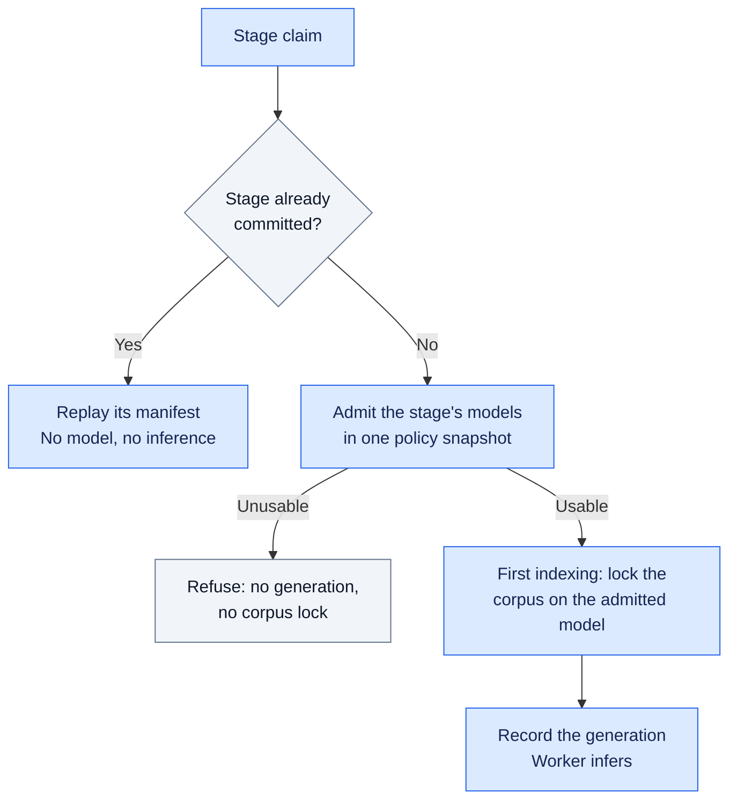
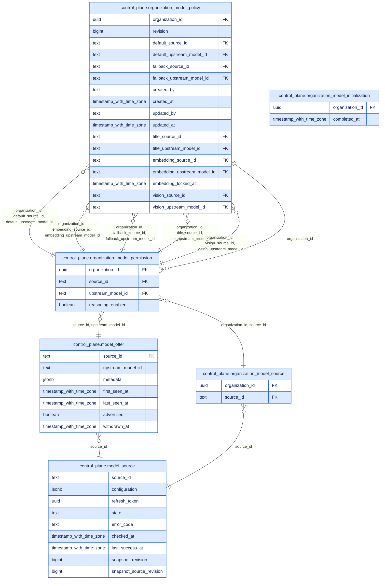

# Reference: model and MCP governance

Companion to [model responsibilities](01-system-overview.md#14-model-decisions-and-credentials)
and [turn admission](02.3-agent-administration.md#2-configure-an-assistant-for-the-task).
The [selection contract](A2-manager-contracts.md#chat-model-preparation-and-turn-admission)
owns precedence, diagnostics and withdrawal fallback; the
[action/role matrix](A7-action-role-matrix.md#model-administration-and-the-first-managed-chat)
owns administration permissions. This reference supplies their generated technical
facts and implementation entry points, not another policy definition.

## MCP connection boundary

Companion to [the administration journey](02.3-agent-administration.md#models-and-mcp)
and [runtime responsibilities](01-system-overview.md#mcp-connection-to-agent-tools).
Model sources remain deployment-configured; MCP connections are space-owned SQL
resources, currently managed only for organization spaces. Shared governance does
not imply identical provisioning, defaults or transport.

| Boundary | Canonical reference |
| --- | --- |
| Ownership and identity | [SQL migration 0023](../../apps/control-plane/migrations/0023_mcp_space_ownership.sql): required owning space, stable UUID and logical name unique per space |
| Connection management and validation | [MCP HTTP contract](../../apps/control-plane/src/mcp_connections/http.rs), [organization-scoped REST inventory](A12-control-plane-api.md#spaces-routes) |
| Permission | [Existing offer governance](../../apps/control-plane/src/agents/enablement.rs) and [role matrix](A7-action-role-matrix.md#model-administration-and-the-first-managed-chat) |
| Execution | [Managed MCP runtime](../../libs/fred-runtime/fred_runtime/common/managed_mcp.py) and [tool integration](../../libs/fred-runtime/fred_runtime/common/mcp_runtime.py) |

The following fragments are generated from existing responsibility anchors; they
identify the catalogue/admission bridge without copying its implementation.

<!-- generated: source-map apps/control-plane/src/mcp_connections/store.rs::available_offers apps/control-plane/src/mcp_connections/store.rs::bindings -->
| Implementation anchor | Responsibility declared in source |
| --- | --- |
| [`store.rs::available_offers`](../../apps/control-plane/src/mcp_connections/store.rs#L50) | Read the offer projection maintained in the same transaction as each connection mutation. Template pickers never need observed/published tool contracts. |
| [`store.rs::bindings`](../../apps/control-plane/src/mcp_connections/store.rs#L135) | Resolve in the admission snapshot. Caller has checked the same selection's organization/local policy. Network discovery never occurs in this transaction. |
<!-- end generated -->

Observation, reviewed publication, technical activation, permission and agent
selection are separate facts. The UI calls publication **Validate tools** or
**Apply changes**; REST retains its publication operation. A connection is one
governed capability offer, not one permission per discovered tool. Admission uses
the reviewed inventory and checks the selected connection in the trusted context.

The [connection contract](../../apps/control-plane/README.md#managed-mcp-connections-reception-pending)
owns credential provisioning and runtime checks. A successful Control Plane
discovery or a UI check with simulated APIs is not proof of a tool call from a
deployed pod. This reference establishes responsibilities and contract boundaries;
it does not certify every deletion, replacement or in-flight execution scenario.

## Responsibility and implementation

| Boundary | Source of truth | Consumer / enforcement |
| --- | --- | --- |
| Approved destinations and inventory | [`ModelSource`](../../apps/control-plane/src/model_catalog/config.rs), platform configuration | [`discovery.rs`](../../apps/control-plane/src/model_catalog/discovery.rs), retained SQL observations; discovery grants no permission |
| Organization policy | [`policy.rs`](../../apps/control-plane/src/model_catalog/policy.rs), organization model tables | Organization Owner through [`http.rs`](../../apps/control-plane/src/model_catalog/http.rs); technical Admin alone cannot administer the policy |
| UI choices | [`preparation.rs`](../../apps/control-plane/src/agent_instances/preparation.rs), public `InferenceSelection` | [`OrganizationModels`](../../apps/frontend/src/rework/components/pages/admin/FeaturesPage/OrganizationModels.tsx), generated frontend client; preparation is not admission |
| Turn decision | [`resolve_runtime_binding`](../../apps/control-plane/src/agent_instances/runtime.rs), [`decide` / `admit`](../../apps/control-plane/src/model_catalog/instance.rs) | Space-derived organization, saved instance tuning and requested choice in a consistent snapshot |
| Shared wire contract | [`InferenceAdmission`](../../libs/fred-rust-sdk/src/inference.rs), Python [`contracts.weaver`](../../libs/fred-sdk/fred_sdk/contracts/weaver.py) | [Generated API types](../../apps/frontend/src/slices/controlPlane/controlPlaneOpenApi.ts); connection only on the trusted execution path |
| Python execution | [`TurnAuthority`](../../libs/fred-runtime/fred_runtime/model_routing/turn.py), [`RoutedChatModelFactory`](../../libs/fred-runtime/fred_runtime/model_routing/provider.py) | [`checked_clients`](../../libs/fred-runtime/fred_runtime/model_routing/guard.py) checks destination/authentication before transport |
| Client translation | `InferenceAdmission.chat_settings` in [`contracts.weaver`](../../libs/fred-sdk/fred_sdk/contracts/weaver.py) | Agent Pod and Knowledge Flow build chat clients from the admitted protocol, destination and options alone |
| Embedded Rust execution | [`InferenceTurn`](../../libs/fred-rust-agent/src/turn.rs) | [`Ralph`](../../libs/fred-rust-agent/README.md), hosted by Control Plane; local binding checked before inference |
| Document models | Policy `embedding`, `vision` and `default`; source `embedding_models` attestation; [migration 0020](../../apps/control-plane/migrations/0020_document_models.sql) lock trigger | Stage claim [`stage_models`](../../apps/control-plane/src/processing/store.rs) / [`admit_document`](../../apps/control-plane/src/model_catalog/instance.rs) for the worker; [`cp_read.organization_model`](../../apps/control-plane/migrations/0020_document_models.sql), with the same availability criteria, for search and document tools |
| Knowledge Flow execution | [`DocumentModels`](../../libs/fred-knowledge/fred_knowledge/models.py) | Worker [`admit_models`](../../apps/knowledge-flow-worker/knowledge_flow_worker/application_context.py), backend [`organization_models`](../../apps/knowledge-flow-backend/knowledge_flow_backend/common/organization_models.py); local binding checked before inference; corpus stores cached by `DocumentModels.identity` |

Selection is shared; transport support is not identical. The
[runtime connection contract](../../apps/control-plane/README.md#inference-connection)
and [provisioning contract](../../apps/control-plane/README.md#workload-provisioning-and-rotation)
define supported forms. The Python Agent Pod supports every form of the contract.
Ralph and Knowledge Flow accept the `standard` route with `api_key` (Knowledge Flow
also `none`), without an API version or gateway header; Knowledge Flow refuses any
other form before a remote call. `wire` selects the generation protocol, chat
completions or responses; an embedding offer is always called at
`{api_root}/embeddings`. An option the admission leaves unset stays unset: no client
default replaces it. No consumer substitutes a local model policy for the admitted
selection.

Provider model lists do not say which offers embed, so a source's `embedding_models`
attests them; such an offer is never chat. Chat is attested by a declared list, by a
`chat_source` qualification, which then cannot also attest embedding models, or by
the source's own metadata (`mixed_capabilities_v1`); otherwise it stays unknown and the
offer cannot be chosen. A list without capability metadata, such as OpenAI's, is
therefore declared. A policy choice must fit its use: chat for default, fallback and
title; an attested embedding offer for `embedding`; a chat offer not reported without
image input for `vision`.



A document model is never substituted: an unusable choice stops the stage. A new
generation is admitted before the claim records anything. The first indexing claim
then locks the corpus on exactly the admitted model, in the claim's transaction and
serialized with policy writes on the policy row; a policy changed in between is
retried, never locked on another model. A trigger then refuses any change, release
or deletion of the lock while the organization exists. A committed stage replays its
result with no admission, so a source disabled afterwards cannot block the replay.

Search applies the same availability as the worker's admission: an enabled source
observed at its current revision and a present offer with the aptitude of its use.
A failed discovery keeps the last observed offers; a withdrawn offer or a removed
attestation makes the corpus unavailable until the source changes, never another
model. Each organization's corpus is its own index, `document-vectors-<organization
id>` (pgvector: a collection with the same suffix), created by the first indexing.
OpenSearch roles therefore grant the corpus prefix: write and index creation to the
ingestion worker, read to the API. Cleanup and visibility changes use the corpus
without an embedding model on both backends.

[Automatic conversation titles](../../apps/control-plane/README.md#automatic-conversation-titles)
receive their own Control Plane admission through `decide_title`, under the same
organization policy. This optional title model does not create a runtime-local
selection rule.

## SQL view

**Legend:** 🟦 Fred · 🟨 COTS · 🟪 Extensions · ⬜ Concepts

Generated from the complete migration chain through PostgreSQL and tbls. This is
an induced subgraph: only relationships between the listed tables are shown.
Organization identifiers refer to `space`; instance recommendations/options live
in `agent_instance.tuning`. These external relationships remain in the
[complete SQL catalogue](A2-manager-contracts.md#control-plane-sql-catalogue).
The ER format shows columns and foreign keys, not every check, index or transaction:
consult the [migrations](../../apps/control-plane/migrations) for exact constraints.

<!-- generated: mermaid docs/architecture/generated/control-plane.er.mmd control_plane.model_source control_plane.model_offer control_plane.organization_model_source control_plane.organization_model_policy control_plane.organization_model_permission control_plane.organization_model_initialization -->

<!-- end generated -->

## Control Plane configuration

Generated from the [configuration schema](../../apps/control-plane/config/schema/configuration.schema.json).
`platform.model_sources` contains `ModelSource`; `platform.organization_models`
contains `OrganizationModels` for one-time initialization after provisioning.
The SQL policy subsequently administered through the UI remains authoritative;
initialization is not a restart-time overwrite. Embedded Ralph's local bindings
are in `platform.inference_credentials`.

The schema defines shape and defaults. Cross-field validation and eligibility
remain in the linked Rust sources; a structurally valid configuration does not
prove provider connectivity. Environment-variable names below are references,
never credential values.

<!-- generated: schemas apps/control-plane/config/schema/configuration.schema.json ModelSource OrganizationModels InferenceCredentialBinding -->
### CredentialAuthority

One of: `discovery_only`, `discovery_and_inference`.

### DeclaredModel

Chat is guaranteed by this declaration, except for an offer the source attests in `embedding_models`; an absent fact stays unknown.

| Field | Type | Required | Description |
| --- | --- | --- | --- |
| `context_window_tokens` | integer (int64), >= 1 or null |  |  |
| `display_name` | string or null |  |  |
| `id` | string | yes | Exact upstream identifier, never normalized. |
| `max_input_tokens` | integer (int64), >= 1 or null |  |  |
| `max_output_tokens` | integer (int64), >= 1 or null |  |  |
| `reasoning` | boolean or null |  |  |

### DiscoveryAuthentication

One of:

- `mode` = `public`

| Field | Type | Required | Description |
| --- | --- | --- | --- |
| `mode` | `public` | yes |  |

- `mode` = `bearer`

| Field | Type | Required | Description |
| --- | --- | --- | --- |
| `accept_inference_authority` | boolean |  |  |
| `authority` | [`CredentialAuthority`](#credentialauthority) | yes |  |
| `mode` | `bearer` | yes |  |
| `provider_scopes` | array of string | yes | Actual provider scopes, reviewed by the platform; a separate key proves nothing. |
| `secret_env_var` | string | yes |  |

### InferenceCredentialBinding

Local deployment attestation, independent of the received admission.

| Field | Type | Required | Description |
| --- | --- | --- | --- |
| `api_key_env` | string | yes |  |
| `api_root` | string | yes |  |
| `credential_binding` | string | yes |  |

### ModelAuth

Authentication facts only: the secrets stay in the workload's local binding.

| Field | Type | Required | Description |
| --- | --- | --- | --- |
| `client_id` | string or null |  |  |
| `gateway_key_header` | string or null |  | Name of the header carrying a gateway key, with any kind. |
| `kind` | [`ModelAuthKind`](#modelauthkind) | yes |  |
| `scope` | string or null |  |  |
| `tenant_id` | string or null |  | Required with kind `entra`, forbidden otherwise, like `client_id` and `scope`. |

### ModelAuthKind

One of: `none`, `api_key`, `entra`.

### ModelConnection

One destination, independent of the vendor: protocol, address and authentication. Mirrored by `fred_sdk.contracts.weaver`; `inference_connections.json` pins both.

| Field | Type | Required | Description |
| --- | --- | --- | --- |
| `api_root` | string | yes | Separately approved canonical root; never derived from a discovery URL. |
| `api_version` | string or null |  |  |
| `auth` | [`ModelAuth`](#modelauth) | yes |  |
| `credential_binding` | string | yes | Source-bound workload provisioning reference; never a credential value. |
| `dialect` | [`ModelDialect`](#modeldialect) | yes |  |
| `route` | [`ModelRoute`](#modelroute) | yes |  |
| `wire` | [`ModelWire`](#modelwire) | yes |  |

### ModelDialect

One of: `openai`, `openai_compatible`, `mistral`.

### ModelOfferKey

| Field | Type | Required | Description |
| --- | --- | --- | --- |
| `source_id` | string | yes |  |
| `upstream_model_id` | string | yes |  |

### ModelRoute

One of: `standard`, `azure_deployment`.

### ModelSource

Platform approval of one source. Contains references only, never secret values.

| Field | Type | Required | Description |
| --- | --- | --- | --- |
| `allow_insecure_http` | boolean |  | Explicit platform approval for internal HTTP routes; HTTPS is the default. |
| `embedding_models` | array of string, max items 256 |  | Platform attestation: these exact offers compute embeddings and are never chat. Provider model lists do not establish this aptitude. |
| `enabled` | boolean |  |  |
| `inference` | [`ModelConnection`](#modelconnection) | yes |  |
| `inventory` | [`SourceInventory`](#sourceinventory) | yes |  |
| `revision` | integer (int64) | yes | Strictly increase for every configuration change, including secret rotation. |
| `source_id` | string | yes |  |
| `visibility_scope` | string | yes | Stable provider account, model namespace and list visibility contract. A changed account/namespace/scope needs a new source_id, even with the same URL. |

### ModelWire

Generation protocol only. An attested embedding offer is always called at `{api_root}/embeddings`, the one embedding endpoint of these APIs.

One of: `openai_chat`, `openai_responses`.

### OrganizationModels

| Field | Type | Required | Description |
| --- | --- | --- | --- |
| `default` | [`ModelOfferKey`](#modelofferkey) or null |  |  |
| `embedding` | [`ModelOfferKey`](#modelofferkey) or null |  |  |
| `fallback` | [`ModelOfferKey`](#modelofferkey) or null |  |  |
| `organization` | string | yes | Exact existing organization name, resolved using the provisioning SQL lookup. |
| `permitted` | array of [`ModelOfferKey`](#modelofferkey), max items 4096 | yes |  |
| `reasoning_enabled` | array of [`ModelOfferKey`](#modelofferkey), max items 4096 |  |  |
| `sources` | array of string, max items 64 | yes |  |
| `vision` | [`ModelOfferKey`](#modelofferkey) or null |  |  |

### Qualification

One of: `chat_source`, `mixed_capabilities_v1`.

### SourceInventory

Where this source's offers come from. A declared list replaces discovery for its source, never supplements it, and both publish through the same refresh.

One of:

- `kind` = `discovered`

| Field | Type | Required | Description |
| --- | --- | --- | --- |
| `authentication` | [`DiscoveryAuthentication`](#discoveryauthentication) | yes |  |
| `complete_inventory_guaranteed` | boolean | yes | Platform attests that an unpaginated response lists the entire visibility scope. Without this guarantee, discovery cannot publish an authoritative inventory. |
| `kind` | `discovered` | yes |  |
| `qualification` | [`Qualification`](#qualification) | yes |  |
| `url` | string | yes |  |

- `kind` = `declared`

| Field | Type | Required | Description |
| --- | --- | --- | --- |
| `kind` | `declared` | yes |  |
| `models` | array of [`DeclaredModel`](#declaredmodel), min items 1, max items 256 | yes |  |
<!-- end generated -->

## Agent Pod and Knowledge Flow configuration

Python's top-level `inference_credentials` is generated from the
[Agent Pod configuration schema](../../apps/fred-agents/config/schema/configuration.schema.json),
whose owner is [`AgentPodConfig`](../../libs/fred-runtime/fred_runtime/app/config.py).
Knowledge Flow's backend and worker configurations carry the same type. It maps an
admitted binding/destination to local variables; it contains no model catalogue or
organization selection policy.

<!-- generated: schemas apps/fred-agents/config/schema/configuration.schema.json InferenceCredentialBinding -->
### InferenceCredentialBinding

A workload's local attestation of one admitted destination, read from its own configuration: variable names only, never secrets. Every model client (Agent Pod, Knowledge Flow) checks the Control Plane's admitted connection against it.

| Field | Type | Required | Description |
| --- | --- | --- | --- |
| `api_key_env` | string or null |  | Default: `null`. |
| `api_root` | string | yes |  |
| `client_secret_env` | string or null |  | Default: `null`. |
| `credential_binding` | string, min length 1, max length 128 | yes |  |
| `gateway_key_env` | string or null |  | Default: `null`. |
<!-- end generated -->

## Deployment evidence

The local profile is owned by the factory; the [deployment guide](../../deploy/k3d/README.md#models-for-local-testing)
owns its operational procedure. It declares the `mistral` (discovered) and `openai`
(declared) sources, maps their bindings to the same API roots in Control Plane,
Agent Pod and Knowledge Flow, and gives each workload `MISTRAL_API_KEY` and
`OPENAI_API_KEY` from optional keys of the Kubernetes Secret `fred-model-credentials`.
The operator chooses the demo organizations' initial policy explicitly: Mistral by
default, or an OpenAI-only or mixed overlay. A source without its key stays
unavailable; it does not block a policy that does not use it. No Secret value is read
or embedded here. The
[rotation procedure](../../apps/control-plane/README.md#workload-provisioning-and-rotation)
covers source revision, refresh and workload rollout; environment variables are
process snapshots. Revoking a provider key can still interrupt an admitted turn.

Three kinds of evidence stay distinct. Source inspection and the generated references
here describe the code. Automated checks run on fakes and disposable databases and
prove no provider call. Only a deployed reception, recorded in its PR with the Fred and
factory revisions it used and its outcome, establishes that a configuration works; a
branch name or an uncommitted factory change is not such a record. Fred-only CI cannot
establish freshness of a separate factory checkout.

## Keeping this reference current

Use the existing architecture generator from `docs/architecture`:

```sh
make generate-models
make check-models
```

Generation rebuilds the SQL reference from disposable PostgreSQL and reads the
committed configuration schemas. The existing config-schema checks compare those
schemas with Rust/Pydantic types. `check-models` compares SQL without rewriting the
versioned diagram, checks these generated blocks and local navigation links, and
renders the reading-path diagrams. CI runs both the architecture and schema checks
on Weaver changes. A schema/type rename or changed field therefore requires a
regenerated reference, not a manually edited table.

Human review still owns diagram meaning, selection rules and runtime limitations.
Follow the source map when changing those responsibilities; update the main
explanation and its contract in the same PR. Generated references describe code,
not successful tests or deployed behavior. Shared inference fixtures and their
consumers are linked in the [runtime contract](../../apps/control-plane/README.md#workload-provisioning-and-rotation);
their presence is not an execution result.
