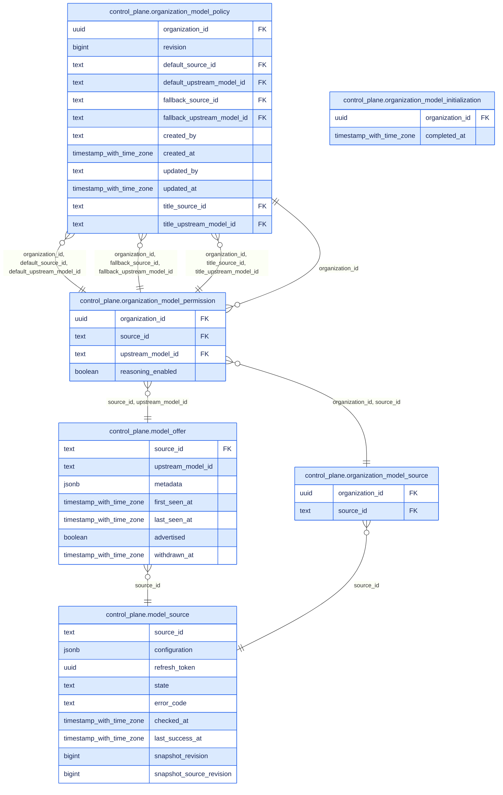

# Reference: model governance and execution

Companion to [model responsibilities](01-system-overview.md#14-model-decisions-and-credentials)
and [turn admission](02.3-agent-administration.md#2-configure-an-assistant-for-the-task).
The [selection contract](A2-manager-contracts.md#chat-model-preparation-and-turn-admission)
owns precedence, diagnostics and withdrawal fallback; the
[action/role matrix](A7-action-role-matrix.md#model-administration-and-the-first-managed-chat)
owns administration permissions. This reference supplies their generated technical
facts and implementation entry points, not another policy definition.

## Responsibility and implementation

| Boundary | Source of truth | Consumer / enforcement |
| --- | --- | --- |
| Approved destinations and inventory | [`ModelSource`](../../apps/control-plane/src/model_catalog/config.rs), platform configuration | [`discovery.rs`](../../apps/control-plane/src/model_catalog/discovery.rs), retained SQL observations; discovery grants no permission |
| Organization policy | [`policy.rs`](../../apps/control-plane/src/model_catalog/policy.rs), organization model tables | Organization Owner through [`http.rs`](../../apps/control-plane/src/model_catalog/http.rs); technical Admin alone cannot administer the policy |
| UI choices | [`preparation.rs`](../../apps/control-plane/src/agent_instances/preparation.rs), public `InferenceSelection` | [`OrganizationModels`](../../apps/frontend/src/rework/components/pages/admin/FeaturesPage/OrganizationModels.tsx), generated frontend client; preparation is not admission |
| Turn decision | [`resolve_runtime_binding`](../../apps/control-plane/src/agent_instances/runtime.rs), [`decide` / `admit`](../../apps/control-plane/src/model_catalog/instance.rs) | Space-derived organization, saved instance tuning and requested choice in a consistent snapshot |
| Shared wire contract | [`InferenceAdmission`](../../libs/fred-rust-sdk/src/inference.rs), Python [`contracts.weaver`](../../libs/fred-sdk/fred_sdk/contracts/weaver.py) | [Generated API types](A12-control-plane-api.md#inferenceadmission); connection only on the trusted execution path |
| Python execution | [`TurnAuthority`](../../libs/fred-runtime/fred_runtime/model_routing/turn.py), [`RoutedChatModelFactory`](../../libs/fred-runtime/fred_runtime/model_routing/provider.py) | [`checked_clients`](../../libs/fred-runtime/fred_runtime/model_routing/guard.py) checks destination/authentication before transport |
| Embedded Rust execution | [`InferenceTurn`](../../libs/fred-rust-agent/src/turn.rs) | [`Ralph`](../../libs/fred-rust-agent/README.md), hosted by Control Plane; local binding checked before inference |

Selection is shared; transport support is not identical. The
[runtime connection contract](../../apps/control-plane/README.md#inference-connection)
and [provisioning contract](../../apps/control-plane/README.md#workload-provisioning-and-rotation)
define supported forms. Ralph currently accepts `openai_chat`, `standard`,
`api_key`, without an API version or gateway header. No runtime substitutes a
pod-local model policy for the admitted selection.

[Automatic conversation titles](../../apps/control-plane/README.md#automatic-conversation-titles)
receive their own Control Plane admission through `decide_title`, under the same
organization policy. This optional title model does not create a runtime-local
selection rule.

## SQL view

**Legend:** 🟦 Fred · 🟨 COTS · 🟪 Extensions · ⬜ Concepts

Generated from the complete migration chain through PostgreSQL and tbls. This is
an induced subgraph: only relationships between the listed tables are shown.
Organization identifiers refer to `space`; instance recommendations/options live
in `agent_instance.tuning`. These external relationships remain in the
[complete SQL catalogue](A2-manager-contracts.md#control-plane-sql-catalogue).
The ER format shows columns and foreign keys, not every check, index or transaction:
consult the [migrations](../../apps/control-plane/migrations) for exact constraints.

<!-- generated: mermaid docs/architecture/generated/control-plane.er.mmd control_plane.model_source control_plane.model_offer control_plane.organization_model_source control_plane.organization_model_policy control_plane.organization_model_permission control_plane.organization_model_initialization -->

<!-- end generated -->

## Control Plane configuration

Generated from the [configuration schema](../../apps/control-plane/config/schema/configuration.schema.json).
`platform.model_sources` contains `ModelSource`; `platform.organization_models`
contains `OrganizationModels` for one-time initialization after provisioning.
The SQL policy subsequently administered through the UI remains authoritative;
initialization is not a restart-time overwrite. Embedded Ralph's local bindings
are in `platform.inference_credentials`.

The schema defines shape and defaults. Cross-field validation and eligibility
remain in the linked Rust sources; a structurally valid configuration does not
prove provider connectivity. Environment-variable names below are references,
never credential values.

<!-- generated: schemas apps/control-plane/config/schema/configuration.schema.json ModelSource OrganizationModels InferenceCredentialBinding -->
### CredentialAuthority

One of: `discovery_only`, `discovery_and_inference`.

### DeclaredModel

Chat is guaranteed by this declaration; an absent fact stays unknown.

| Field | Type | Required | Description |
| --- | --- | --- | --- |
| `context_window_tokens` | integer (int64), >= 1 or null |  |  |
| `display_name` | string or null |  |  |
| `id` | string | yes | Exact upstream identifier, never normalized. |
| `max_input_tokens` | integer (int64), >= 1 or null |  |  |
| `max_output_tokens` | integer (int64), >= 1 or null |  |  |
| `reasoning` | boolean or null |  |  |

### DiscoveryAuthentication

One of:

- `mode` = `public`

| Field | Type | Required | Description |
| --- | --- | --- | --- |
| `mode` | `public` | yes |  |

- `mode` = `bearer`

| Field | Type | Required | Description |
| --- | --- | --- | --- |
| `accept_inference_authority` | boolean |  |  |
| `authority` | [`CredentialAuthority`](#credentialauthority) | yes |  |
| `mode` | `bearer` | yes |  |
| `provider_scopes` | array of string | yes | Actual provider scopes, reviewed by the platform; a separate key proves nothing. |
| `secret_env_var` | string | yes |  |

### InferenceCredentialBinding

Local deployment attestation, independent of the received admission.

| Field | Type | Required | Description |
| --- | --- | --- | --- |
| `api_key_env` | string | yes |  |
| `api_root` | string | yes |  |
| `credential_binding` | string | yes |  |

### ModelAuth

Authentication facts only: the secrets stay in the workload's local binding.

| Field | Type | Required | Description |
| --- | --- | --- | --- |
| `client_id` | string or null |  |  |
| `gateway_key_header` | string or null |  | Name of the header carrying a gateway key, with any kind. |
| `kind` | [`ModelAuthKind`](#modelauthkind) | yes |  |
| `scope` | string or null |  |  |
| `tenant_id` | string or null |  | Required with kind `entra`, forbidden otherwise, like `client_id` and `scope`. |

### ModelAuthKind

One of: `none`, `api_key`, `entra`.

### ModelConnection

One destination, independent of the vendor: protocol, address and authentication. Mirrored by `fred_sdk.contracts.weaver`; `inference_connections.json` pins both.

| Field | Type | Required | Description |
| --- | --- | --- | --- |
| `api_root` | string | yes | Separately approved canonical root; never derived from a discovery URL. |
| `api_version` | string or null |  |  |
| `auth` | [`ModelAuth`](#modelauth) | yes |  |
| `credential_binding` | string | yes | Source-bound workload provisioning reference; never a credential value. |
| `dialect` | [`ModelDialect`](#modeldialect) | yes |  |
| `route` | [`ModelRoute`](#modelroute) | yes |  |
| `wire` | [`ModelWire`](#modelwire) | yes |  |

### ModelDialect

One of: `openai`, `openai_compatible`, `mistral`.

### ModelOfferKey

| Field | Type | Required | Description |
| --- | --- | --- | --- |
| `source_id` | string | yes |  |
| `upstream_model_id` | string | yes |  |

### ModelRoute

One of: `standard`, `azure_deployment`.

### ModelSource

Platform approval of one source. Contains references only, never secret values.

| Field | Type | Required | Description |
| --- | --- | --- | --- |
| `allow_insecure_http` | boolean |  | Explicit platform approval for internal HTTP routes; HTTPS is the default. |
| `enabled` | boolean |  |  |
| `inference` | [`ModelConnection`](#modelconnection) | yes |  |
| `inventory` | [`SourceInventory`](#sourceinventory) | yes |  |
| `revision` | integer (int64) | yes | Strictly increase for every configuration change, including secret rotation. |
| `source_id` | string | yes |  |
| `visibility_scope` | string | yes | Stable provider account, model namespace and list visibility contract. A changed account/namespace/scope needs a new source_id, even with the same URL. |

### ModelWire

One of: `openai_chat`, `openai_responses`.

### OrganizationModels

| Field | Type | Required | Description |
| --- | --- | --- | --- |
| `default` | [`ModelOfferKey`](#modelofferkey) or null |  |  |
| `fallback` | [`ModelOfferKey`](#modelofferkey) or null |  |  |
| `organization` | string | yes | Exact existing organization name, resolved using the provisioning SQL lookup. |
| `permitted` | array of [`ModelOfferKey`](#modelofferkey), max items 4096 | yes |  |
| `reasoning_enabled` | array of [`ModelOfferKey`](#modelofferkey), max items 4096 |  |  |
| `sources` | array of string, max items 64 | yes |  |

### Qualification

One of: `chat_source`, `mixed_capabilities_v1`.

### SourceInventory

Where this source's offers come from. A declared list replaces discovery for its source, never supplements it, and both publish through the same refresh.

One of:

- `kind` = `discovered`

| Field | Type | Required | Description |
| --- | --- | --- | --- |
| `authentication` | [`DiscoveryAuthentication`](#discoveryauthentication) | yes |  |
| `complete_inventory_guaranteed` | boolean | yes | Platform attests that an unpaginated response lists the entire visibility scope. Without this guarantee, discovery cannot publish an authoritative inventory. |
| `kind` | `discovered` | yes |  |
| `qualification` | [`Qualification`](#qualification) | yes |  |
| `url` | string | yes |  |

- `kind` = `declared`

| Field | Type | Required | Description |
| --- | --- | --- | --- |
| `kind` | `declared` | yes |  |
| `models` | array of [`DeclaredModel`](#declaredmodel), min items 1, max items 256 | yes |  |
<!-- end generated -->

## Agent Pod configuration

Python's top-level `inference_credentials` is generated from the
[Agent Pod configuration schema](../../apps/fred-agents/config/schema/configuration.schema.json),
whose owner is [`AgentPodConfig`](../../libs/fred-runtime/fred_runtime/app/config.py).
It maps an admitted binding/destination to local variables; it contains no model
catalogue or organization selection policy.

<!-- generated: schemas apps/fred-agents/config/schema/configuration.schema.json InferenceCredentialBinding -->
### InferenceCredentialBinding

Attests one admitted destination, even without a secret; holds variable names only.

| Field | Type | Required | Description |
| --- | --- | --- | --- |
| `api_key_env` | string or null |  | Default: `null`. |
| `api_root` | string | yes |  |
| `client_secret_env` | string or null |  | Default: `null`. |
| `credential_binding` | string, min length 1, max length 128 | yes |  |
| `gateway_key_env` | string or null |  | Default: `null`. |
<!-- end generated -->

## Deployment evidence

The local profile is owned by the factory; the [deployment guide](../../deploy/k3d/README.md#models-for-local-testing)
owns its operational procedure. For the source inspection behind this explanation,
the paired revisions are:

| Repository | Inspected revision / input |
| --- | --- |
| Fred | [`374530ebf8f8`](https://github.com/ThalesGroup/fred/tree/374530ebf8f8930f3ca6d4545598b3a6ef978ffd), application chart and runtime contracts |
| Factory | [`3ebf2cb4a860`](https://github.com/fred-agent/fred-deployment-factory/blob/3ebf2cb4a86089eb44fba0136bc4b0dff0cf4fd1/k3d-apps/fred/values-weaver.yaml), instance values |

These immutable links identify inspected configuration, not a deployed version
or a provider acceptance result. A new deployment validation must record its own
pair in its PR, alongside the outcome; matching branch names is insufficient.
Fred-only CI cannot establish freshness of a separate factory checkout.

This factory revision maps the `mistral` binding to the same approved API root in
Control Plane and Agent Pod. Each receives `OPENAI_API_KEY` from the Kubernetes
Secret reference `fred-model-credentials/OPENAI_API_KEY`. Discovery authentication
is separately declared even though this local profile deliberately shares the key.
No Secret value is read or embedded here. The
[rotation procedure](../../apps/control-plane/README.md#workload-provisioning-and-rotation)
covers source revision, refresh and workload rollout; environment variables are
process snapshots. Revoking a provider key can still interrupt an admitted turn.

## Keeping this reference current

Use the existing architecture generator from `docs/architecture`:

```sh
make generate-models
make check-models
```

Generation rebuilds the SQL reference from disposable PostgreSQL and reads the
committed configuration schemas. The existing config-schema checks compare those
schemas with Rust/Pydantic types. `check-models` compares SQL without rewriting the
versioned diagram, checks these generated blocks and local navigation links, and
renders the reading-path diagrams. CI runs both the architecture and schema checks
on Weaver changes. A schema/type rename or changed field therefore requires a
regenerated reference, not a manually edited table.

Human review still owns diagram meaning, selection rules and runtime limitations.
Follow the source map when changing those responsibilities; update the main
explanation and its contract in the same PR. Generated references describe code,
not successful tests or deployed behavior. Shared inference fixtures and their
consumers are linked in the [runtime contract](../../apps/control-plane/README.md#workload-provisioning-and-rotation);
their presence is not an execution result.
