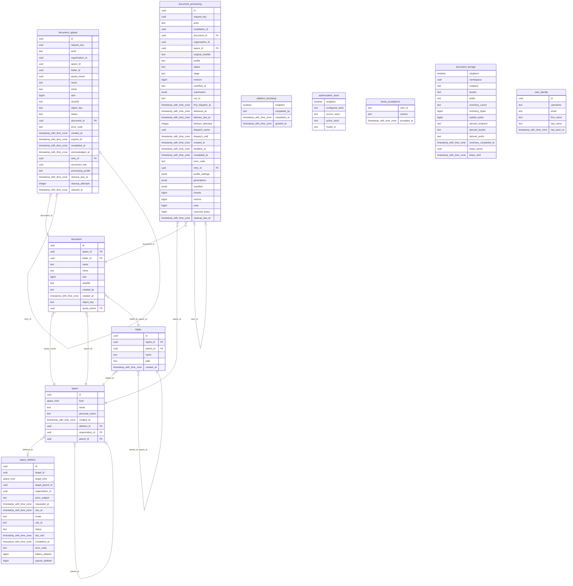

# Reference: control-plane schemas and contracts

Exact source-derived references for the organization/team/project implementation.
Read [Security](03-security.md) and [Organizations](04-organizations.md) for meaning.

## control-plane HTTP surface

Health and frontend configuration are public. Other routes require a bearer token
([security](03-security.md)); business routes also require current personal CGU acceptance
and the unique organization context described in [Organizations](04-organizations.md#one-person-one-organization).
`/me` remains platform-role metadata; `/me/spaces` validates business context and
returns 409 for contradictory attachments. No organization request parameter
selects a tenant. Business authorization probes return `allowed: false` for a missing or
foreign context, and 409 for ambiguity.

<!-- generated: routes apps/control-plane/src/api.rs /control-plane/v1 -->
| Method | Path | Handler |
| --- | --- | --- |
| GET | `/control-plane/v1/admin/organizations` | `organization_registry` |
| POST | `/control-plane/v1/admin/organizations` | `create_organization` |
| GET | `/control-plane/v1/admin/organizations/candidates` | `search_organization_candidates` |
| GET | `/control-plane/v1/admin/teams` | `team_registry` |
| POST | `/control-plane/v1/authorize/document` | `authorize_document` |
| POST | `/control-plane/v1/authorize/platform` | `authorize_platform` |
| POST | `/control-plane/v1/authorize/scope` | `authorize_scope` |
| POST | `/control-plane/v1/authorize/space` | `authorize_space` |
| POST | `/control-plane/v1/bootstrap/platform-admin` | `bootstrap_platform_admin` |
| GET | `/control-plane/v1/deletions/{operation_id}` | `deletion_status` |
| POST | `/control-plane/v1/folders` | `create_folder` |
| DELETE | `/control-plane/v1/folders/{id}` | `delete_folder` |
| PATCH | `/control-plane/v1/folders/{id}` | `rename_folder` |
| GET | `/control-plane/v1/frontend/config` | `frontend_config` |
| POST | `/control-plane/v1/gcu` | `accept_terms` |
| GET | `/control-plane/v1/healthz` | `health` |
| POST | `/control-plane/v1/import-export/import` | `import_blueprint` |
| GET | `/control-plane/v1/me` | `me` |
| GET | `/control-plane/v1/me/onboarding` | `onboarding_status` |
| POST | `/control-plane/v1/me/personal-space` | `create_personal_space` |
| GET | `/control-plane/v1/me/spaces` | `my_spaces` |
| POST | `/control-plane/v1/spaces` | `create_space` |
| DELETE | `/control-plane/v1/spaces/{id}` | `delete_space` |
| GET | `/control-plane/v1/spaces/{id}/folders` | `list_folders` |
| DELETE | `/control-plane/v1/spaces/{id}/roles/{role}/{user}` | `revoke` |
| PUT | `/control-plane/v1/spaces/{id}/roles/{role}/{user}` | `grant` |
| GET | `/control-plane/v1/users/platform-roles` | `list_platform_roles` |
| DELETE | `/control-plane/v1/users/{user}/platform-roles/{role}` | `revoke_platform_role` |
| PUT | `/control-plane/v1/users/{user}/platform-roles/{role}` | `grant_platform_role` |
<!-- end generated -->


Original-storage routes use the same router/OpenAPI registration mechanism:

<!-- generated: routes apps/control-plane/src/documents/http.rs /control-plane/v1 -->
| Method | Path | Handler |
| --- | --- | --- |
| GET | `/control-plane/v1/document-uploads/{id}` | `receipt` |
| PUT | `/control-plane/v1/document-uploads/{id}/acknowledgment` | `acknowledge` |
| GET | `/control-plane/v1/documents/{id}/content` | `content` |
| POST | `/control-plane/v1/folders/{id}/documents` | `upload` |
| POST | `/control-plane/v1/folders/{id}/documents/preflight` | `preflight` |
| GET | `/control-plane/v1/spaces/{id}/document-uploads` | `receipts` |
| GET | `/control-plane/v1/spaces/{id}/entries` | `entries` |
| GET | `/control-plane/v1/spaces/{id}/storage` | `summary` |
<!-- end generated -->

Processing routes share the same generated OpenAPI mechanism. `/documents` routes
use personal admission and space authority; `/document-processing` routes use the
strict service-account protocol, then operation and actor checks.

<!-- generated: routes apps/control-plane/src/processing/http.rs /control-plane/v1 -->
| Method | Path | Handler |
| --- | --- | --- |
| GET | `/control-plane/v1/document-processing/cleanup` | `cleanup` |
| POST | `/control-plane/v1/document-processing/cleanup` | `cleaned` |
| POST | `/control-plane/v1/document-processing/{id}/abandon` | `abandon` |
| POST | `/control-plane/v1/document-processing/{id}/claim` | `claim` |
| POST | `/control-plane/v1/document-processing/{id}/commit` | `commit` |
| GET | `/control-plane/v1/document-processing/{id}/original` | `original` |
| POST | `/control-plane/v1/document-processing/{id}/vectors` | `vectors` |
| GET | `/control-plane/v1/document-processing/{id}/work` | `work` |
| GET | `/control-plane/v1/documents/{id}/preview` | `preview` |
| GET | `/control-plane/v1/documents/{id}/processing` | `history` |
| POST | `/control-plane/v1/documents/{id}/processing` | `start` |
<!-- end generated -->

## Control-plane SQL catalogue

This catalogue covers the Rust control-plane's PostgreSQL tables. In the local k3d
configuration they live in database `fred`, schema `public`. It does not describe
the private schemas of Keycloak, Temporal, OpenFGA or other Fred services.

The source of truth is the ordered SQL migration chain:

| Migration | Responsibility |
| --- | --- |
| [0001_manager_schema.sql](../../apps/control-plane/migrations/0001_manager_schema.sql) | Space and document metadata, operational receipts, bootstrap, consent and installation bindings; constraints, indexes and triggers. |
| [0002_user_identity.sql](../../apps/control-plane/migrations/0002_user_identity.sql) | Local authenticated identity profiles and their username index. |
| [0003_space_placement.sql](../../apps/control-plane/migrations/0003_space_placement.sql) | Immutable organization/parent placement and indexed foreign keys on `space`; requires an empty space table. |

Together they define the current schema: eleven application tables, plus SQLx's
own `_sqlx_migrations` history table. The diagram below is generated by tbls from
all migration files (`make -C docs/architecture er`), not maintained by hand.
SQLx creates its history table itself; it is outside that generated diagram.

### Table responsibilities

| Table | Key and responsibility | Lifecycle and ownership |
| --- | --- | --- |
| `space` | UUID `id`; kind, name, optional personal owner, required `organization_id` and optional `parent_id`, both referencing `space.id`. | Control-plane records immutable placement before publishing matching FGA links. Roles and permission evaluation remain in OpenFGA. `deletion_id` marks scheduled cleanup without removing attachment metadata. |
| `folder` | UUID `id`; named folder, containing space, optional parent folder and UUID-based path. | Control-plane owns the hierarchy. Placement is immutable; folder and parent must belong to the same space. |
| `document` | UUID `id`; name, MIME type, size, SHA-256, creator, object key and quota owner. | Metadata for a stored original. The bytes live in object storage, not PostgreSQL. Placement is immutable. |
| `space_deletion` | UUID `id`, unique `target_id`; durable deletion request, policy, deadlines, status and progress counters. | API and lifecycle worker share operational state. Target identifiers deliberately have no foreign keys so the receipt can survive target removal. |
| `document_upload` | UUID `id`, unique `(actor, request_key)`; upload reservation and receipt, object key, completion, retry and cleanup state. | Control-plane owns upload idempotency and reservations. Target space/folder IDs are historical references without foreign keys; the resulting document and retry predecessor have SQL links. |
| `document_processing` | UUID `id`, unique `(actor, request_key)` and `workflow_id`; processing attempt, delivery lease, profile, generations, result and cleanup state. | Control-plane records processing orchestration. The document and space have SQL references. JSONB fields contain the submitted contract, settings and artifact metadata, not canonical authorization. |
| `document_storage` | Boolean singleton; installation namespace, original/derived storage locations, inventory counters, cursor and lease. | Installation-wide storage binding and inventory progress, independent of any individual upload. |
| `platform_bootstrap` | Boolean singleton; claimant, claim time and OpenFGA grant completion time. | Durable bootstrap receipt. `granted_at IS NULL` distinguishes an unfinished claim from a completed grant. This is not the platform-owner role store. |
| `authorization_store` | Boolean singleton; configured/source/active OpenFGA store and published model ID. | Pins the installation's initialized authorization store/model. It contains no grants or permission matrix. |
| `terms_acceptance` | Text `user_id`; accepted terms version and timestamp. | Consent belongs to the authenticated subject independently of directory profiles and space membership. |
| `user_identity` | UUID `id`; username, email, first/last names and last observation time. | Local-directory profiles observed after authentication, including generic OIDC users. No passwords, bearer tokens or grants. Usernames are intentionally not unique; exact lookup rejects ambiguous matches. |
| `_sqlx_migrations` | Migration `version`; description, installation time, success, checksum and execution time. | Owned by SQLx. Records which immutable migration files were applied; application code must not rewrite its checksums. |

### Physical relationships

The diagram represents SQL foreign keys. Absence of an edge is meaningful:
SQL records immutable organization/parent placement; OpenFGA owns user-role relationships
and evaluates its matching links. Subject identifiers such
as `actor`, `created_by`, `completed_by` and `terms_acceptance.user_id` do not
reference `user_identity`: Keycloak directory mode does not require local profile
rows. Do not add such foreign keys as an apparent completeness fix.

`document.folder_id` is nullable for a document at the space root, whereas an upload
reservation requires a folder. The self-reference on `folder` also allows a null
parent for a root folder. The generated composite-FK edges do not express that
nullability precisely; the SQL declarations and these rules define it. Deletion order must respect SQL foreign keys; the
`document_upload.retry_of` reference explicitly uses `ON DELETE SET NULL`.

<!-- generated: mermaid docs/architecture/generated/control-plane.er.mmd -->

<!-- end generated -->

SQL records the immutable space tree without any grants. OpenFGA retains matching
`parent` and `organization` links for its model and structural operations.
What the schema enforces by itself:

| Rule | Mechanism |
| --- | --- |
| A personal space is a team | `check (personal_owner is null or kind = 'team')` |
| Unique organization names | unique index on `name` where `kind = 'organization'` |
| A document's folder is in the document's space | composite foreign key `(folder_id, space_id)` |
| A sub-folder is in its parent's space | composite foreign key `(parent_id, space_id)` |
| A document-bearing folder subtree cannot be deleted | document foreign key refuses deletion while referenced; the API maps that conflict to HTTP 409 |
| Space references exist | `organization_id` and `parent_id` foreign keys to `space.id`; the organization root references itself |
| Placement never changes | `before update` triggers on `space` kind, owner, organization and parent, `folder`, `document` |
| At most one bootstrap marker | `platform_bootstrap` single row (`singleton` key); permanent closure and claimant-only retry are enforced by the bootstrap code |

### Constraints and operational indexes

Primary keys and unique constraints create their own indexes. The additional
indexes support the actual traversal, quota and retry paths:

| Area | Constraints and indexes |
| --- | --- |
| Spaces | `space_organization_name` makes organization names unique. `space_deletion_manifest` indexes rows participating in deletion. `space_organization` and `space_parent` support foreign-key reference checks during deletion. Personal ownership is allowed only on a team. |
| Folders and documents | Composite foreign keys keep folders/documents in their containing space. `UNIQUE NULLS NOT DISTINCT` prevents duplicate sibling names, including at the root. Placement triggers prevent moves. |
| Original documents | Size is between 0 and 104857600 bytes (100 MiB); SHA-256 is 64 lowercase hexadecimal characters. Object keys are unique. `document_quota_owner` includes sizes for quota accounting. |
| Deletion receipts | Deadline cannot precede request time; completion timestamp agrees with status. `space_deletion_due` selects unfinished work; `space_deletion_overlap` supports overlap detection. |
| Upload receipts | Status is `pending`, `stored` or `failed`; stored status requires a document, and pending status has no completion timestamp. Partial indexes protect active names and index active quota, unacknowledged receipts, cleanup and expiration. |
| Processing attempts | One active and one successful attempt per document are enforced by partial unique indexes. Additional indexes cover history, delivery and cleanup. Checks bound counters and the generations array (at most 64). Triggers verify the original's space/digest and prevent changes to processing identity or terminal outcome. |
| Pending uploads | Delete triggers on `space` and `folder` refuse removal while pending uploads reference them, despite those historical IDs having no foreign keys. |
| Installation state | `platform_bootstrap`, `authorization_store` and `document_storage` admit only the singleton key `true`. |
| Consent and identities | Terms versions have length 1..128. `user_identity_username` indexes `(username, id)` without imposing username uniqueness. |

SQL constraints do not replace OpenFGA checks or application mutation locks.
In particular, parent kinds and organization agreement are validated by the
application; foreign keys guarantee existence, not those domain rules. Sibling
space names and membership eligibility are enforced by the application. See [security](03-security.md) and [organizations](04-organizations.md).
For deployment and schema inspection, see
[SQLx schema evolution](A3-manager-operations.md#sqlx-schema-evolution).

Manager enforces under the organization lock using SQL placement: a team's parent
is an organization and a project's parent a non-personal team; sibling names are
unique; one personal space per owner and organization.


`POST /me/personal-space` retains `{organization_id}` and returns a `Space`: 201
for creation, 200 for current-authority reuse. The identifier must match the caller's
unique organization. Missing eligibility on creation, organization read or personal
read on reuse gives 403. Inaccessible existing spaces are not replaced.
`MySpace` adds required `organization_id` from placement, without changing personal
paths. `Role` adds `personal_space_creator`; `SpacePermission` adds `create_personal_space`.

## OpenFGA model

`store_name` identifies the configured source store. The SQL singleton
`authorization_store` binds that name to the active store and model IDs; it holds
no roles. Startup pins those IDs without selecting an arbitrary newer model or
falling back to the source. A published model that differs from the binary's model
is refused. Empty initialization publishes
a fresh store only after its initialization writes succeed; existing state without a
matching publication is refused. User IDs are the configured authenticated UID. In generic OIDC mode a non-UUID
identity is normalized to UUIDv5 from the configured realm URL and identity; UUID
identities are retained (see `auth.rs`).

Each organization and the platform has a `guard` object with an immutable
`initialized` sentinel and one random `version` revision. A mutation captures its
scope revisions before authorization/state checks. Its Write deletes the captured
revisions with `on_missing: error` and inserts fresh revisions together with the
role delta. Missing revisions roll back the complete Write. Unknown outcomes end
the attempt; replay captures fresh revisions and reauthorizes. Role insertions
remain idempotent. Guard relations imply no permission.

<!-- generated: include apps/control-plane/openfga/model.fga text -->
```text
model
  schema 1.1

type user

# One object, platform:root. Platform owner is the technical platform role; platform roles grant
# no access to any space's content.
type platform
  relations
    define platform_owner: [user]
    define platform_observer: [user] or platform_owner
    define feature_manager: [user] or platform_owner
    define prompt_editor: [user] or platform_owner
    define can_list_all_teams: feature_manager
    define can_delete_team: platform_owner
    define can_delete_space: platform_owner
    define can_rescue_team_admin: platform_owner
    define can_edit_agent_class_path: platform_owner
    define can_observe_platform: platform_observer
    define can_administer_users: platform_owner
    define can_manage_platform: platform_owner
    define can_manage_capabilities: feature_manager
    define can_edit_platform_prompt: prompt_editor

# Permission links match immutable SQL placement, written once at creation. A personal space has no
# parent; `organization` records who manages it and grants nothing.
# A role on a space requires a direct content role on its parent (enforced by control-plane).
type space
  relations
    define parent: [space]
    define organization: [space]
    define member: [user]
    define editor: [user]
    define admin: [user]
    define analyst: [user]
    # Technical role of an organization: names its admins, reads nothing, never descends.
    define organization_owner: [user]
    # Editor, admin and analyst reach every descendant; member stays local.
    define effective_editor: editor or effective_editor from parent
    define effective_admin: admin or effective_admin from parent
    define effective_analyst: analyst or effective_analyst from parent
    define can_read: member or effective_editor or effective_analyst
    define can_write: effective_editor
    define can_manage: effective_admin
    define can_run_evaluations: effective_analyst or effective_admin
    define can_manage_evaluation_corpus: effective_analyst or effective_admin
    define can_read_conversations_for_evaluation: effective_analyst
    define can_own_organization: organization_owner
    # Explicit organization eligibility, without content access or inheritance.
    define personal_space_creator: [user]
    define can_create_personal_space: personal_space_creator

# Mutation ordering only; these relations grant no permission.
type revision

type guard
  relations
    define initialized: [revision]
    define version: [revision]
```
<!-- end generated -->


## Provisioning declarations

The ZIP has exactly five root files. `manifest.json` declares
`{"format_version":2,"users_schema_version":2,"source_platform":"swift"}`. The
other files are arrays:

| File | Declaration |
| --- | --- |
| `users.json` | Unique lowercase `username` without surrounding whitespace or control characters, optional `email`, `first_name`, `last_name`, `password`, default-empty `platform_roles` |
| `organizations.json` | `ref`, `name`, `roles`; at least one organization |
| `teams.json` | `ref`, `name`, `organization` reference, `roles` |
| `projects.json` | `ref`, `name`, `team` reference, `roles`; empty array accepted |

A roles object maps declared usernames to arrays of `member`, `editor`, `analyst`,
`admin`, and on organizations `organization_owner`. Roles accumulate and equivalent grants are
deduplicated. Admin and owner confer no implicit content role. Every new space
requires a declared admin, and every new organization a declared owner. Every child-role
holder requires a declared or existing direct parent content role; inherited access
does not count. Existing direct roles are read from OpenFGA; no space grant is synthesized. The demo explicitly declares
organization membership for team-role holders.

References are nonempty and unique across the entire bundle. Parents and role
subjects must be declared. Space names are nonempty and unique within each parent;
homonyms under distinct parents remain distinct. Role names are exact, without
aliases: `platform_owner`, `platform_observer`, `feature_manager`, `prompt_editor` and
`organization_owner`. Unknown fields/roles,
duplicate JSON keys, usernames, references and sibling names are rejected. Legacy
`teams`/`team_roles` user fields are not accepted. Old JSON and Python version-1 ZIPs,
unknown versions/sections and multidisk formats return `not_yet_supported`.
Malformed archives, unsupported compression, encryption and symlinks are rejected.

Missing identities require a nonempty password and are created enabled with a
non-temporary credential. Absent or empty email uses `<username>@example.com`;
optional first/last names are passed when supplied. Existing identity fields remain intact.
Usernames are rejected when noncanonical, never silently normalized. Preflight checks
effective emails of missing identities, case-insensitively within the bundle and
against Keycloak's exact email search. A known conflict refuses the whole import
before any identity creation. The supported realm disallows duplicate emails;
concurrent external changes remain subject to the additive replay contract.

## Space deletion contract

`DELETE /spaces/{id}` returns a `Receipt`: operation/target/organization identifiers,
root-parent recovery snapshot, actor subject, frozen request/due timestamps and
mode/rule, status, safe error code, SQL deletion counters and completion time.
It returns 202 while pending and 200 on completed replay. `GET /deletions/{operation_id}`
returns that receipt after a fresh platform capability check. No names, bearer,
content or canonical grants are retained in it.

Statuses are `queued`, `running`, `retrying`, `blocked`, `completed`. Disabled
lifecycle refuses new requests with 503 while preserving reads and replay. Overlap,
retired targets, personal-only deletion and document-bearing scopes return 409.
Unsupported documents or unexpected references discovered during cleanup block the
receipt; later sweeps resume after the cause is corrected. Completion requires all
manifest rows and their FGA references absent.

`space_deletion` records each deletion and `space.deletion_id` its manifest. The receipt has no
foreign key to its target, and survives physical deletion. Its parent snapshot is
operational recovery metadata. SQL retains immutable placement on space rows;
OpenFGA retains grants and the links evaluated by its model.
