# Reference: control-plane schemas and contracts

Exact source-derived references for the organization/team/project implementation.
Read [Security](03-security.md) and [Organizations](04-organizations.md) for meaning.

## control-plane HTTP surface

Health and frontend configuration are public. Other routes require a bearer token
([security](03-security.md)); business routes also require current personal CGU acceptance
and the unique organization context described in [Organizations](04-organizations.md#one-person-one-organization).
`/me` remains platform-role metadata; `/me/spaces` validates business context and
returns 409 for contradictory attachments. No organization request parameter
selects a tenant. Business routes answer a missing or foreign space with 404, then a
retired one with 409 `space_pending_deletion`, then a missing permission with 403
([security](A6-security.md#business-authorization-answer)). Authorization probes return
`allowed: false` for each of these refusals and for a missing document, and 409 for
an ambiguous context. A role grant answers 422 for a malformed subject,
one unknown to the user directory or a tuple OpenFGA rejects as invalid, 409 when its
OpenFGA guard was consumed (retry with fresh checks), and 503 when the directory is
unavailable.

`GET /organizations/{organization_id}/agents` reuses runtime discovery after
`spaces::authorize(..., Manage)` and an organization-kind check. The target must
belong to the admitted caller's unique organization and be active. Organization
ownership alone, team/project administration and platform roles confer no access.
The response contains `AgentEnablement` rows with runtime/template provenance and
the OpenFGA `default_on` marker for this organization. The UI reuses the existing
switch and confirmation with organization-scoped messages.
`PUT /organizations/{organization_id}/agents/{agent_id}/default-on` repeats
admission and authorization, discovers before locking, then rechecks under the
existing platform/organization guards. It writes the template anchor and changes
only the default marker. Dependencies are outside this initial integration: an
activation declaring tool dependencies is refused before writes.
Template IDs are UUIDv5, first namespaced by organization/runtime, then template;
no mutable display name participates. `agent_template` retains the Swift
explicit-deny, explicit-grant and personal-class precedence, evaluated in OpenFGA.
`can_use_agent` supplies contextual reverse links from trusted space placement;
it is not wired to enrollment or execution. The cleanup reader drains template
references in bounded pages and retains the organization anchor until the last
page, including orphan exception subjects. The embedded definition is `fred.github.ralph`, version `0.1.0`, provider
`control-plane`; external-source failure still fails the whole discovery.

<!-- generated: routes apps/control-plane/src/agents.rs /control-plane/v1 -->
| Method | Path | Handler |
| --- | --- | --- |
| GET | `/control-plane/v1/organizations/{organization_id}/agents` | `organization_agents` |
| PUT | `/control-plane/v1/organizations/{organization_id}/agents/{agent_id}/default-on` | `set_organization_agent_default` |
| GET | `/control-plane/v1/spaces/{space_id}/agent-templates` | `space_agent_templates` |
<!-- end generated -->

<!-- generated: routes apps/control-plane/src/agent_instances/http.rs /control-plane/v1 -->
| Method | Path | Handler |
| --- | --- | --- |
| GET | `/control-plane/v1/spaces/{space_id}/agent-instances` | `list_agent_instances` |
| POST | `/control-plane/v1/spaces/{space_id}/agent-instances` | `create_agent_instance` |
| DELETE | `/control-plane/v1/spaces/{space_id}/agent-instances/{agent_instance_id}` | `delete_agent_instance` |
| GET | `/control-plane/v1/spaces/{space_id}/agent-instances/{agent_instance_id}` | `get_agent_instance` |
| PATCH | `/control-plane/v1/spaces/{space_id}/agent-instances/{agent_instance_id}` | `update_agent_instance` |
<!-- end generated -->

Every error answer is an `ErrorBody` JSON object with `detail` and `code`. An unreadable
JSON body answers 400 `invalid_json`; path, query or body values that do not match
their type answer 422 `invalid_fields`; an oversized JSON body answers 413
`request_too_large`. These rejections use fixed messages that never echo input, and
the contract declares them on every route that takes parameters or a body.

`POST /me/personal-space` takes `{organization_id}` and returns a `Space`: 201 when it
creates the caller's personal space, 200 when it reuses it under current authority.
Another organization than the caller's gives 404; missing eligibility on creation, or
missing organization or personal read on reuse, gives 403; a personal space without its
organization link gives 409. An inaccessible existing space is never replaced. `MySpace`
carries the space's `organization_id` from SQL placement.

<!-- generated: routes apps/control-plane/src/api.rs /control-plane/v1 -->
| Method | Path | Handler |
| --- | --- | --- |
| GET | `/control-plane/v1/admin/organizations` | `organization_registry` |
| POST | `/control-plane/v1/admin/organizations` | `create_organization` |
| GET | `/control-plane/v1/admin/organizations/candidates` | `search_organization_candidates` |
| GET | `/control-plane/v1/admin/teams` | `team_registry` |
| POST | `/control-plane/v1/authorize/document` | `authorize_document` |
| POST | `/control-plane/v1/authorize/platform` | `authorize_platform` |
| POST | `/control-plane/v1/authorize/scope` | `authorize_scope` |
| POST | `/control-plane/v1/authorize/space` | `authorize_space` |
| POST | `/control-plane/v1/bootstrap/platform-admin` | `bootstrap_platform_admin` |
| GET | `/control-plane/v1/deletions/{operation_id}` | `deletion_status` |
| POST | `/control-plane/v1/folders` | `create_folder` |
| DELETE | `/control-plane/v1/folders/{id}` | `delete_folder` |
| PATCH | `/control-plane/v1/folders/{id}` | `rename_folder` |
| GET | `/control-plane/v1/frontend/config` | `frontend_config` |
| POST | `/control-plane/v1/gcu` | `accept_terms` |
| GET | `/control-plane/v1/healthz` | `health` |
| POST | `/control-plane/v1/import-export/import` | `import_blueprint` |
| GET | `/control-plane/v1/me` | `me` |
| GET | `/control-plane/v1/me/onboarding` | `onboarding_status` |
| POST | `/control-plane/v1/me/personal-space` | `create_personal_space` |
| GET | `/control-plane/v1/me/spaces` | `my_spaces` |
| POST | `/control-plane/v1/spaces` | `create_space` |
| DELETE | `/control-plane/v1/spaces/{id}` | `delete_space` |
| DELETE | `/control-plane/v1/spaces/{id}/roles/{role}/{user}` | `revoke` |
| PUT | `/control-plane/v1/spaces/{id}/roles/{role}/{user}` | `grant` |
| GET | `/control-plane/v1/users/platform-roles` | `list_platform_roles` |
| DELETE | `/control-plane/v1/users/{user}/platform-roles/{role}` | `revoke_platform_role` |
| PUT | `/control-plane/v1/users/{user}/platform-roles/{role}` | `grant_platform_role` |
<!-- end generated -->


Original-storage routes use the same router/OpenAPI registration mechanism:

<!-- generated: routes apps/control-plane/src/documents/http.rs /control-plane/v1 -->
| Method | Path | Handler |
| --- | --- | --- |
| GET | `/control-plane/v1/document-uploads/{id}` | `receipt` |
| PUT | `/control-plane/v1/document-uploads/{id}/acknowledgment` | `acknowledge` |
| DELETE | `/control-plane/v1/documents/{id}` | `delete_document` |
| GET | `/control-plane/v1/documents/{id}/content` | `content` |
| POST | `/control-plane/v1/folders/{id}/documents` | `upload` |
| POST | `/control-plane/v1/folders/{id}/documents/preflight` | `preflight` |
| GET | `/control-plane/v1/spaces/{id}/document-uploads` | `receipts` |
| GET | `/control-plane/v1/spaces/{id}/entries` | `entries` |
| GET | `/control-plane/v1/spaces/{id}/storage` | `summary` |
<!-- end generated -->

Processing routes share the same generated OpenAPI mechanism. `/documents` routes
use personal admission and space authority; `/document-processing` routes use the
strict service-account protocol, then operation and actor checks.

<!-- generated: routes apps/control-plane/src/processing/http.rs /control-plane/v1 -->
| Method | Path | Handler |
| --- | --- | --- |
| GET | `/control-plane/v1/document-processing/cleanup` | `cleanup` |
| POST | `/control-plane/v1/document-processing/cleanup` | `cleaned` |
| GET | `/control-plane/v1/document-processing/retrievable/{id}` | `retrieval_work` |
| POST | `/control-plane/v1/document-processing/retrievable/{id}` | `confirm_retrievable` |
| POST | `/control-plane/v1/document-processing/{id}/abandon` | `abandon` |
| POST | `/control-plane/v1/document-processing/{id}/claim` | `claim` |
| POST | `/control-plane/v1/document-processing/{id}/commit` | `commit` |
| GET | `/control-plane/v1/document-processing/{id}/original` | `original` |
| POST | `/control-plane/v1/document-processing/{id}/vectors` | `vectors` |
| GET | `/control-plane/v1/document-processing/{id}/work` | `work` |
| GET | `/control-plane/v1/documents/{id}/preview` | `preview` |
| GET | `/control-plane/v1/documents/{id}/processing` | `history` |
| POST | `/control-plane/v1/documents/{id}/processing` | `start` |
| PUT | `/control-plane/v1/documents/{id}/retrievable` | `set_retrievable` |
<!-- end generated -->

### Organization supervision API

These routes expose aggregate metadata through the existing Control Plane process.
They require organization ownership, not content read permission. The
[supervision contract](A8-organizations.md#organization-supervision) defines
disclosure boundaries, counters, failure behavior and pagination. Wire schemas
come from [supervision/models.rs](../../apps/control-plane/src/supervision/models.rs)
through utoipa/OpenAPI and the generated RTK client. The
[supervision UI](A8-organizations.md#supervision-ui) consumes these two read routes.

<!-- generated: routes apps/control-plane/src/supervision/mod.rs /control-plane/v1 -->
| Method | Path | Handler |
| --- | --- | --- |
| GET | `/control-plane/v1/organizations/{organization_id}/supervision` | `organization_supervision` |
| GET | `/control-plane/v1/organizations/{organization_id}/supervision/teams/{team_id}` | `team_supervision` |
<!-- end generated -->

## Control-plane SQL catalogue

This catalogue covers the Rust control-plane's PostgreSQL tables. In the local k3d
configuration they live in database `fred`, schema `public`. It does not describe
the private schemas of Keycloak, Temporal, OpenFGA or other Fred services.

Internal catalog storage is defined by the `runtime_*` tables of
[`0001_schema.sql`](../../apps/control-plane/migrations/0001_schema.sql)
and [`agents/catalog.rs`](../../apps/control-plane/src/agents/catalog.rs).
Offerings and template links share the composite runtime/capability key; successful
replacement and failed observation retain withdrawn or last-known declarations.
[`agents/inventory.rs`](../../apps/control-plane/src/agents/inventory.rs) connects
configured sources to organization Manage-protected read/refresh. The pod's complete
registry advertisement lives in
[`agent_app.py`](../../libs/fred-runtime/fred_runtime/app/agent_app.py).
Read uses a consistent SQL snapshot; bounded discovery precedes the authorized
write transaction. Agent enrollment and chat preparation read live template
discovery, not this store.

Organization enablement of these offers is defined by table `organization_capability` of
[`0001_schema.sql`](../../apps/control-plane/migrations/0001_schema.sql)
and owned by [`agents/enablement.rs`](../../apps/control-plane/src/agents/enablement.rs).
A row enables one `(runtime_id, capability_id)` offer for every space of the
organization; no row denies it. Its foreign key requires an observed offer, and
enabling requires the offer to be currently advertised. It is SQL configuration,
not an OpenFGA grant. The organization Capabilities tab reads it within the
inventory snapshot and writes it in the same authorized transaction as refresh,
with a `capability.default_changed` audit event when the decision changes.
`usable_capability_ids` filters agent forms and gates enrollment and capability
edits; chat preparation does not consult it.

Model storage has a separate platform owner in
[`model_catalog`](../../apps/control-plane/src/model_catalog/mod.rs) and the `model_source` and `model_offer` tables of
[`0001_schema.sql`](../../apps/control-plane/migrations/0001_schema.sql).
Observations and retained offers use `(source_id, upstream_model_id)` and create no
grants. [`http.rs`](../../apps/control-plane/src/model_catalog/http.rs) supplies
organization Manage-protected inventory, refresh and policy read/write.
[`policy.rs`](../../apps/control-plane/src/model_catalog/policy.rs) and the `organization_model_*` tables
store organization choices with expected revision, attribution and composite foreign
keys. Source approvals remain platform-only. Publication uses the transaction that
rechecks admission/Manage and fences authorization after HTTP, preserving the M1
configuration/token fences. Turn admission consumes this policy through the
[model contract below](#chat-model-preparation-and-turn-admission); saving the policy
alone does not prove provider connectivity or pod credential provisioning.
The [component contract](../../apps/control-plane/README.md#platform-model-inventory-and-organization-administration)
defines source approval, payloads, eligibility, errors and concurrency.

The organization Models tab is bound through
[`OrganizationModels.tsx`](../../apps/frontend/src/rework/components/pages/admin/FeaturesPage/OrganizationModels.tsx)
and the generated Control Plane client. It reads inventory and policy together,
refreshes discovery on entry as in Swift, and replaces policy with its expected
revision. Known rows remain visible while discovery runs; the existing Refresh
action performs the same update without exposing per-source controls.
Source observations remain distinct from model permission; failed refreshes retain
existing choices. Discovery retains the provider's boolean `capabilities.reasoning`;
missing metadata remains unknown. The existing reasoning switch persists an
organization ceiling on permission rows (`reasoning_enabled`).
Preparation exposes the corresponding per-model control. The pod combines it with
the user's explicit per-question choice in its admitted turn context, and enforces
`reasoning_effort: high` (or omission) at the transport boundary. This UI binding
still requires functional validation.

Instance model settings reuse `agent_instance.tuning` through
[`agent_instances/http.rs`](../../apps/control-plane/src/agent_instances/http.rs)
and [`tuning.rs`](../../apps/control-plane/src/agent_instances/tuning.rs).
[`model_catalog/instance.rs`](../../apps/control-plane/src/model_catalog/instance.rs)
reuses M2 selection locks and defines the three typed invocation options. The
[existing resolver](../../apps/control-plane/src/agent_instances/runtime.rs) reads
policy/catalog/configuration in one snapshot and exposes approved inference
connections only to trusted delegated workloads. Legacy profiles remain diagnostic
references, never selectable aliases. Control Plane supplies the complete model
facts and a browser preparation diagnostic; final selection and invocation remain
in the Python pod. [Component semantics](../../apps/control-plane/README.md#instance-recommendations-and-resolver-data-m3)
define omission/null, known limits, candidate diagnostics and connection visibility.

### Chat model preparation and turn admission

Companion to [Bob's first exchange](02.3-agent-administration.md). Model identity is
`(source_id, upstream_model_id)`, not a display name or pod-local profile. Discovery
supplies observations; the organization's policy supplies permission. The retained
instance recommendation and organization default are optional.

| Selection step | Rule |
| --- | --- |
| Explicit chat choice | Used first, subject to permission and candidate checks. |
| Instance recommendation | Used only when the chat supplies no choice. |
| Organization default | Used only when neither choice nor recommendation is present. |
| No selection | Refuse with a diagnostic; do not pick the first available offer. |

A missing or forbidden selected offer cannot trigger substitution. An approved
fallback applies only to confirmed withdrawal without another disqualifying
condition, and must itself be permitted and a candidate. Failed discovery alone
is not withdrawal: an existing candidate may remain usable, while new administrative selection
writes require successful observation at the current source revision. A retained
legacy profile requires explicit offer re-selection unless a recommendation exists.

**Browser preparation.**
[`preparation.rs`](../../apps/control-plane/src/agent_instances/preparation.rs)
accepts paired `model_source_id` / `model_upstream_id` query parameters and an
optional registered `session_id`. It verifies space, instance, template and session
access, then evaluates the model facts already read in its transaction.
`ExecutionPreparation` returns `model_choice` and nullable `model_error` alongside
the offers, controls and approved runtime URLs. A readable response may be HTTP 200
with an unusable model choice: callers must check the diagnostic before sending.
No inference connection or secret is exposed in this browser response.

[`model_catalog/instance.rs`](../../apps/control-plane/src/model_catalog/instance.rs),
`preparation_error`, distinguishes `selection_missing`, `reselection_required`,
`offer_unknown`, `offer_forbidden`, `offer_unavailable` and `fallback_unavailable`.
These are safe fixed messages. Preparation does not verify pod-local credentials
or make an inference request.

**Turn admission.** The browser sends canonical `runtime_context.space_id` and
its requested model choice to Agent Pod. It does not invent a `team_id` to establish
authority. The pod obtains a fresh trusted binding from Control Plane; it does not
reuse browser preparation as a grant. The pure Python
[`ModelRoutingResolver`](../../libs/fred-runtime/fred_runtime/model_routing/resolver.py)
selects over that binding, and `TurnAuthority` enforces it within the admitted turn.
The [security annex](A6-security.md#managed-agent-turn-authority) describes identity,
conversation binding and the turn boundary. No per-LLM-call authority refresh is
added. Catalogue management and policy are centralized; the final resolver remains
in Python.

**UI consumers.** The generated
[`Control Plane client`](../../apps/frontend/src/slices/controlPlane/controlPlaneOpenApi.ts)
is consumed by
[`useChatSse`](../../apps/frontend/src/rework/core/hooks/useChatSse.ts) and
[`useManagedChat`](../../apps/frontend/src/rework/components/pages/ManagedChatPage/useManagedChat.ts).
The chat binds the preparation diagnostic to the requested choice, preserves the
draft and keeps the selector accessible. Every send checks preparation before
optimistic message insertion or runtime dispatch. Resume code has the same guard;
Weaver preparation still advertises `supports_hitl: false`. An enabled instance is
not a model-readiness guarantee, and creation does not require a recommendation.

**Operator boundary.**
[`model_catalog/config.rs`](../../apps/control-plane/src/model_catalog/config.rs)
defines platform-approved discovery and inference destinations separately.
Control Plane uses the configured discovery authentication; the inference
connection contains a binding reference that the pod resolves locally, not a secret
value. Alice, Acme's organization admin, may refresh an approved source and
change Acme's model policy; this is business responsibility, not Oscar's owner
mandate. Her organization role cannot rewrite platform connections. Dana must
provision both discovery and inference access; discovering an offer proves neither permission nor
a successful model call.

<!-- generated: routes apps/control-plane/src/model_catalog/http.rs /control-plane/v1 -->
| Method | Path | Handler |
| --- | --- | --- |
| GET | `/control-plane/v1/organizations/{organization_id}/model-policy` | `organization_model_policy` |
| PUT | `/control-plane/v1/organizations/{organization_id}/model-policy` | `replace_organization_model_policy` |
| POST | `/control-plane/v1/organizations/{organization_id}/model-sources/{source_id}/refresh` | `refresh_model_source` |
| GET | `/control-plane/v1/organizations/{organization_id}/models` | `organization_models` |
<!-- end generated -->

<!-- generated: routes apps/control-plane/src/agents/inventory.rs /control-plane/v1 -->
| Method | Path | Handler |
| --- | --- | --- |
| GET | `/control-plane/v1/organizations/{organization_id}/capabilities` | `organization_capabilities` |
| POST | `/control-plane/v1/organizations/{organization_id}/capabilities/{runtime_id}/refresh` | `refresh_organization_capabilities` |
| PUT | `/control-plane/v1/organizations/{organization_id}/capabilities/{runtime_id}/{capability_id}/default-on` | `set_organization_capability_default` |
<!-- end generated -->

The [administration journey](02.3-agent-administration.md) remains agreed behavior.

The source of truth is the ordered SQL migration chain, starting with
[0001_schema.sql](../../apps/control-plane/migrations/0001_schema.sql). It defines every
application table, plus SQLx's own `_sqlx_migrations` history table. The diagram below
is generated by tbls from all migration files (`make -C docs/architecture er`), not maintained by hand.
SQLx creates its history table itself; it is outside that generated diagram.

### Table responsibilities

| Table | Key and responsibility | Lifecycle and ownership |
| --- | --- | --- |
| `space` | UUID `id`; kind, name, optional personal owner, required `organization_id` and optional `parent_id`, both referencing `space.id`. | Control-plane records immutable placement before publishing matching FGA links. Roles and permission evaluation remain in OpenFGA. `deletion_id` marks scheduled cleanup without removing attachment metadata. |
| `folder` | UUID `id`; named folder, containing space, optional parent folder and UUID-based path. | Control-plane owns the hierarchy. Placement is immutable; folder and parent must belong to the same space. `deletion_id` marks a retired row: reads and producers ignore it, and name uniqueness covers only active rows. |
| `document` | UUID `id`; name, MIME type, size, SHA-256, creator, object key and quota owner. | Metadata for a stored original. The bytes live in object storage, not PostgreSQL. Placement is immutable. `deletion_id` marks a retired row: reads and producers ignore it, and name uniqueness covers only active rows. |
| `deletion` | UUID `id`, unique `target_id`; durable deletion request, policy, deadlines, status and progress counters. | API and lifecycle worker share operational state. Target identifiers deliberately have no foreign keys so the receipt can survive target removal. `target_kind` is text constrained to `organization`, `team`, `project` or `document`. |
| `document_upload` | UUID `id`, unique `(actor, request_key)`; upload reservation and receipt, object key, completion, retry and cleanup state. | Control-plane owns upload idempotency and reservations. Target space/folder IDs are historical references without foreign keys; the resulting document and retry predecessor have SQL links. |
| `document_processing` | UUID `id`, unique `(actor, request_key)` and `workflow_id`; processing attempt, delivery lease, profile, generations, result and cleanup state. | Control-plane records processing orchestration. The document and space have SQL references. JSONB fields contain the submitted contract, settings and artifact metadata, not canonical authorization. |
| `document_storage` | Boolean singleton; installation namespace, original/derived storage locations, inventory counters, cursor and lease. | Installation-wide storage binding and inventory progress, independent of any individual upload. |
| `platform_bootstrap` | Boolean singleton; claimant, claim time and OpenFGA grant completion time. | Durable bootstrap receipt. `granted_at IS NULL` distinguishes an unfinished claim from a completed grant. This is not the platform-owner role store. |
| `authorization_store` | Boolean singleton; configured/source/active OpenFGA store and published model ID. | Pins the installation's initialized authorization store/model. It contains no grants or permission matrix. |
| `terms_acceptance` | Text `user_id`; accepted terms version and timestamp. | Consent belongs to the authenticated subject independently of directory profiles and space membership. |
| `user_identity` | UUID `id`; username, email, first/last names and last observation time. | Local-directory profiles observed after authentication, including generic OIDC users. No passwords, bearer tokens or grants. Usernames are intentionally not unique; exact lookup rejects ambiguous matches. |
| `_sqlx_migrations` | Migration `version`; description, installation time, success, checksum and execution time. | Owned by SQLx. Records which immutable migration files were applied; application code must not rewrite its checksums. |

### Physical relationships

The diagram represents SQL foreign keys. Absence of an edge is meaningful:
SQL records immutable organization/parent placement; OpenFGA owns user-role relationships
and evaluates its matching links. Subject identifiers such
as `actor`, `created_by`, `completed_by` and `terms_acceptance.user_id` do not
reference `user_identity`: Keycloak directory mode does not require local profile
rows. Do not add such foreign keys as an apparent completeness fix.

`document.folder_id` is nullable for a document at the space root, whereas an upload
reservation requires a folder. The self-reference on `folder` also allows a null
parent for a root folder. The generated composite-FK edges do not express that
nullability precisely; the SQL declarations and these rules define it. Deletion order must respect SQL foreign keys; the
`document_upload.retry_of` reference explicitly uses `ON DELETE SET NULL`.

```mermaid
erDiagram

"space" }o--o| "deletion" : "deletion_id"
"space" }o--|| "space" : "organization_id"
"space" }o--o| "space" : "parent_id"
"folder" }o--o| "deletion" : "deletion_id"
"folder" }o--|| "space" : "space_id"
"folder" }o--|| "folder" : "parent_id, space_id"
"document" }o--o| "deletion" : "deletion_id"
"document" }o--|| "space" : "quota_owner"
"document" }o--|| "space" : "space_id"
"document" }o--|| "folder" : "folder_id, space_id"
"document_upload" |o--o| "document" : "document_id"
"document_upload" |o--o| "document_upload" : "retry_of"
"document_processing" }o--|| "space" : "space_id"
"document_processing" }o--|| "document" : "document_id"
"document_processing" |o--o| "document_processing" : "retry_of"
"agent_instance" }o--|| "space" : "space_id"
"runtime_capability" }o--|| "runtime_catalog" : "runtime_id"
"runtime_template_capability" }o--|| "runtime_capability" : "runtime_id, capability_id"
"model_offer" }o--|| "model_source" : "source_id"
"organization_model_policy" |o--|| "space" : "organization_id"
"organization_model_policy" }o--|| "organization_model_permission" : "organization_id, default_source_id, default_upstream_model_id"
"organization_model_policy" }o--|| "organization_model_permission" : "organization_id, fallback_source_id, fallback_upstream_model_id"
"organization_model_permission" }o--|| "model_offer" : "source_id, upstream_model_id"
"organization_model_permission" }o--|| "organization_model_policy" : "organization_id"
"session_metadata" }o--o| "deletion" : "deletion_id"
"organization_capability" }o--|| "space" : "organization_id"
"organization_capability" }o--|| "runtime_capability" : "runtime_id, capability_id"

"deletion" {
  uuid id
  uuid target_id
  text target_kind
  uuid target_parent_id
  uuid organization_id
  text actor_subject
  timestamp_with_time_zone requested_at
  timestamp_with_time_zone due_at
  text rule_id
  text status
  timestamp_with_time_zone last_visit
  timestamp_with_time_zone completed_at
  text error_code
  bigint folders_deleted
  bigint spaces_deleted
  bigint documents_deleted
}
"space" {
  uuid id
  space_kind kind
  text name
  text personal_owner
  timestamp_with_time_zone created_at
  uuid deletion_id FK
  uuid organization_id FK
  uuid parent_id FK
}
"folder" {
  uuid id
  uuid space_id FK
  uuid parent_id FK
  text name
  text path
  timestamp_with_time_zone created_at
  uuid deletion_id FK
}
"document" {
  uuid id
  uuid space_id FK
  uuid folder_id FK
  text name
  text mime
  bigint size
  text sha256
  text created_by
  timestamp_with_time_zone created_at
  text object_key
  uuid quota_owner FK
  boolean retrievable
  jsonb retrieval_command
  boolean retrievable_pending
  uuid deletion_id FK
}
"platform_bootstrap" {
  boolean singleton
  text completed_by
  timestamp_with_time_zone completed_at
  timestamp_with_time_zone granted_at
}
"authorization_store" {
  boolean singleton
  text configured_store
  text source_store
  text active_store
  text model_id
}
"terms_acceptance" {
  text user_id
  text version
  timestamp_with_time_zone accepted_at
}
"user_identity" {
  uuid id
  text username
  text email
  text first_name
  text last_name
  timestamp_with_time_zone last_seen_at
}
"document_storage" {
  boolean singleton
  uuid namespace
  text endpoint
  text bucket
  text prefix
  text inventory_cursor
  bigint inventory_bytes
  bigint orphan_bytes
  text derived_endpoint
  text derived_bucket
  text derived_prefix
  timestamp_with_time_zone inventory_completed_at
  uuid lease_owner
  timestamp_with_time_zone lease_until
}
"document_upload" {
  uuid id
  uuid request_key
  text actor
  uuid organization_id
  uuid space_id
  uuid folder_id
  uuid quota_owner
  text name
  text mime
  bigint size
  text sha256
  text object_key
  text status
  uuid document_id FK
  text error_code
  timestamp_with_time_zone created_at
  timestamp_with_time_zone expires_at
  timestamp_with_time_zone completed_at
  timestamp_with_time_zone acknowledged_at
  uuid retry_of FK
  uuid successor_key
  text processing_profile
  timestamp_with_time_zone cleanup_due_at
  integer cleanup_attempts
  timestamp_with_time_zone cleaned_at
}
"document_processing" {
  uuid id
  uuid request_key
  text actor
  uuid installation_id
  uuid document_id FK
  uuid organization_id
  uuid space_id FK
  text original_sha256
  text profile
  text status
  text stage
  bigint revision
  text workflow_id
  jsonb submission
  text run_id
  timestamp_with_time_zone first_dispatch_at
  timestamp_with_time_zone delivered_at
  timestamp_with_time_zone delivery_due_at
  integer delivery_attempts
  uuid dispatch_owner
  timestamp_with_time_zone dispatch_until
  timestamp_with_time_zone created_at
  timestamp_with_time_zone deadline_at
  timestamp_with_time_zone completed_at
  text error_code
  uuid retry_of FK
  jsonb profile_settings
  jsonb generations
  jsonb manifest
  bigint chunks
  bigint vectors
  bigint rows
  bigint reserved_bytes
  timestamp_with_time_zone cleanup_due_at
}
"agent_instance" {
  uuid agent_instance_id
  uuid space_id FK
  uuid template_id
  text source_runtime_id
  text source_agent_id
  varchar_255_ display_name
  varchar_500_ description
  boolean enabled
  text created_by
  text updated_by
  jsonb tuning
  timestamp_with_time_zone created_at
  timestamp_with_time_zone updated_at
}
"users_preferences" {
  text user_id
  text ui_theme_id
  text theme_mode
  text language
  boolean sidebar_collapsed
  text team_sort_mode
  text agent_sort
  timestamp_with_time_zone updated_at
}
"runtime_catalog" {
  text runtime_id
  boolean reachable
  timestamp_with_time_zone checked_at
  timestamp_with_time_zone observed_at
}
"runtime_capability" {
  text runtime_id FK
  text capability_id
  text version
  jsonb descriptor
  boolean advertised
}
"runtime_template_capability" {
  text runtime_id FK
  text source_agent_id
  text capability_id FK
  boolean default_selected
}
"model_source" {
  text source_id
  jsonb configuration
  uuid refresh_token
  text state
  text error_code
  timestamp_with_time_zone checked_at
  timestamp_with_time_zone last_success_at
  bigint snapshot_revision
  bigint snapshot_source_revision
}
"model_offer" {
  text source_id FK
  text upstream_model_id
  jsonb metadata
  timestamp_with_time_zone first_seen_at
  timestamp_with_time_zone last_seen_at
  boolean advertised
  timestamp_with_time_zone withdrawn_at
}
"organization_model_policy" {
  uuid organization_id FK
  bigint revision
  text default_source_id FK
  text default_upstream_model_id FK
  text fallback_source_id FK
  text fallback_upstream_model_id FK
  text created_by
  timestamp_with_time_zone created_at
  text updated_by
  timestamp_with_time_zone updated_at
}
"organization_model_permission" {
  uuid organization_id FK
  text source_id FK
  text upstream_model_id FK
  boolean reasoning_enabled
}
"session_metadata" {
  uuid session_id
  text user_id
  uuid space_id
  uuid agent_instance_id
  uuid template_id
  text runtime_id
  varchar_255_ agent_display_name
  varchar_500_ title
  timestamp_with_time_zone created_at
  timestamp_with_time_zone updated_at
  uuid deletion_id FK
}
"organization_capability" {
  uuid organization_id FK
  text runtime_id FK
  text capability_id FK
  text enabled_by
  timestamp_with_time_zone enabled_at
}
```

<!-- generated: mermaid docs/architecture/generated/control-plane.er.mmd -->

<!-- end generated -->

SQL records the immutable space tree without any grants. OpenFGA retains matching
`parent` and `organization` links for its model and structural operations.
What the schema enforces by itself:

| Rule | Mechanism |
| --- | --- |
| A personal space has its own kind and an owner, with no parent | `space_personal_identity`: `(kind = 'personal') = (personal_owner IS NOT NULL)` and `kind <> 'personal' OR parent_id IS NULL` |
| Unique organization names | unique index on `name` where `kind = 'organization'` |
| A document's folder is in the document's space | composite foreign key `(folder_id, space_id)` |
| A sub-folder is in its parent's space | composite foreign key `(parent_id, space_id)` |
| A document-bearing folder subtree cannot be deleted | document foreign key refuses deletion while referenced; the API maps that conflict to HTTP 409 |
| Space references exist | `organization_id` and `parent_id` foreign keys to `space.id`; the organization root references itself |
| Placement never changes | `before update` triggers on `space` kind, owner, organization and parent, `folder`, `document` |
| At most one bootstrap marker | `platform_bootstrap` single row (`singleton` key); permanent closure and claimant-only retry are enforced by the bootstrap code |

### Constraints and operational indexes

Primary keys and unique constraints create their own indexes. The additional
indexes support the actual traversal, quota and retry paths:

| Area | Constraints and indexes |
| --- | --- |
| Spaces | `space_organization_name` makes organization names unique. `space_deletion_manifest` indexes rows participating in deletion. `space_organization` and `space_parent` support foreign-key reference checks during deletion. `space_personal_identity` requires an owner exactly for kind `personal` and forbids its parent; `space_personal_owner` keeps one active personal space per owner and organization and serves its lookup. |
| Folders and documents | Composite foreign keys keep folders/documents in their containing space. Partial unique indexes with `NULLS NOT DISTINCT` prevent duplicate active sibling names, including at the root. `folder_deletion_manifest` and `document_deletion_manifest` index retired rows by deletion receipt. Placement triggers prevent moves. |
| Original documents | Size is between 0 and 104857600 bytes (100 MiB); SHA-256 is 64 lowercase hexadecimal characters. Object keys are unique. `document_quota_owner` includes sizes for quota accounting. |
| Deletion receipts | Deadline cannot precede request time; completion timestamp agrees with status. `deletion_due` selects unfinished work; `deletion_overlap` supports overlap detection. |
| Upload receipts | Status is `pending`, `stored` or `failed`; stored status requires a document, and pending status has no completion timestamp. Partial indexes protect active names and index active quota, unacknowledged receipts, cleanup and expiration. |
| Processing attempts | One active and one successful attempt per document are enforced by partial unique indexes. Additional indexes cover history, delivery and cleanup. Checks bound counters and the generations array (at most 64). Triggers verify the original's space/digest and prevent changes to processing identity or terminal outcome. |
| Pending uploads | Delete triggers on `space` and `folder` refuse removal while pending uploads reference them, despite those historical IDs having no foreign keys. |
| Installation state | `platform_bootstrap`, `authorization_store` and `document_storage` admit only the singleton key `true`. |
| Consent and identities | Terms versions have length 1..128. `user_identity_username` indexes `(username, id)` without imposing username uniqueness. The four `user_identity_*_prefix` indexes on `lower(field) text_pattern_ops` serve the local prefix search. |

SQL constraints do not replace OpenFGA checks or application mutation locks.
In particular, parent kinds and organization agreement are validated by the
application; foreign keys guarantee existence, not those domain rules. Sibling
space names and membership eligibility are enforced by the application. See [security](03-security.md) and [organizations](04-organizations.md).
For deployment and schema inspection, see
[SQLx schema evolution](A3-manager-operations.md#sqlx-schema-evolution).

## OpenFGA model

`store_name` identifies the configured source store. The SQL singleton
`authorization_store` binds that name to the active store and model IDs; it holds
no roles. Startup pins those IDs without selecting an arbitrary newer model or
falling back to the source. A published model that differs from the binary's model
is refused. Empty initialization publishes
a fresh store only after its initialization writes succeed; existing state without a
matching publication is refused. User IDs are the configured authenticated UID. In generic OIDC mode a non-UUID
identity is normalized to UUIDv5 from the configured realm URL and identity; UUID
identities are retained (see `auth.rs`).

Each organization and the platform has a `guard` object with an immutable
`initialized` sentinel and one random `version` revision. A mutation captures its
scope revisions before authorization/state checks. Its Write deletes the captured
revisions with `on_missing: error` and inserts fresh revisions together with the
role delta. Missing revisions roll back the complete Write. Unknown outcomes end
the attempt; replay captures fresh revisions and reauthorizes. Role insertions
remain idempotent. Guard relations imply no permission.

This literal source extract preserves code identifiers and comments. The
[responsibility comparison](A11-roles.md#responsibility-boundaries-and-current-enforcement) distinguishes
the agreed owner/admin vocabulary from the permissions currently encoded below.

<!-- generated: include apps/control-plane/openfga/model.fga text -->
```text
model
  schema 1.1

type user

# One object, platform:root. Platform owner is the technical platform role; platform roles grant
# no access to any space's content.
type platform
  relations
    define platform_owner: [user]
    define platform_observer: [user] or platform_owner
    define feature_manager: [user] or platform_owner
    define prompt_editor: [user] or platform_owner
    define can_list_all_teams: feature_manager
    define can_delete_team: platform_owner
    define can_delete_space: platform_owner
    define can_rescue_team_admin: platform_owner
    define can_edit_agent_class_path: platform_owner
    define can_observe_platform: platform_observer
    define can_administer_users: platform_owner
    define can_manage_platform: platform_owner
    define can_manage_capabilities: feature_manager
    define can_edit_platform_prompt: prompt_editor

# Permission links match immutable SQL placement, written once at creation. A personal space has no
# parent; `organization` records who manages it and grants nothing.
# A role on a space requires a direct content role on its parent (enforced by control-plane).
type space
  relations
    define parent: [space]
    define organization: [space]
    define member: [user]
    define editor: [user]
    define admin: [user]
    define analyst: [user]
    # Technical role of an organization: names its admins, reads nothing, never descends.
    define organization_owner: [user]
    # Editor, admin and analyst reach every descendant; member stays local.
    define effective_editor: editor or effective_editor from parent
    define effective_admin: admin or effective_admin from parent
    define effective_analyst: analyst or effective_analyst from parent
    define can_read: member or effective_editor or effective_analyst
    define can_write: effective_editor
    define can_manage: effective_admin
    define can_run_evaluations: effective_analyst or effective_admin
    define can_manage_evaluation_corpus: effective_analyst or effective_admin
    define can_read_conversations_for_evaluation: effective_analyst
    define can_own_organization: organization_owner
    # Explicit organization eligibility, without content access or inheritance.
    define personal_space_creator: [user]
    define can_create_personal_space: personal_space_creator
    # Contextual reverse links supplied only after resolving a team's organization.
    define template_team: [space]
    define template_personal_team: [space]

# Each template object belongs to exactly one organization; no global enablement.
type agent_template
  relations
    define organization: [space]
    define default_on: [space]
    define enabled: [space]
    define disabled: [space]
    define personal_on: [space]
    define personal_disabled: [space]
    define can_manage: can_manage from organization
    define personal_grant: template_personal_team from personal_on
    define personal_block: template_personal_team from personal_disabled
    define inherited_grant: template_team from default_on or personal_grant
    define inherited: inherited_grant but not personal_block
    define granted: enabled or inherited
    define can_use: granted but not disabled

# Mutation ordering only; these relations grant no permission.
type revision

type guard
  relations
    define initialized: [revision]
    define version: [revision]
```
<!-- end generated -->


## Provisioning declarations

The ZIP has exactly five root files. `manifest.json` declares
`{"format_version":2,"users_schema_version":2,"source_platform":"swift"}`. The
other files are arrays:

| File | Declaration |
| --- | --- |
| `users.json` | Unique lowercase `username` without surrounding whitespace or control characters, optional `email`, `first_name`, `last_name`, `password`, default-empty `platform_roles` |
| `organizations.json` | `ref`, `name`, `roles`; at least one organization |
| `teams.json` | `ref`, `name`, `organization` reference, `roles` |
| `projects.json` | `ref`, `name`, `team` reference, `roles`; empty array accepted |

A roles object maps declared usernames to arrays of `member`, `editor`, `analyst`,
`admin`, and on organizations `organization_owner`. Roles accumulate and equivalent grants are
deduplicated. Admin and owner confer no implicit content role. Every new space
requires a declared admin, and every new organization a declared owner. Every child-role
holder requires a declared or existing direct parent content role; inherited access
does not count. Existing direct roles are read from OpenFGA; no space grant is synthesized. The demo explicitly declares
organization membership for team-role holders.

References are nonempty and unique across the entire bundle. Parents and role
subjects must be declared. Space names are nonempty and unique within each parent;
homonyms under distinct parents remain distinct. Role names are exact, without
aliases: `platform_owner`, `platform_observer`, `feature_manager`, `prompt_editor` and
`organization_owner`. Unknown fields/roles,
duplicate JSON keys, usernames, references and sibling names are rejected. Legacy
`teams`/`team_roles` user fields are not accepted. Old JSON and Python version-1 ZIPs,
unknown versions/sections and multidisk formats return `not_yet_supported`.
Malformed archives, unsupported compression, encryption and symlinks are rejected.

Missing identities require a nonempty password and are created enabled with a
non-temporary credential. Absent or empty email uses `<username>@example.com`;
optional first/last names are passed when supplied. Existing identity fields remain intact.
Usernames are rejected when noncanonical, never silently normalized. Preflight checks
effective emails of missing identities, case-insensitively within the bundle and
against Keycloak's exact email search. A known conflict refuses the whole import
before any identity creation. The supported realm disallows duplicate emails;
concurrent external changes remain subject to the additive replay contract.

## Space deletion contract

`DELETE /spaces/{id}` returns a `Receipt`: operation/target/organization identifiers,
root-parent recovery snapshot, actor subject, frozen request/due timestamps and
mode/rule, status, safe error code, SQL deletion counters (`documents_deleted`,
`folders_deleted`, `spaces_deleted`) and completion time.
It returns 202 while pending and 200 on completed replay. `GET /deletions/{operation_id}`
returns that receipt after a fresh platform capability check. No names, bearer,
content or canonical grants are retained in it.

Statuses are `queued`, `running`, `retrying`, `blocked`, `completed`. Disabled
lifecycle refuses new requests with 503 while preserving reads and replay. Overlap,
retired targets, personal-only deletion and document-bearing scopes return 409.
Unsupported documents or unexpected references discovered during cleanup block the
receipt; later sweeps resume after the cause is corrected. Completion requires all
manifest rows and their FGA references absent.

`deletion` records each deletion and `space.deletion_id` its manifest. The receipt has no
foreign key to its target, and survives physical deletion. Its parent snapshot is
operational recovery metadata. SQL retains immutable placement on space rows;
OpenFGA retains grants and the links evaluated by its model.
