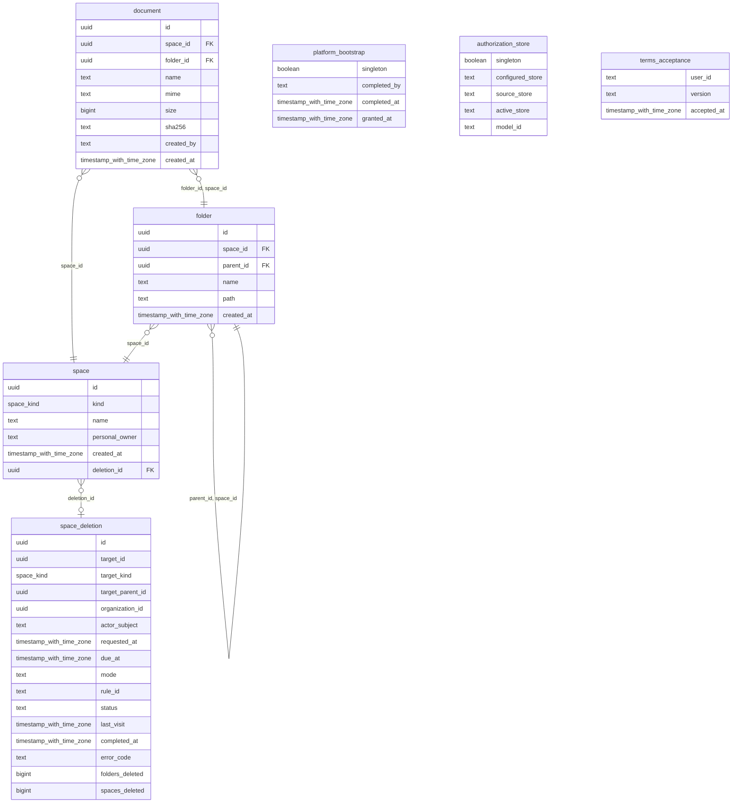

# Reference: manager schemas and contracts

Exact source-derived references for the organization/team/project implementation.
Read [Security](03-security.md) and [Organizations](04-organizations.md) for meaning.

## fred-manager HTTP surface

Health and frontend configuration are public. Other routes require a bearer token
([security](03-security.md)); business routes also require current personal CGU acceptance
and the unique organization context described in [Organizations](04-organizations.md#one-person-one-organization).
`/me` remains platform-role metadata; `/me/spaces` validates business context and
returns 409 for contradictory attachments. No organization request parameter
selects a tenant. Business authorization probes return `allowed: false` for a missing or
foreign context, and 409 for ambiguity.

<!-- generated: routes apps/fred-manager/src/api.rs /fred-manager/v1 -->
| Method | Path | Handler |
| --- | --- | --- |
| GET | `/fred-manager/v1/admin/organizations` | `organization_registry` |
| POST | `/fred-manager/v1/admin/organizations` | `create_organization` |
| GET | `/fred-manager/v1/admin/teams` | `team_registry` |
| POST | `/fred-manager/v1/authorize/document` | `authorize_document` |
| POST | `/fred-manager/v1/authorize/platform` | `authorize_platform` |
| POST | `/fred-manager/v1/authorize/scope` | `authorize_scope` |
| POST | `/fred-manager/v1/authorize/space` | `authorize_space` |
| POST | `/fred-manager/v1/bootstrap/platform-admin` | `bootstrap_platform_admin` |
| GET | `/fred-manager/v1/deletions/{operation_id}` | `deletion_status` |
| GET | `/fred-manager/v1/documents/{id}` | `get_document` |
| POST | `/fred-manager/v1/folders` | `create_folder` |
| DELETE | `/fred-manager/v1/folders/{id}` | `delete_folder` |
| PATCH | `/fred-manager/v1/folders/{id}` | `rename_folder` |
| GET | `/fred-manager/v1/frontend/config` | `frontend_config` |
| POST | `/fred-manager/v1/gcu` | `accept_terms` |
| GET | `/fred-manager/v1/healthz` | `health` |
| POST | `/fred-manager/v1/import-export/import` | `import_blueprint` |
| GET | `/fred-manager/v1/me` | `me` |
| GET | `/fred-manager/v1/me/onboarding` | `onboarding_status` |
| POST | `/fred-manager/v1/me/personal-space` | `create_personal_space` |
| GET | `/fred-manager/v1/me/spaces` | `my_spaces` |
| POST | `/fred-manager/v1/spaces` | `create_space` |
| DELETE | `/fred-manager/v1/spaces/{id}` | `delete_space` |
| GET | `/fred-manager/v1/spaces/{id}/documents` | `list_documents` |
| GET | `/fred-manager/v1/spaces/{id}/folders` | `list_folders` |
| DELETE | `/fred-manager/v1/spaces/{id}/roles/{role}/{user}` | `revoke` |
| PUT | `/fred-manager/v1/spaces/{id}/roles/{role}/{user}` | `grant` |
| GET | `/fred-manager/v1/users/platform-roles` | `list_platform_roles` |
| DELETE | `/fred-manager/v1/users/{user}/platform-roles/{role}` | `revoke_platform_role` |
| PUT | `/fred-manager/v1/users/{user}/platform-roles/{role}` | `grant_platform_role` |
<!-- end generated -->


## fred-manager schema

Generated by tbls from `apps/fred-manager/migrations` (`make er`). The tables live in
the `fred` database, created by sqlx migrations at startup. An applied migration is
never edited: sqlx checksums each file.

<!-- generated: mermaid docs/architecture/generated/fred-manager.er.mmd -->

<!-- end generated -->

The space tree is not in SQL: it lives in OpenFGA `parent` and `organization` links.
What the schema enforces by itself:

| Rule | Mechanism |
| --- | --- |
| A personal space is a team | `check (personal_owner is null or kind = 'team')` |
| Unique organization names | unique index on `name` where `kind = 'organization'` |
| A document's folder is in the document's space | composite foreign key `(folder_id, space_id)` |
| A sub-folder is in its parent's space | composite foreign key `(parent_id, space_id)` |
| A non-empty folder cannot be deleted | foreign keys, answered 409 |
| Placement never changes | `before update` triggers on `space` kind and owner, `folder`, `document` |
| One root bootstrap, ever | `platform_bootstrap` single row (`singleton` key) |

Manager enforces under the organization lock, after reading links: a team's parent
is an organization and a project's parent a non-personal team; sibling names are
unique; one personal space per owner and organization.


`POST /me/personal-space` retains `{organization_id}` and returns a `Space`: 201
for creation, 200 for current-authority reuse. The identifier must match the caller's
unique organization. Missing eligibility on creation, organization read or personal
read on reuse gives 403. Inaccessible existing spaces are not replaced.
`MySpace` adds required `organization_id` from placement, without changing personal
paths. `Role` adds `personal_space_creator`; `SpacePermission` adds `create_personal_space`.

## OpenFGA model

`store_name` identifies the configured source store. The SQL singleton
`authorization_store` binds that name to the active store and model IDs; it holds
no roles. Startup pins those IDs without selecting an arbitrary newer model or
falling back to the source. With schema synchronization, the exact predecessor
without personal eligibility, or without space deletion, upgrades additively in the same store; the SQL pointer
commits before the initialized client is returned. Empty initialization publishes a fresh store only after its initialization writes
succeed; existing state without a matching publication is refused. User IDs are Keycloak subjects.

Each organization and the platform has a `guard` object with an immutable
`initialized` sentinel and one random `version` revision. A mutation captures its
scope revisions before authorization/state checks. Its Write deletes the captured
revisions with `on_missing: error` and inserts fresh revisions together with the
role delta. Missing revisions roll back the complete Write. Unknown outcomes end
the attempt; replay captures fresh revisions and reauthorizes. Role insertions
remain idempotent. Guard relations imply no permission.

<!-- generated: include apps/fred-manager/openfga/model.fga text -->
```text
model
  schema 1.1

type user

# One object, platform:root. Owner is the technical platform role; platform roles grant
# no access to any space's content.
type platform
  relations
    define owner: [user]
    define observer: [user] or owner
    define feature_manager: [user] or owner
    define prompt_editor: [user] or owner
    define can_list_all_teams: feature_manager
    define can_delete_team: owner
    define can_delete_space: owner
    define can_rescue_team_admin: owner
    define can_edit_agent_class_path: owner
    define can_observe_platform: observer
    define can_administer_users: owner
    define can_manage_platform: owner
    define can_manage_capabilities: feature_manager
    define can_edit_platform_prompt: prompt_editor

# The space tree lives here only, written once at creation. A personal space has no
# parent; `organization` records who manages it and grants nothing.
# A role on a space requires a direct content role on its parent (enforced by fred-manager).
type space
  relations
    define parent: [space]
    define organization: [space]
    define member: [user]
    define editor: [user]
    define admin: [user]
    define analyst: [user]
    # Technical role of an organization: names its admins, reads nothing, never descends.
    define owner: [user]
    # Editor, admin and analyst reach every descendant; member stays local.
    define effective_editor: editor or effective_editor from parent
    define effective_admin: admin or effective_admin from parent
    define effective_analyst: analyst or effective_analyst from parent
    define can_read: member or effective_editor or effective_analyst
    define can_write: effective_editor
    define can_manage: effective_admin
    define can_run_evaluations: effective_analyst or effective_admin
    define can_manage_evaluation_corpus: effective_analyst or effective_admin
    define can_read_conversations_for_evaluation: effective_analyst
    define can_own: owner
    # Explicit organization eligibility, without content access or inheritance.
    define personal_space_creator: [user]
    define can_create_personal_space: personal_space_creator

# Mutation ordering only; these relations grant no permission.
type revision

type guard
  relations
    define initialized: [revision]
    define version: [revision]
```
<!-- end generated -->


## Provisioning declarations

The ZIP has exactly five root files. `manifest.json` declares
`{"format_version":2,"users_schema_version":2,"source_platform":"swift"}`. The
other files are arrays:

| File | Declaration |
| --- | --- |
| `users.json` | Unique lowercase `username` without surrounding whitespace or control characters, optional `email`, `first_name`, `last_name`, `password`, default-empty `platform_roles` |
| `organizations.json` | `ref`, `name`, `roles`; at least one organization |
| `teams.json` | `ref`, `name`, `organization` reference, `roles` |
| `projects.json` | `ref`, `name`, `team` reference, `roles`; empty array accepted |

A roles object maps declared usernames to arrays of `member`, `editor`, `analyst`,
`admin`, and on organizations `owner`. Roles accumulate and equivalent grants are
deduplicated. Admin and owner confer no implicit content role. Every new space
requires a declared admin, and every new organization a declared owner. Every child-role
holder requires a declared or existing direct parent content role; inherited access
does not count. Existing direct roles are read from OpenFGA; no space grant is synthesized. The demo explicitly declares
organization membership for team-role holders.

References are nonempty and unique across the entire bundle. Parents and role
subjects must be declared. Space names are nonempty and unique within each parent;
homonyms under distinct parents remain distinct. Platform aliases `owner` and
`observer` normalize to `platform_owner` and `platform_observer`. Unknown fields/roles,
duplicate JSON keys, usernames, references and sibling names are rejected. Legacy
`teams`/`team_roles` user fields are not accepted. Old JSON and Python version-1 ZIPs,
unknown versions/sections and multidisk formats return `not_yet_supported`.
Malformed archives, unsupported compression, encryption and symlinks are rejected.

Missing identities require a nonempty password and are created enabled with a
non-temporary credential. Absent or empty email uses `<username>@example.com`;
optional first/last names are passed when supplied. Existing identity fields remain intact.
Usernames are rejected when noncanonical, never silently normalized. Preflight checks
effective emails of missing identities, case-insensitively within the bundle and
against Keycloak's exact email search. A known conflict refuses the whole import
before any identity creation. The supported realm disallows duplicate emails;
concurrent external changes remain subject to the additive replay contract.

## Space deletion contract

`DELETE /spaces/{id}` returns a `Receipt`: operation/target/organization identifiers,
root-parent recovery snapshot, actor subject, frozen request/due timestamps and
mode/rule, status, safe error code, SQL deletion counters and completion time.
It returns 202 while pending and 200 on completed replay. `GET /deletions/{operation_id}`
returns that receipt after a fresh platform capability check. No names, bearer,
content or canonical grants are retained in it.

Statuses are `queued`, `running`, `retrying`, `blocked`, `completed`. Disabled
lifecycle refuses new requests with 503 while preserving reads and replay. Overlap,
retired targets, personal-only deletion and document-bearing scopes return 409.
Unsupported documents or unexpected references discovered during cleanup block the
receipt; later sweeps resume after the cause is corrected. Completion requires all
manifest rows and their FGA references absent.

Migration 0007 adds `space_deletion` and `space.deletion_id`. The receipt has no
foreign key to its target, and survives physical deletion. Its parent snapshot is
operational recovery metadata; the canonical tree and grants remain in OpenFGA.
