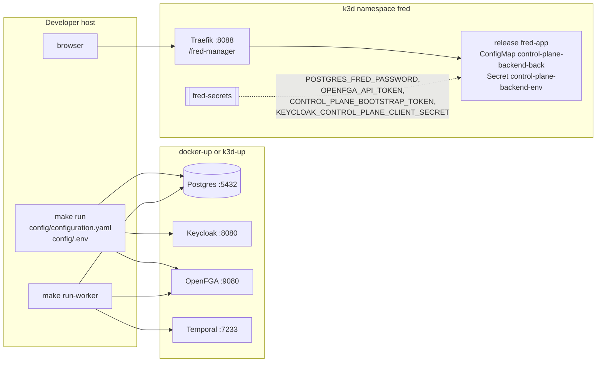

# Reference: manager operations

Configuration, diagnostics and runtime topology of manager within Fred's shared
infrastructure. Developer commands also live in the [component README](../../apps/fred-manager/README.md).

## Logging

Structured stdout, in the format shared by Fred's services.

| `app.log_format` | Output |
| --- | --- |
| `json` | One object per line: `severity`, `message`, `timestamp` `{seconds, nanos}`, `logger`, `service` (`fred-manager`), `service_role` (`api` or `worker`), `category`, `logging.googleapis.com/sourceLocation` (`file`, `line`, `function` = module path), `process`, `thread` |
| `text` | `<rfc3339> <SEVERITY> fred-manager/<logger> <message> key=value ...`, no wrapping, colors only on a terminal without `NO_COLOR` |

- Event fields and request context are top-level and never replace core fields.
  Fields named `token`, `access_token`, `refresh_token`, `id_token`, `authorization`,
  `cookie`, `password`, `secret`, `email`, `user`, `prompt`, `completion`, `content`,
  `body`, `arguments`, `result`, `url` or `signed_url` are dropped (I11).
- Dependencies log from WARNING only, as `Dependency diagnostic`, without their text or
  fields (I11).
- Each request gets `X-Request-ID` and `X-Correlation-ID`; its lines carry
  `request_id`, `correlation_id` and, once authenticated, `user_id`. It ends with one
  event on logger `http`: `METHOD route → status | Nms`, fields `http_method`, `route`
  (template), `http_status`, `duration_ms`, `outcome`; INFO below 400, WARNING for
  other 4xx, ERROR for 5xx; omitted for a successful `/healthz`; `cancelled` when the
  client goes away (I13).
- Acknowledged role writes emit `authz.relation.granted` or `authz.relation.revoked`
  on `fred.security.audit`, with `actor_uid` when known, `subject`, `relation`,
  `resource` and `outcome: succeeded`. This stream is always JSON and includes INFO
  even when the application threshold is WARNING or ERROR. Events precede SQL commit:
  an acknowledged FGA write remains auditable when SQL commit fails (I16).
- A changed personal acceptance emits `terms.accepted` on `fred.security.audit`
  with `actor_uid`, `version` and `outcome: succeeded`, after SQL persistence.
  Repeating an existing acceptance emits no new event.
- A single global filter applies the severity rules; a suppressed dependency probe
  cannot suppress the next application event. A fatal error after startup is one
  ERROR event, `fred-manager stopped`.


## Errors

Application error bodies use `{"detail": "<message>"}`, as FastAPI.
Unregistered paths and unsupported methods use the router's 404/405 responses.

| Status | When |
| --- | --- |
| 400 | Unknown role name, placement rule broken (I1), malformed multipart import |
| 401 | Missing or invalid bearer ([authentication details](03-security.md#authentication)) |
| 403 | Permission denied (`forbidden`), wrong bootstrap secret, `user_not_accept_gcu` |
| 404 | Unknown id or unregistered path |
| 405 | Unsupported method on a registered path |
| 409 | Unique or foreign-key violation, invariant refusal, bootstrap completed, `gcu_version_changed`, second or ambiguous organization attachment |
| 413 | Import exceeds 50 MiB compressed or 100 MiB expanded |
| 422 | Invalid ZIP/declarations, `not_yet_supported` import format; invalid JSON body, short bootstrap token, half a cursor |
| 503 | Bootstrap or platform-role administration with authentication disabled; grant with no directory or incompatible subject/realm mapping |
| 500 | Anything else, logged, answered `internal error` |


## Organization conflict recovery

A `multiple organization attachments` conflict means existing canonical roles place
the subject in more than one organization. It is invalid data, not a supported
multi-organization mode. Manager blocks business context instead of choosing one.
An attachment conflict during import is reported through the sanitized preflight
or roles/spaces error and existing acknowledgment counters.

Inspect the subject's direct OpenFGA roles and the committed SQL spaces, including
personal links and governance-only roles. Agree the intended organization, then
have administrators authorized in each affected organization revoke its unwanted
grants bottom-up:
projects, teams/personal spaces, then organization. Keep the required administrator
and owner in every non-personal space. Platform owners can correct organization
owner grants through their independent platform authority. Revocation does not
require the target to have a valid unique context; it still checks the caller.
No role or content is deleted automatically, and granting platform ownership does
not bypass content or ordinary space-administration checks.

Upgrade all manager role writers together; an old writer can still create conflicting
data. There is no SQL/FGA schema migration for this rule. Deployment and rollback
steps are in the [migration note](../swift/ops/migrations/manager-single-organization.md).

## Configuration

`CONFIG_FILE` (default `./config/configuration.yaml`) holds the settings, in sections
`app`, `security`, `storage`, `scheduler`, `policies`; `ENV_FILE` (default `./config/.env`) holds
secrets only and never overrides the process environment.

| Secret | Read from |
| --- | --- |
| `FRED_POSTGRES_PASSWORD` | process or `.env` |
| `OPENFGA_API_TOKEN` | the variable `security.rebac.token_env_var` names |
| `KEYCLOAK_FRED_MANAGER_CLIENT_SECRET` (host default), `KEYCLOAK_CONTROL_PLANE_CLIENT_SECRET` (chart) | the variable `security.m2m.secret_env_var` names |
| `FRED_BOOTSTRAP_TOKEN` | the variable `app.bootstrap_token_env_var` names |

Local reference configuration:

<!-- generated: include apps/fred-manager/config/configuration.yaml yaml -->
```yaml
# fred-manager on the host, against the local stack of fred-deployment-factory.
# Secrets come from config/.env.

app:
  gcu_version: v1
  name: Fred Manager
  base_url: /fred-manager/v1
  address: 0.0.0.0
  port: 8400
  log_level: info
  log_format: text
  # One-time root platform-admin bootstrap secret, from config/.env.
  bootstrap_token_env_var: FRED_BOOTSTRAP_TOKEN

security:
  profile: c3
  m2m:
    enabled: true
    client_id: fred-manager
    secret_env_var: KEYCLOAK_FRED_MANAGER_CLIENT_SECRET
    realm_url: http://localhost:8080/realms/app
  user:
    enabled: true
    realm_url: http://localhost:8080/realms/app
    client_id: app
  authorized_origins:
    - http://localhost:5173
  rebac:
    type: openfga
    api_url: "http://localhost:9080"
    store_name: fred-manager

storage:
  postgres:
    host: localhost
    port: 5432
    database: fred
    username: fred

policies:
  purge_catalog_path: ./config/lifecycle_policy_catalog.yaml

scheduler:
  lifecycle:
    enabled: false
    sweep_interval: PT10M
    batch_size: 100
    temporal:
      host: localhost:7233
      namespace: default
      task_queue: fred-manager-lifecycle
      workflow_id_prefix: fred-manager-lifecycle
      connect_timeout_seconds: 5
      rpc_timeout_seconds: 10
```
<!-- end generated -->


## Outbound Keycloak directory

`security.m2m.enabled` enables the manager's own client-credentials identity, configured
by `realm_url`, `client_id` and `secret_env_var`. An issuer-only legacy m2m section does
not enable directory access. User bearer verification and service credentials remain
separate. Platform grants require Keycloak authentication with `claims.uid: sub` and
the same normalized user/directory realm; revocations remain available for stale grants.

The shared client rejects redirects and uses a five-second request timeout. A synchronized
process-local cache renews the service token five seconds before expiry; a 401 invalidates
that token and retries once. Errors expose operation and status, never upstream bodies,
credentials or raw transport diagnostics. User lookup encodes the subject as a path segment.


## Import boundary and feedback

The CLI reads the operator bearer from a file, separately from the service-client
secret. HTTP accepts exactly one multipart `file` after verified platform-admin
authority. The ZIP parser accepts stored/deflated entries without extraction,
checks actual expanded bytes and rejects duplicate/path-bearing entries, inconsistent
headers, symlinks, encryption and corrupt data. Archive size is 50 MiB; expanded
data totals at most 100 MiB. The HTTP body limit adds 64 KiB for multipart framing.
Parsing runs on a blocking worker. Old formats return 422 `not_yet_supported`.
HTTP maps operator authentication to 401, authority to 403, invalid declarations
to 422, state/revision conflicts to 409, unavailable dependencies to 503 and internal
SQL failures to 500. Importer failures contain static reasons and safe counts, never dependency
diagnostics or input values. HTTP upload, parsing and initial authorization
failures contain a `detail` without reconciliation counts.
CLI initialization and validation failures report zero counters and no provisioning writes,
including configuration/file errors before logging starts. Bundle types do not implement
Debug or Serialize. Parsing diagnostics do not echo input
values; provisioning failures report a safe phase and acknowledgment counts, and the CLI exits
nonzero. Counts cover resolved/created identities, committed reconciled spaces and
acknowledged grants; a lost response can leave uncounted remote effects. Success returns
these counts as one JSON object (stdout or HTTP 200). The recovery action after a partial failure is replay
with a valid operator token, after correcting the cause. Created identities are not deleted
as compensation. `create-org` retains its operator/database trust boundary.

## Deployment topology

Both stories run against the infrastructure of fred-deployment-factory. fred-manager
creates its tables (sqlx migrations) and its OpenFGA store at startup; the Keycloak
realm starts empty.



| | Host run | k3d release |
| --- | --- | --- |
| Start | `make run` in `apps/fred-manager` | `make k3d-app APP=fred DIR=../fred` in the factory |
| Configuration | `config/configuration.yaml`, `log_format: text` | values `configuration`, rendered to ConfigMap `control-plane-backend-back`, `log_format: json` |
| Secrets | `config/.env` | `fred-secrets`, as `extraEnvVars` |
| Addresses | `localhost` ports | `postgres`, `openfga:9080`, `temporal:7233`, `keycloak:8080` |
| Token issuer accepted | `http://localhost:8080/realms/app` | `http://keycloak:8080/realms/app` (hosts entry `127.0.0.1 keycloak`) |
| Public URL | `http://localhost:8400/fred-manager/v1` | `http://localhost:8088/fred-manager/v1` |
| Bootstrap secret | `FRED_BOOTSTRAP_TOKEN` in `.env` | `CONTROL_PLANE_BOOTSTRAP_TOKEN` of `fred-secrets`, generated with the cluster |

Manager API and worker are ordinary applications in Fred's chart (`deploy/charts/fred`)
and release `fred-app`, alongside Knowledge Flow API/worker and frontend. The chart
validates manager configuration through its generated schema. `generate-config-schema`
runs offline from the same Rust configuration types; `make generate-chart-schema`
embeds that schema with the other application contracts. The manager API owns the
shared configuration/catalog mounts and both manager rollout checksums cover them.

The image (`dockerfiles/Dockerfile-prod`) builds the release binary with `protoc` and
`libprotobuf-dev`, then runs it as user 1000 on Debian slim; migrations and the OpenFGA
model are compiled into the binary.

The factory's standard `control-plane` confidential client has the
`realm-management/query-users`, `view-users` and `manage-users` grants. The cluster
configuration uses `KEYCLOAK_CONTROL_PLANE_CLIENT_SECRET` from `fred-secrets`.
A host process keeps its own `security.m2m.client_id` and `secret_env_var` settings;
when reusing this client, configure both settings and supply its secret in `.env`.

In the chart, manager runs as `control-plane-backend` and `control-plane-worker`
using the `control-plane-backend` image built from `apps/fred-manager`. API port
8222 serves `/control-plane/v1`. The migration hook invokes `fred-manager migrate`
with `DATABASE_URL` alone; it accepts PostgreSQL URLs including the factory's
`postgresql+asyncpg` scheme. It applies the same embedded migrations as API startup,
without loading identity, authorization or runtime configuration. Both processes
mount the API configuration/catalog. The factory's `scheduler.temporal` host and
namespace feed the lifecycle connection without changing its queue or prefix.

## Running provisioning

Start the compatible service once to initialize SQL migrations and the extended FGA
model, then accept CGU and complete root bootstrap in the UI. CLI import itself never migrates SQL, creates a store
or synchronizes a model. It needs Postgres, OpenFGA and Keycloak; it does not need the
HTTP server or Temporal to remain running. It loads the published store/model IDs.

From `apps/fred-manager`, with the directory client configured and an operator access
token in a private file:

```sh
make build-demo-bundle
make import-provisioning BUNDLE=target/demo-provisioning-bundle.zip TOKEN_FILE=/path/to/operator-token
```

`build-demo-bundle` packages the five checked-in JSON files with Python's standard
ZIP library and atomically replaces its output. `DEMO_PROVISIONING_FIXTURE_DIR`
and `DEMO_BUNDLE_FILE` override source/output paths, including paths with spaces;
no running service is needed. HTTP clients submit the same ZIP as multipart `file`
to `/fred-manager/v1/import-export/import` on the running server.

The bearer must identify a current platform owner, who may declare any platform role
and organization owners.
The operator token is never used to administer Keycloak: that traffic uses the manager's
service identity from `identities.yaml`. Token validity and authority are rechecked during
import; replay after expiry uses a fresh operator token.

## Frontend routing

The frontend uses same-origin `/fred-manager/v1` requests. Vite resolves the
`/fred-manager` prefix before its broad `/fred` rule and proxies to
`VITE_BACKEND_URL_FRED_MANAGER`, default `http://localhost:8400`. Production nginx
forwards `/fred-manager/` to `FRONTEND_FRED_MANAGER_UPSTREAM`, default
`http://control-plane-backend:8222`, replacing the prefix with
`FRONTEND_FRED_MANAGER_API_PREFIX` (default `/control-plane`). Direct
`/control-plane/` calls reach the same API. Read/send timeouts are 3600 seconds;
DNS resolves at request time. Local frontend `make docker-run` uses
`http://host.docker.internal:8400` and prefix `/fred-manager` for a host manager.
On Kubernetes, the chart supplies `control-plane-backend.<namespace>.svc.cluster.local:8222`
for both manager and control-plane upstreams: nginx's request-time resolver does
not apply the pod's DNS search domains. These defaults survive replacement of the
frontend environment list by instance values. Explicit upstream entries in `env`
or `extraEnvVars` override them, including for a custom cluster DNS domain.
Access logs retain the bounded `fred-manager` route family without paths, tokens
or upload contents. UI components and generated API paths are unchanged.

## Authorization store publication

`sync_schema_on_init` allows empty initialization and the exact additive
personal-eligibility and space-deletion upgrades. Existing bindings pin the model even when arbitrary
newer models exist. Upgrade verifies the published predecessor, publishes in the
same store and commits the model ID under the platform SQL lock. Spaces, tuples
and guard revisions are preserved. Concurrent initializers converge. Failed SQL
publication leaves the previous pointer usable for retry; an unused model grants nothing.

Ordinary loads, CLI import and create-org never synchronize models. Unknown models,
changed logical store names and existing data without publication are refused.
Stop old writers, enable `security.rebac.sync_schema_on_init` on manager startup,
then deploy matching API/CLI/frontend versions. Old binaries reject the upgraded
pinned model. Rollback requires coordinated SQL/OpenFGA backup restoration with
writers stopped, not a pointer edit or shared-data reset. See the
[migration guide](../swift/ops/migrations/manager-personal-space.md).

## First-user application entry

Manager and frontend from this branch are deployed together. Migration 0005 adds
personal consent storage at manager startup; existing migrations remain intact.
The reference and k3d manager configurations require CGU version `v1`. Legal assets
in the frontend match the configured version; a version change requires renewed
personal acceptance. The frontend depends on manager public configuration before
login and displays a reload action if it is unavailable. Root bootstrap uses the
configured secret and grants no organization membership. The Make ZIP builder and
the UI provisioning page populate explicitly declared memberships. Fred retains
its existing business pages, navigation and controls. An unavailable product API
does not remove its UI; Home remains interactive while its bootstrap data is
loading or unavailable. Rebuilding the frontend preserves manager consent,
bootstrap and imported data.

## Space deletion lifecycle

API and worker share `scheduler.lifecycle` and `policies.purge_catalog_path`.
Omitted lifecycle configuration is disabled. The shipped catalog defaults to
`deferred_delete` with `P7D`; `immediate_delete` still uses the worker. Rules match
`space_id` and/or `space_kind`, most defined criteria first, then file order.
An empty match object matches every space. Durations accept nonnegative ISO weeks,
days, hours, minutes and seconds; unsupported fields, calendar/fractional durations,
empty match lists and overflows fail validation. Accepted deadlines never change
when a catalog is reloaded.

`make run-worker` starts the separate process. Fred's chart deploys
`control-plane-worker` from the same image, with the API's config/catalog mounts,
SQL/FGA secrets and `/healthz` probes, without ingress or a Service. Local
`k3d-app-reset` recognizes the integrated release and the earlier standalone manager,
validates configurations, stops producers before erasure and restores their original replicas. Its logs use
`service_role: worker`. Acceptance and completion emit `space.deletion.accepted`
and `space.deletion.completed` on `fred.security.audit` after SQL commit.

The manager-owned schedule defaults to PT10M and 100 candidates (range 1..5000),
skips overlap and reconciles idempotently at startup. Queue and workflow prefix
must begin with `fred-manager-`. Connect/RPC
timeouts default to 5/10 seconds. Sweep cadence, backlog and outages add latency;
due time is an earliest cleanup time. Disabling every worker prevents cleanup and
pauses its schedule when Temporal is reachable. Settings load at process startup.

A sweep selects at most `batch_size` operations and performs one successful batch
per selected operation. This is not a throughput limit in folders or tuples per
minute. For an operation needing `B` successful batches and interval `I`, with no
backlog, failures or overlap skips, completion after its due time takes roughly
`delta + (B - 1) * I` plus execution time, where `delta` is the wait for the first
sweep (normally less than `I`). Retries after ambiguous effects can advance work
within the same sweep; outages and long sweeps can extend the delay without bound.

Folder batches remove at most 1000 current leaves. A chain of 15 folders therefore
needs 15 successful folder batches, followed by tuple cleanup and a separate SQL
space-removal batch. For one space with at most 96 direct tuples, this is at least
17 batches: about 160-170 minutes after its due time with PT10M, before additional
backlog or failure delay. Descendant spaces add their own batches. A person's
organization attachment persists while their direct roles on remaining retired
rows exist; it can end before the whole operation completes. Names remain reserved
until their corresponding SQL rows are removed.

Deploy API/worker with lifecycle disabled; replace every API replica and operator
producer with retirement-aware binaries, verify compatible schema/model and worker,
then activate all affected processes. An old producer must never write retired
state. Old binaries reject the new model publication even after draining requests;
rollback requires coordinated pre-activation SQL/OpenFGA restoration with all
producers stopped. Prefer a forward fix. See the [migration note](../swift/ops/migrations/manager-space-deletion.md).

Cleanup also drains SQL-absent descendants left by aborted creations or imports
when they remain linked to the retired space. It removes their grants and descendants
before removing the placement link in a separate batch. These extra batches add
sweep intervals but do not increment `spaces_deleted`. No global orphan scan runs;
committed spaces outside the retired manifest are preserved.

Inspect safe errors through the receipt. `unsupported_documents` requires resolving
unexpected document metadata through its owning lifecycle; `unexpected_reference`
or `unexpected_hierarchy` requires reconciling the scope before retry.
`dependency_unavailable` retries; missing organization guards require operator
reconciliation unless only final root removal remains. No content-store cleanup is
claimed. `make test-lifecycle-temporal` verifies HTTP acceptance, a real worker restart,
schedule reuse, history replay, SIGTERM during a SQL lock wait and exhausted-retry
recovery against disposable services.
