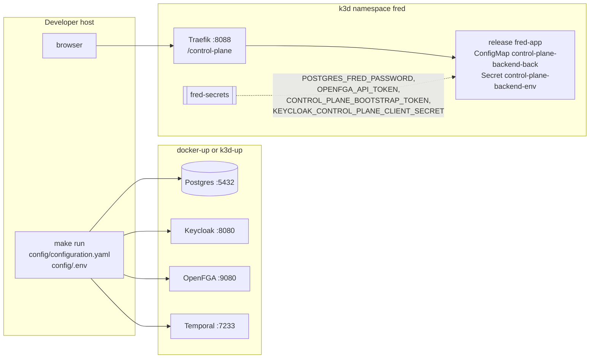

# Reference: control-plane operations

Configuration, diagnostics and runtime topology of manager within Fred's shared
infrastructure. Developer commands also live in the [component README](../../apps/control-plane/README.md).

## Logging

Structured stdout, in the format shared by Fred's services.

| `app.log_format` | Output |
| --- | --- |
| `json` | One object per line: `severity`, `message`, `timestamp` `{seconds, nanos}`, `logger`, `service` (`control-plane`), `service_role` (`api` or `worker`), `category`, `logging.googleapis.com/sourceLocation` (`file`, `line`, `function` = module path), `process`, `thread` |
| `text` | `<rfc3339> <SEVERITY> control-plane/<logger> <message> key=value ...`, no wrapping, colors only on a terminal without `NO_COLOR` |

- Event fields and request context are top-level and never replace core fields.
  Fields named `token`, `access_token`, `refresh_token`, `id_token`, `authorization`,
  `cookie`, `password`, `secret`, `email`, `user`, `prompt`, `completion`, `content`,
  `body`, `arguments`, `result`, `url` or `signed_url` are dropped (I11).
- Dependencies log from WARNING only, as `Dependency diagnostic`, without their text or
  fields (I11).
- Each request gets `X-Request-ID` and `X-Correlation-ID`; its lines carry
  `request_id`, `correlation_id` and, once authenticated, `user_id`. It ends with one
  event on logger `http`: `METHOD route → status | Nms`, fields `http_method`, `route`
  (template), `http_status`, `duration_ms`, `outcome`; INFO below 400, WARNING for
  other 4xx, ERROR for 5xx; omitted for a successful `/healthz`; `cancelled` when the
  client goes away (I13).
- Acknowledged role writes emit one `authz.relation.granted` or `authz.relation.revoked`
  on `fred.security.audit`, with `actor_uid` when known, `subject`, `relation`,
  `resource` and `outcome: succeeded`; no other event carries those names. Revoking a
  role that is not held advances the guard but emits nothing. This stream is always JSON and includes INFO
  even when the application threshold is WARNING or ERROR. Events precede SQL commit:
  an acknowledged FGA write remains auditable when SQL commit fails (I16).
- A changed personal acceptance emits `terms.accepted` on `fred.security.audit`
  with `actor_uid`, `version` and `outcome: succeeded`, after SQL persistence.
  Repeating an existing acceptance emits no new event.
- A single global filter applies the severity rules; a suppressed dependency probe
  cannot suppress the next application event. A fatal error after startup is one
  ERROR event, `control-plane stopped`.


## Errors

Application error bodies use `{"code": "<stable code>", "detail": "<safe message>"}`.
Unregistered paths and unsupported methods use the router's 404/405 responses.

| Status | When |
| --- | --- |
| 400 | Unknown role name, placement rule broken (I1), malformed multipart import |
| 401 | Missing or invalid bearer ([authentication details](A6-security.md#authentication)) |
| 403 | Permission denied (`forbidden`), wrong bootstrap secret, `user_not_accept_gcu` |
| 404 | Unknown id or unregistered path |
| 405 | Unsupported method on a registered path |
| 409 | Unique or foreign-key violation, invariant refusal, bootstrap completed, `gcu_version_changed`, second or ambiguous organization attachment |
| 413 | Import exceeds 50 MiB compressed or 100 MiB expanded |
| 422 | Invalid ZIP/declarations, `not_yet_supported` import format; invalid JSON body, short bootstrap token, half a cursor |
| 503 | Bootstrap or platform-role administration with authentication disabled; grant with no directory or incompatible subject/realm mapping |
| 500 | Anything else, logged, answered `internal error` |

Original-storage handlers distinguish malformed JSON/multipart (400), invalid fields
(422), idle/total upload timeout (408), actual byte limit (413), unavailable transfer
capacity (429), and provider/dependency/backlog unavailability (503). Name, request
binding and retry-state conflicts use distinct 409 codes. Pending upload conflicts
include `Retry-After` and `Location`; successes include the receipt location.
Streaming download errors after headers abort the body rather than append JSON.


## Organization conflict recovery

A `multiple organization attachments` conflict means existing canonical roles place
the subject in more than one organization. It is invalid data, not a supported
multi-organization mode. Manager blocks business context instead of choosing one.
An attachment conflict during import is reported through the sanitized preflight
or roles/spaces error and existing acknowledgment counters.

Inspect the subject's direct OpenFGA roles and the committed SQL spaces, including
personal links and governance-only roles. Agree the intended organization, then
have administrators authorized in each affected organization revoke its unwanted
grants bottom-up:
projects, teams/personal spaces, then organization. Keep the required administrator
and owner in every non-personal space. Platform owners can correct organization
owner grants through their independent platform authority. Revocation does not
require the target to have a valid unique context; it still checks the caller.
No role or content is deleted automatically, and granting platform ownership does
not bypass content or ordinary space-administration checks.

Upgrade all manager role writers together; an old writer can still create conflicting
data. There is no SQL/FGA schema migration for this rule. Deployment and rollback
steps are in the [migration note](../swift/ops/migrations/rust-control-plane.md).

## Configuration

`CONFIG_FILE` (default `./config/configuration.yaml`) holds the settings, in sections
`app`, `security`, `storage`, `scheduler`, `policies`. An unknown key at any level
refuses startup and names the key; the chart's values schema rejects it before
rendering. `ENV_FILE` (default `./config/.env`) holds
secrets and the two token-time settings below, and never overrides the process environment.

| Token-time setting | Default |
| --- | --- |
| `FRED_JWT_MAX_LIFETIME_SECONDS` | `3600`, maximum `exp - iat` |
| `FRED_JWT_CLOCK_SKEW` | `0`, leeway in seconds |

| Secret | Read from |
| --- | --- |
| `FRED_POSTGRES_PASSWORD` | process or `.env` |
| `OPENFGA_API_TOKEN` | the variable `security.rebac.token_env_var` names |
| `KEYCLOAK_CONTROL_PLANE_CLIENT_SECRET` (host default), `KEYCLOAK_CONTROL_PLANE_CLIENT_SECRET` (chart) | the variable `security.m2m.secret_env_var` names |
| `FRED_BOOTSTRAP_TOKEN` | the variable `app.bootstrap_token_env_var` names |
| `FRED_CONTENT_ACCESS_KEY`, `FRED_CONTENT_SECRET_KEY` | variables named by `storage.content.access_key_env_var` and `secret_key_env_var`, when content is configured |

Local reference configuration:

<!-- generated: include apps/control-plane/config/configuration.yaml yaml -->
```yaml
# control-plane on the host, against the local stack of fred-deployment-factory.
# Secrets come from config/.env.

app:
  gcu_version: v1
  base_url: /control-plane/v1
  address: 0.0.0.0
  port: 8222
  log_level: info
  log_format: text
  # One-time root platform-admin bootstrap secret, from config/.env.
  bootstrap_token_env_var: FRED_BOOTSTRAP_TOKEN

security:
  profile: c3
  m2m:
    enabled: true
    client_id: control-plane
    secret_env_var: KEYCLOAK_CONTROL_PLANE_CLIENT_SECRET
    realm_url: http://localhost:8080/realms/app
  user:
    enabled: true
    realm_url: http://localhost:8080/realms/app
    client_id: app
  authorized_origins:
    - http://localhost:5173
  rebac:
    api_url: "http://localhost:9080"
    store_name: control-plane

storage:
  # Enable after provisioning a bucket without versioning, Object Lock or lifecycle.
  # content:
  #   endpoint: http://localhost:8333
  #   allow_insecure: true
  #   bucket: app-content-documents
  #   access_key_env_var: FRED_CONTENT_ACCESS_KEY
  #   secret_key_env_var: FRED_CONTENT_SECRET_KEY
  postgres:
    host: localhost
    port: 5432
    database: fred
    username: fred

policies:
  purge_catalog_path: ./config/lifecycle_policy_catalog.yaml

scheduler:
  lifecycle:
    enabled: false
    sweep_interval: PT10M
    batch_size: 100
    temporal:
      host: localhost:7233
      namespace: default
      task_queue: control-plane-lifecycle
      workflow_id_prefix: control-plane-lifecycle
      connect_timeout_seconds: 5
      rpc_timeout_seconds: 10

# Read-only discovery; used by `control-plane discover-agents`.
platform:
  runtime_catalog_sources:
    - runtime_id: fred-agents
      base_url: http://localhost:8000/fred/agents/v2
      # Opt in only when this external runtime is running.
      enabled: false
```
<!-- end generated -->


## Outbound Keycloak directory

`security.m2m.enabled` enables the manager's own client-credentials identity, configured
by `realm_url`, `client_id` and `secret_env_var`. `enabled` is required; `false`
disables directory access. User bearer verification and service credentials remain
separate. Platform grants require Keycloak authentication with `claims.uid: sub` and
the same normalized user/directory realm; revocations remain available for stale grants.

The shared client rejects redirects and uses a five-second request timeout. A synchronized
process-local cache renews the service token five seconds before expiry; a 401 invalidates
that token and retries once. Errors expose operation and status, never upstream bodies,
credentials or raw transport diagnostics. User lookup encodes the subject as a path segment.


## Import boundary and feedback

The CLI reads the operator bearer from a file, separately from the service-client
secret. HTTP accepts exactly one multipart `file` after verified platform-admin
authority. The ZIP parser accepts stored/deflated entries without extraction,
checks actual expanded bytes and rejects duplicate/path-bearing entries, inconsistent
headers, symlinks, encryption and corrupt data. Archive size is 50 MiB; expanded
data totals at most 100 MiB. The HTTP body limit adds 64 KiB for multipart framing.
Parsing runs on a blocking worker. Old formats return 422 `not_yet_supported`.
HTTP maps operator authentication to 401, authority to 403, invalid declarations
to 422, state/revision conflicts to 409, unavailable dependencies to 503 and internal
SQL failures to 500. Importer failures contain static reasons and safe counts, never dependency
diagnostics or input values. HTTP upload, parsing and initial authorization
failures contain a `detail` without reconciliation counts.
CLI initialization and validation failures report zero counters and no provisioning writes,
including configuration/file errors before logging starts. Bundle types do not implement
Debug or Serialize. Parsing diagnostics do not echo input
values; provisioning failures report a safe phase and acknowledgment counts, and the CLI exits
nonzero. Counts cover resolved/created identities, committed reconciled spaces and
acknowledged grants; a lost response can leave uncounted remote effects. Success returns
these counts as one JSON object (stdout or HTTP 200). The recovery action after a partial failure is replay
with a valid operator token, after correcting the cause. Created identities are not deleted
as compensation.

## Deployment topology

Both stories run against the infrastructure of fred-deployment-factory. control-plane
requires its SQL migrations to be applied before startup and initializes its
OpenFGA store at startup; the Keycloak
realm starts empty.



| | Host run | k3d release |
| --- | --- | --- |
| Start | `make run` in `apps/control-plane` | `make k3d-app APP=fred DIR=../fred` in the factory |
| Configuration | `config/configuration.yaml`, `log_format: text` | values `configuration`, rendered to ConfigMap `control-plane-backend-back`, `log_format: json` |
| Secrets | `config/.env` | `fred-secrets`, as `extraEnvVars` |
| Addresses | `localhost` ports | `postgres`, `openfga:9080`, `temporal:7233`, `keycloak:8080` |
| Token issuer accepted | `http://localhost:8080/realms/app` | `http://keycloak:8080/realms/app` (hosts entry `127.0.0.1 keycloak`) |
| Public URL | `http://localhost:8222/control-plane/v1` | `http://localhost:8088/control-plane/v1` |
| Bootstrap secret | `FRED_BOOTSTRAP_TOKEN` in `.env` | `CONTROL_PLANE_BOOTSTRAP_TOKEN` of `fred-secrets`, generated with the cluster |

The local profile runs the control-plane API and background tasks in one deployment,
with Knowledge Flow worker and frontend. The chart validates control-plane
configuration through its generated Rust schema. `generate-config-schema` runs
offline; `make generate-chart-schema` embeds the application contracts.

The image (`dockerfiles/Dockerfile-prod`) builds the release binary with `protoc` and
`libprotobuf-dev`, then runs it as user 1000 on Debian slim; migrations and the OpenFGA
model are compiled into the binary.

The factory's standard `control-plane` confidential client has the
`realm-management/query-users`, `view-users` and `manage-users` grants. The cluster
configuration uses `KEYCLOAK_CONTROL_PLANE_CLIENT_SECRET` from `fred-secrets`.
A host process keeps its own `security.m2m.client_id` and `secret_env_var` settings;
when reusing this client, configure both settings and supply its secret in `.env`.

The local profile runs `control-plane-backend` using the image built from
`apps/control-plane`. Port 8222 serves `/control-plane/v1`. The migration hook
invokes `control-plane migrate` with `DATABASE_URL` alone, including the factory's
`postgresql+asyncpg` scheme. It applies SQL migrations without loading identity,
authorization or runtime configuration. API startup verifies migration versions
and checksums without applying them.

## SQLx schema evolution

The [SQL catalogue](A2-manager-contracts.md#control-plane-sql-catalogue) identifies
the control-plane tables and their responsibilities. Ordered files in
[`apps/control-plane/migrations`](../../apps/control-plane/migrations) are the
schema source of truth. SQLx embeds them in the Rust binary and records applied
versions and checksums in `_sqlx_migrations`.

`0001_manager_schema.sql` defines the initial schema, including immutable
organization/parent placement and the local identity directory;
`0002_personal_space_owner.sql` adds the unique index of active personal spaces and
`0003_user_identity_prefix_search.sql` the local search indexes. A
fresh installation
applies the whole chain; an existing installation applies only pending files.
Applied files are immutable, including comments and whitespace. A database whose
recorded versions or checksums differ from the embedded files is refused by the API
and by `migrate`; it is recreated explicitly, never reset automatically. Do not repair
a changed file by editing the database's stored checksum.

The `control-plane migrate` command connects using `DATABASE_URL` without loading
the application configuration. When enabled, the chart's pre-install/pre-upgrade
migration Job executes it before rolling the application. The secondary k3d
factory profile enables that Job. The base chart defaults the Job to disabled.
API pool initialization calls the read-only `db::require_initialized` check. It
requires the exact embedded migration versions and checksums, with no incomplete
migration. An empty, older, newer or checksum-mismatched history prevents startup;
the error directs the operator to the migration Job/command or history inspection.
The API does not create tables or update migration history. Provisioning import
also verifies initialization without migration.
SQLx serializes the explicit migration runner with database locking.

Outside Kubernetes, set `DATABASE_URL` for the target database and run
`control-plane migrate` before starting the API. This separates schema execution
from normal application startup; database privilege separation is not enforced by
this code change. Exact history matching also means restarting an older binary
after applying a newer migration is refused, even for an additive migration.

A schema change adds the next numbered SQL file. Back up the target database
before applying it; rebuild the Rust image so that the file is embedded, then
redeploy through the existing application command. Additive changes can preserve
compatibility with the previous running application. Data transformations,
constraint changes and destructive DDL need their own explicit deployment and
recovery procedure: neither SQLx history nor rolling back an image restores lost
data. OpenFGA model publication has its separate lifecycle below; an additive SQL
migration does not require resetting its store.

These read-only queries inspect an installation without reading user profiles or
document contents. Run them in the configured control-plane database (`fred` in
the local profile):

```sql
SELECT version, description, installed_on, success,
       encode(checksum, 'hex') AS checksum
FROM public._sqlx_migrations
ORDER BY version;

SELECT tablename
FROM pg_catalog.pg_tables
WHERE schemaname = 'public'
ORDER BY tablename;

SELECT table_name, ordinal_position, column_name, data_type, is_nullable
FROM information_schema.columns
WHERE table_schema = 'public'
ORDER BY table_name, ordinal_position;
```

Checksums establish migration-file identity, not absence of manual schema drift.
For a schema audit, also inspect actual columns, constraints, indexes and triggers.
The diagram generator creates a temporary PostgreSQL database, applies the SQL
files and runs tbls; it does not connect to the application's database or export
its data. Regenerate the diagram after each schema change with
`make -C docs/architecture er`, and update its generated block in the contracts
reference through the dossier generator.

## Running provisioning

Apply SQL migrations with the migration Job or `control-plane migrate`, then start
the compatible service to initialize the extended FGA model. Accept CGU and
complete root bootstrap in the UI. CLI import itself never migrates SQL, creates a store
or synchronizes a model. It needs Postgres, OpenFGA and Keycloak; it does not need the
HTTP server or Temporal to remain running. It loads the published store/model IDs.

From `apps/control-plane`, with the directory client configured and an operator access
token in a private file:

```sh
make build-demo-bundle
make import-provisioning BUNDLE=target/demo-provisioning-bundle.zip TOKEN_FILE=/path/to/operator-token
```

`build-demo-bundle` packages the five checked-in JSON files with Python's standard
ZIP library and atomically replaces its output. `DEMO_PROVISIONING_FIXTURE_DIR`
and `DEMO_BUNDLE_FILE` override source/output paths, including paths with spaces;
no running service is needed. HTTP clients submit the same ZIP as multipart `file`
to `/control-plane/v1/import-export/import` on the running server.

The bearer must identify a current platform owner, who may declare any platform role
and organization owners.
The operator token is never used to administer Keycloak: that traffic uses the manager's
service identity from `identities.yaml`. Token validity and authority are rechecked during
import; replay after expiry uses a fresh operator token.

## Frontend routing

The frontend uses same-origin `/control-plane/v1` requests. Vite resolves the
`/control-plane` prefix before its broad `/fred` rule and proxies to
`VITE_BACKEND_URL_CONTROL_PLANE`, default `http://localhost:8222`. Production nginx
forwards `/control-plane/` to `FRONTEND_CONTROL_PLANE_UPSTREAM`, default
`http://control-plane-backend:8222`, replacing the prefix with
`FRONTEND_CONTROL_PLANE_API_PREFIX` (default `/control-plane`). Direct
`/control-plane/` calls reach the same API. Read/send timeouts are 3600 seconds;
DNS resolves at request time. Local frontend `make docker-run` uses
`http://host.docker.internal:8222` and prefix `/control-plane` for a host manager.
On Kubernetes, the chart supplies `control-plane-backend.<namespace>.svc.cluster.local:8222`
for both manager and control-plane upstreams: nginx's request-time resolver does
not apply the pod's DNS search domains. These defaults survive replacement of the
frontend environment list by instance values. Explicit upstream entries in `env`
or `extraEnvVars` override them, including for a custom cluster DNS domain.
Access logs retain the bounded `control-plane` route family without paths, tokens
or upload contents. UI components and generated API paths are unchanged.

## Authorization store publication

`sync_schema_on_init` allows initialization of an empty installation only. An
existing binding pins its model; a published model that differs from the binary's
model is refused.
Concurrent initializers converge. Ordinary loads and CLI import never
synchronize models; changed logical store names and existing data without
publication are refused.

## First-user application entry

Manager and frontend are deployed together; personal consent is stored by manager.
The reference and k3d manager configurations require CGU version `v1`. Legal assets
in the frontend match the configured version; a version change requires renewed
personal acceptance. The frontend depends on manager public configuration before
login and displays a reload action if it is unavailable. Root bootstrap uses the
configured secret and grants no organization membership. The Make ZIP builder and
the UI provisioning page populate explicitly declared memberships. Fred retains
its existing business pages, navigation and controls. An unavailable product API
does not remove its UI; Home remains interactive while its bootstrap data is
loading or unavailable. Rebuilding the frontend preserves manager consent,
bootstrap and imported data.

## Space deletion lifecycle

API and worker share `scheduler.lifecycle` and `policies.purge_catalog_path`.
Omitted lifecycle configuration is disabled. Each rule sets a retention, with
`P7D` as the default. Zero retention (`PT0S`) makes deletion due immediately,
still executed by the worker. Rules match
`space_id` and/or `space_kind`, most defined criteria first, then file order.
An empty match object matches every space. Durations accept nonnegative ISO weeks,
days, hours, minutes and seconds; unsupported fields, calendar/fractional durations,
empty match lists and overflows fail validation. Accepted deadlines never change
when a catalog is reloaded.
A document deletion inherits its space's retention and its receipt completes once
the document has been purged.

`control-plane serve` supervises lifecycle tasks in the same process as HTTP and
the processing dispatcher. Acceptance and completion emit `deletion.accepted`
and `deletion.completed` on `fred.security.audit` after SQL commit.
Deletion worker logs inherit `operation_id` from the activity span and
`target_kind` once the batch has read its receipt.
Application data reset is unsupported for this Rust ingestion profile.

The manager-owned schedule defaults to PT10M and 100 candidates (range 1..5000),
skips overlap and reconciles idempotently at startup. Queue and workflow prefix
must begin with `control-plane-`. Connect/RPC
timeouts default to 5/10 seconds. Sweep cadence, backlog and outages add latency;
due time is an earliest cleanup time. Disabling every worker prevents cleanup and
pauses its schedule when Temporal is reachable. Settings load at process startup.

A sweep selects at most `batch_size` operations and performs one successful batch
per selected operation. This is not a throughput limit in folders or tuples per
minute. For an operation needing `B` successful batches and interval `I`, with no
backlog, failures or overlap skips, completion after its due time takes roughly
`delta + (B - 1) * I` plus execution time, where `delta` is the wait for the first
sweep (normally less than `I`). Retries after ambiguous effects can advance work
within the same sweep; outages and long sweeps can extend the delay without bound.

The worker purges documents marked by its operation once their derived results
are cleaned, before folders and spaces; it never deletes an unmarked document.

Folder batches remove at most 1000 current leaves. A chain of 15 folders therefore
needs 15 successful folder batches, followed by tuple cleanup and a separate SQL
space-removal batch. For one space with at most 96 direct tuples, this is at least
17 batches: about 160-170 minutes after its due time with PT10M, before additional
backlog or failure delay. Descendant spaces add their own batches. A person's
organization attachment persists while their direct roles on remaining retired
rows exist; it can end before the whole operation completes. Names remain reserved
until their corresponding SQL rows are removed.

Cleanup also drains SQL-absent descendants left by aborted creations or imports
when they remain linked to the retired space. It removes their grants and descendants
before removing the placement link in a separate batch. These extra batches add
sweep intervals but do not increment `spaces_deleted`. No global orphan scan runs;
committed spaces outside the retired manifest are preserved.

Inspect safe errors through the receipt. `unsupported_documents` requires resolving
unexpected document metadata through its owning lifecycle; `unexpected_reference`
or `unexpected_hierarchy` requires reconciling the scope before retry.
`dependency_unavailable` retries; missing organization guards require operator
reconciliation unless only final root removal remains. No content-store cleanup is
claimed. `make test-lifecycle-temporal` verifies HTTP acceptance, a real worker restart,
schedule reuse, history replay, SIGTERM during a SQL lock wait and exhausted-retry
recovery against disposable services.

## Original storage

Optional `storage.content` enables original upload/download and housekeeping in the
API process. Without it, combined folder browsing stays available and storage
operations return 503. The [chart overlay](../../deploy/charts/fred/examples/document-storage.yaml)
provides explicit endpoint/bucket, Secret references and bounded ephemeral storage.
The API creates a private 0700 child under the mounted spool directory; it does
not chmod the root-owned mount. Replica subdirectories are locked separately,
so startup removes abandoned files without removing another active replica's files.

Provision the bucket before startup. Required operations are PutObject, GetObject,
DeleteObject, ListBucket and inspection of bucket versioning, Object Lock and
lifecycle configuration. Startup refuses versioned (including suspended-versioning),
Object-Locked or enabled-lifecycle buckets and unavailable inspection. The provisioner
keeps those policies unchanged while manager runs. Never enable expiration of
published originals. Production endpoints require HTTPS; `allow_insecure` explicitly
permits a local HTTP service. SeaweedFS 4.29 is exercised by the disposable contract
fixture; arbitrary S3-compatible services are not assumed equivalent.

The database binds endpoint, bucket, prefix and a generated namespace UUID. Changed
coordinates refuse startup; a fresh database uses a new namespace and never adopts
old keys. Originals carry that namespace in `fred-installation` metadata; cleanup
skips unknown/foreign objects and all non-input paths in the shared bucket. The SDK uses one shared client, at most two attempts and finite connect,
operation and streaming deadlines. It verifies complete content after conditional
Put, including an ambiguous acknowledgment; provider errors expose no credentials.

Defaults bound files to 100 MiB, eight uploads and eight downloads per replica,
800 MiB temporary data, 30 s idle, 300 s transfer and 120 s per S3 operation. The
file limit can decrease but cannot exceed 100 MiB. Temporary capacity must cover
all admitted uploads; pod resources must also cover runtime, SDK and log overhead.
Quota defaults are 5 GiB per personal space, team (projects included) or organization.
Failed-object backlog admission stops at 1 GiB. Quotas count SQL ready bytes plus
pending reservations, not provider-reported sizes.

The API sweeps every 30 s with batches of 100 by default. Its upload lease is
`2 * s3_seconds + transfer_seconds + 60` (600 s by default). A stalled process
therefore leaves durable pending work until expiry; no stale token can publish it.
Journal delete attempts back off exponentially up to one hour; inventory retries
independently on periodic scans. Contended organization expiration is deferred 30 s. Inventory cursor, incomplete orphan bytes and last
completion are durable in `document_storage`. The persisted journal and inventory
row expose cleanup backlog for SQL inspection;
journal HEAD/Delete failures emit INFO with `outcome=retry`, inventory HEAD/Delete failures
conservatively accumulate `orphan_bytes` without blocking subsequent keys, and interrupted sweeps emit WARN before later retries.
Failed, cleaned receipts expire after seven days by default; successful receipts
preserve idempotency. Reconciliation uses no Temporal or ingestion service.

Back up/restore SQL and its matching object namespace together. During restore,
set both `uploads_enabled: false` and `cleanup_enabled: false`; uploads cannot be
active with cleanup suspended. Re-enable after validating namespace and originals.
Restoring only SQL can lose bytes; restoring only objects lets cleanup remove keys
without matching metadata. The ordinary local reset does not migrate content.
Migration and rollback constraints are in the
[migration note](../swift/ops/migrations/rust-control-plane.md).


## Document processing

`scheduler.processing` configures manager admission, the existing KF Temporal
namespace/queue, exported worker contract, allowed service identity and the shared
S3 documents bucket. `manager_processing` configures KF callbacks, credentials,
separate durable vectors and per-activity temporary capacity. Settings are validated
at API and worker startup, including when new admissions are disabled. The existing
worker image supplies LibreOffice. The [processing overlay](../../deploy/charts/fred/examples/document-processing.yaml)
and [migration procedure](../swift/ops/migrations/rust-control-plane.md#optional-document-processing)
define provisioning, export, rollout and draining.

The dispatcher uses bounded batches and leases, with no Temporal RPC under a SQL
lock. Each admission notifies it on commit; `limits.poll_seconds` is the safety-net
interval for a notification missed while its listener, which holds one pool
connection, was disconnected. A tick leases never-delivered intents before running
work due for reconciliation, runs at most 16 Temporal RPCs concurrently and repeats
while it leases full `limits.batch` batches. Running work is described again every
two minutes; an uncertain delivery is retried after 15 seconds. Namespace retention must exceed the accepted queue horizon. An uncertain
start is reconciled by workflow identity; missing acknowledged history cannot
create another execution. Queue/execution expiry produces a durable safe failure.
HTTP, lifecycle work and the dispatch loop are supervised together by `control-plane serve`.

Each attempt bounds output bytes, artifact count, chunks and generations. Stage
claims reserve derived capacity; cleanup releases abandoned reservations only after
confirmed cleanup. KF cleanup polls bounded batches, verifies vector deletion and
retains failed work for later sweeps. Published generation objects and vector
ordinals remain protected. SQL failure prevents cleanup acknowledgment.

Extraction runs in the existing supervised child. Original and output budgets are
checked before staging; converter scratch belongs to the activity workspace and
is included in periodic capacity checks. PDF/Parquet intermediates move without a
second full copy. CSV output monitors its complete workspace during DuckDB
conversion and interrupts that connection when capacity is exceeded. Transient
growth can exceed the configured budget between checks. A Kubernetes ephemeral-
storage limit supplies an eviction backstop after excess usage is observed, not
a synchronous filesystem cap. Size the volume for concurrent activities and
converter overhead.

Disable admission to drain, retaining the configuration and worker credentials
until active attempts and abandoned cleanup finish. Restore manager SQL, original
and derived objects and matching vector stores together, with writers stopped.
Changing worker code or policy requires compatible deployment or draining; frozen
policy does not pin the installed Python implementation.


## Complete local ingestion profile

The [k3d entry point](../../deploy/k3d/README.md) uses the factory's complete
`manager-ingestion.yaml` profile, including retained SQL/FGA/identity/model
references. Its prepare hook renders the effective worker configuration, exports
from the selected image without service secrets and applies the contract ConfigMap.
The image ID, configuration and export determine a digest recorded on the
ConfigMap and manager pod template. Profile/image changes regenerate it and roll
the API. Export failure stops deployment. This is deployment provenance, not a
runtime comparison with the installed Python code; incompatible changes require
draining.

The profile allows four 100 MiB uploads with 400 MiB admitted spool and a 2 GiB
API ephemeral limit. KF serves four worker roles, each limited to one activity;
four 1 GiB workspaces plus overhead fit its 8 GiB ephemeral limit (5 GiB request).
Its memory request/limit is 2/6 GiB. Converter peaks remain workload-dependent.
Legacy PDF expiry is disabled. Legacy corpus repair/deletion must not operate on
manager documents; the auxiliary KF credential cannot read, list or mutate document
objects. It can inspect bucket existence/location for the existing adapters' startup.
Application data reset is unsupported for this Rust profile.

Local deviations include single replicas, HTTP inside the cluster, a self-signed
OpenSearch certificate and local static Secrets. The object adapter uses the S3
API; these settings make no native GCS/Workload Identity compatibility claim.
