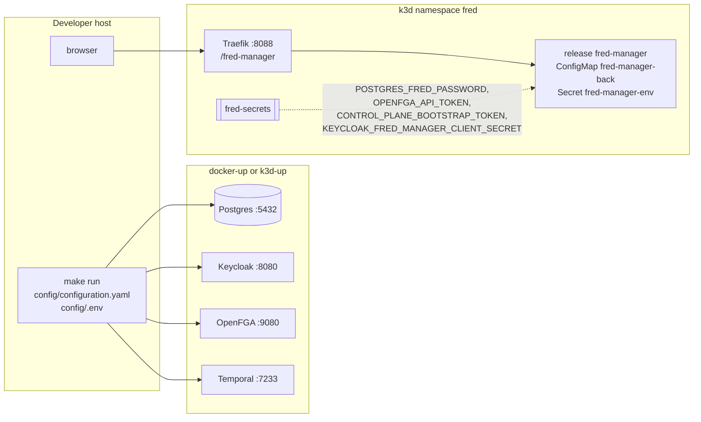

# Reference: manager operations

Configuration, diagnostics and runtime topology of manager within Fred's shared
infrastructure. Developer commands also live in the [component README](../../apps/fred-manager/README.md).

## Logging

Structured stdout, in the format shared by Fred's services.

| `app.log_format` | Output |
| --- | --- |
| `json` | One object per line: `severity`, `message`, `timestamp` `{seconds, nanos}`, `logger`, `service` (`fred-manager`), `service_role` (`api`), `category`, `logging.googleapis.com/sourceLocation` (`file`, `line`, `function` = module path), `process`, `thread` |
| `text` | `<rfc3339> <SEVERITY> fred-manager/<logger> <message> key=value ...`, no wrapping, colors only on a terminal without `NO_COLOR` |

- Event fields and request context are top-level and never replace core fields.
  Fields named `token`, `access_token`, `refresh_token`, `id_token`, `authorization`,
  `cookie`, `password`, `secret`, `email`, `user`, `prompt`, `completion`, `content`,
  `body`, `arguments`, `result`, `url` or `signed_url` are dropped (I11).
- Dependencies log from WARNING only, as `Dependency diagnostic`, without their text or
  fields (I11).
- Each request gets `X-Request-ID` and `X-Correlation-ID`; its lines carry
  `request_id`, `correlation_id` and, once authenticated, `user_id`. It ends with one
  event on logger `http`: `METHOD route → status | Nms`, fields `http_method`, `route`
  (template), `http_status`, `duration_ms`, `outcome`; INFO below 400, WARNING for
  other 4xx, ERROR for 5xx; omitted for a successful `/healthz`; `cancelled` when the
  client goes away (I13).
- Acknowledged role writes emit `authz.relation.granted` or `authz.relation.revoked`
  on `fred.security.audit`, with `actor_uid` when known, `subject`, `relation`,
  `resource` and `outcome: succeeded`. This stream is always JSON and includes INFO
  even when the application threshold is WARNING or ERROR. Events precede SQL commit:
  an acknowledged FGA write remains auditable when SQL commit fails (I16).
- A changed personal acceptance emits `terms.accepted` on `fred.security.audit`
  with `actor_uid`, `version` and `outcome: succeeded`, after SQL persistence.
  Repeating an existing acceptance emits no new event.
- A single global filter applies the severity rules; a suppressed dependency probe
  cannot suppress the next application event. A fatal error after startup is one
  ERROR event, `fred-manager stopped`.


## Errors

Every error body is `{"detail": "<message>"}`, as FastAPI.

| Status | When |
| --- | --- |
| 400 | Unknown role name, placement rule broken (I1), malformed multipart import |
| 401 | Missing or invalid bearer ([authentication details](03-security.md#authentication)) |
| 403 | Permission denied (`forbidden`), wrong bootstrap secret, `user_not_accept_gcu` |
| 404 | Unknown id |
| 409 | Unique or foreign-key violation, invariant refusal, bootstrap completed, ingestion already running, `gcu_version_changed` |
| 413 | Import exceeds 50 MiB compressed or 100 MiB expanded |
| 422 | Invalid ZIP/declarations, `not_yet_supported` import format; invalid JSON body (optional ones included), short bootstrap token, half a cursor |
| 503 | Bootstrap or platform-role administration with authentication disabled; grant with no directory or incompatible subject/realm mapping |
| 500 | Anything else, logged, answered `internal error` |


## Configuration

`CONFIG_FILE` (default `./config/configuration.yaml`) holds the settings, in sections
`app`, `security`, `storage`, `scheduler`; `ENV_FILE` (default `./config/.env`) holds
secrets only and never overrides the process environment.

| Secret | Read from |
| --- | --- |
| `FRED_POSTGRES_PASSWORD` | process or `.env` |
| `OPENFGA_API_TOKEN` | the variable `security.rebac.token_env_var` names |
| `KEYCLOAK_FRED_MANAGER_CLIENT_SECRET` | the variable `security.m2m.secret_env_var` names |
| `FRED_BOOTSTRAP_TOKEN` | the variable `app.bootstrap_token_env_var` names |

Local reference configuration:

<!-- generated: include apps/fred-manager/config/configuration.yaml yaml -->
```yaml
# fred-manager on the host, against the local stack of fred-deployment-factory.
# Secrets come from config/.env.

app:
  gcu_version: v1
  name: Fred Manager
  base_url: /fred-manager/v1
  address: 0.0.0.0
  port: 8400
  log_level: info
  log_format: text
  # One-time root platform-admin bootstrap secret, from config/.env.
  bootstrap_token_env_var: FRED_BOOTSTRAP_TOKEN

security:
  profile: c3
  m2m:
    enabled: true
    client_id: fred-manager
    secret_env_var: KEYCLOAK_FRED_MANAGER_CLIENT_SECRET
    realm_url: http://localhost:8080/realms/app
  user:
    enabled: true
    realm_url: http://localhost:8080/realms/app
    client_id: app
  authorized_origins:
    - http://localhost:5173
  rebac:
    type: openfga
    api_url: "http://localhost:9080"
    store_name: fred-manager

storage:
  postgres:
    host: localhost
    port: 5432
    database: fred
    username: fred

scheduler:
  temporal:
    host: localhost:7233
    namespace: default
    task_queue: fred-ingestion
```
<!-- end generated -->


## Outbound Keycloak directory

`security.m2m.enabled` enables the manager's own client-credentials identity, configured
by `realm_url`, `client_id` and `secret_env_var`. An issuer-only legacy m2m section does
not enable directory access. User bearer verification and service credentials remain
separate. Platform grants require Keycloak authentication with `claims.uid: sub` and
the same normalized user/directory realm; revocations remain available for stale grants.

The shared client rejects redirects and uses a five-second request timeout. A synchronized
process-local cache renews the service token five seconds before expiry; a 401 invalidates
that token and retries once. Errors expose operation and status, never upstream bodies,
credentials or raw transport diagnostics. User lookup encodes the subject as a path segment.


## Import boundary and feedback

The CLI reads the operator bearer from a file, separately from the service-client
secret. HTTP accepts exactly one multipart `file` after verified platform-admin
authority. The ZIP parser accepts stored/deflated entries without extraction,
checks actual expanded bytes and rejects duplicate/path-bearing entries, inconsistent
headers, symlinks, encryption and corrupt data. Archive size is 50 MiB; expanded
data totals at most 100 MiB. The HTTP body limit adds 64 KiB for multipart framing.
Parsing runs on a blocking worker. Old formats return 422 `not_yet_supported`.
HTTP maps operator authentication to 401, authority to 403, invalid declarations
to 422, state/revision conflicts to 409, unavailable dependencies to 503 and internal
SQL failures to 500. Importer failures contain static reasons and safe counts, never dependency
diagnostics or input values. HTTP upload, parsing and initial authorization
failures contain a `detail` without reconciliation counts.
CLI initialization and validation failures report zero counters and no provisioning writes,
including configuration/file errors before logging starts. Bundle types do not implement
Debug or Serialize. Parsing diagnostics do not echo input
values; provisioning failures report a safe phase and acknowledgment counts, and the CLI exits
nonzero. Counts cover resolved/created identities, committed reconciled spaces and
acknowledged grants; a lost response can leave uncounted remote effects. Success returns
these counts as one JSON object (stdout or HTTP 200). The recovery action after a partial failure is replay
with a valid operator token, after correcting the cause. Created identities are not deleted
as compensation. `create-org` retains its operator/database trust boundary.

## Deployment topology

Both stories run against the infrastructure of fred-deployment-factory. fred-manager
creates its tables (sqlx migrations) and its OpenFGA store at startup; the Keycloak
realm starts empty.



| | Host run | k3d release |
| --- | --- | --- |
| Start | `make run` in `apps/fred-manager` | `make k3d-app DIR=../fred/apps/fred-manager` in the factory |
| Configuration | `config/configuration.yaml`, `log_format: text` | values `configuration`, rendered to ConfigMap `fred-manager-back`, `log_format: json` |
| Secrets | `config/.env` | `fred-secrets`, as `extraEnvVars` |
| Addresses | `localhost` ports | `postgres`, `openfga:9080`, `temporal:7233`, `keycloak:8080` |
| Token issuer accepted | `http://localhost:8080/realms/app` | `http://keycloak:8080/realms/app` (hosts entry `127.0.0.1 keycloak`) |
| Public URL | `http://localhost:8400/fred-manager/v1` | `http://localhost:8088/fred-manager/v1` |
| Bootstrap secret | `FRED_BOOTSTRAP_TOKEN` in `.env` | `CONTROL_PLANE_BOOTSTRAP_TOKEN` of `fred-secrets`, generated with the cluster |

The release uses fred's own chart (`deploy/charts/fred`) with every other application
disabled, through `apps/fred-manager/deploy/k3d/` (factory contract: `helmfile.yaml.gotmpl`,
`values.yaml`, `build`). `deploy/k3d/chart` links to that chart without its
`values.schema.json`, whose closed application list `helm lint` enforces even with
`--skip-schema-validation`.

The image (`dockerfiles/Dockerfile-prod`) builds the release binary with `protoc` and
`libprotobuf-dev`, then runs it as user 1000 on Debian slim; migrations and the OpenFGA
model are compiled into the binary.

`deploy/k3d/identities.yaml` declares the `fred-manager` confidential service client and
its `realm-management/query-users`, `view-users` and `manage-users` grants. The factory's
`k3d-app` identity reconciliation populates `KEYCLOAK_FRED_MANAGER_CLIENT_SECRET` in
`fred-secrets`; the release consumes it through `extraEnvVars`.
For a host process using this realm, the same client secret goes in `config/.env`.
`docker-up` alone does not consume the application's identity declaration: the directory
requires a provisioned client with these grants, or `security.m2m.enabled: false` to
run without directory-based role grants.

## Running provisioning

Start the compatible service once to initialize SQL migrations and the extended FGA
model, then accept CGU and complete root bootstrap in the UI. CLI import itself never migrates SQL, creates a store
or synchronizes a model. It needs Postgres, OpenFGA and Keycloak; it does not need the
HTTP server or Temporal to remain running. It loads the published store/model IDs.

From `apps/fred-manager`, with the directory client configured and an operator access
token in a private file:

```sh
make build-demo-bundle
make import-provisioning BUNDLE=target/demo-provisioning-bundle.zip TOKEN_FILE=/path/to/operator-token
```

`build-demo-bundle` packages the five checked-in JSON files with Python's standard
ZIP library and atomically replaces its output. `DEMO_PROVISIONING_FIXTURE_DIR`
and `DEMO_BUNDLE_FILE` override source/output paths, including paths with spaces;
no running service is needed. HTTP clients submit the same ZIP as multipart `file`
to `/fred-manager/v1/import-export/import` on the running server.

The bearer must identify a current platform owner, who may declare any platform role
and organization owners.
The operator token is never used to administer Keycloak: that traffic uses the manager's
service identity from `identities.yaml`. Token validity and authority are rechecked during
import; replay after expiry uses a fresh operator token.

## Frontend routing

The frontend uses same-origin `/fred-manager/v1` requests. Vite resolves the
`/fred-manager` prefix before its broad `/fred` rule and proxies to
`VITE_BACKEND_URL_FRED_MANAGER`, default `http://localhost:8400`. Production nginx
proxies `/fred-manager/` to `FRONTEND_FRED_MANAGER_UPSTREAM`, default
`http://fred-manager:8400`, with 3600-second read/send timeouts. It resolves this
optional service at request time, so frontend startup does not require its DNS
name to exist. Local frontend `make docker-run` supplies
`http://host.docker.internal:8400`. Access logs use the bounded `fred-manager`
route family without exposing paths, tokens or upload contents.

## Authorization store publication

`sync_schema_on_init` allows initialization of an entirely empty installation: manager
creates a fresh store, writes its model, initializes the platform guard and publishes
the store/model IDs in one SQL commit. Existing bindings pin the exact model even
when a newer model exists. An installation with spaces, bootstrap state or tuples but
no binding, or a binding whose model differs from the built model, refuses startup:
manager never converts existing authorization data. On a dedicated local k3d, the
[local data reset](08-operations.md) clears manager data and authorization together.
Changing the configured logical store name does not select a different
authorization source behind an existing binding.

## First-user application entry

Manager and frontend from this branch are deployed together. Migration 0005 adds
personal consent storage at manager startup; existing migrations remain intact.
The reference and k3d manager configurations require CGU version `v1`. Legal assets
in the frontend match the configured version; a version change requires renewed
personal acceptance. The frontend depends on manager public configuration before
login and displays a reload action if it is unavailable. Root bootstrap uses the
configured secret and grants no organization membership. The Make ZIP builder and
the UI provisioning page populate explicitly declared memberships. Fred's existing
Home, sidebar and administration console expose this bounded journey; unrelated
product routes are not mounted. Rebuilding the frontend changes presentation only:
existing manager consent, bootstrap and imported data remain valid.
