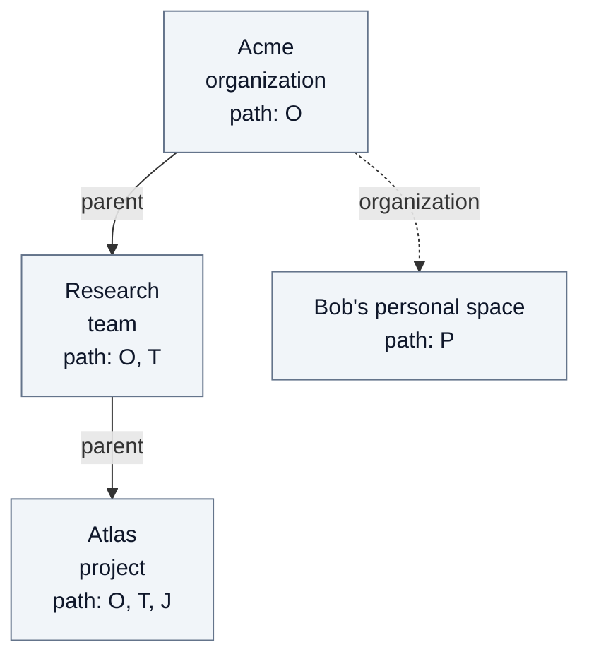

# Reference: organizations, membership and provisioning

Technical companion to [Organizations](04-organizations.md), for Fred developers
and coding assistants. It preserves context resolution, placement, membership,
provisioning and retirement contracts for the Control Plane organization model.
See [Security](03-security.md) for the reader-facing explanation of roles and rights.

## People and organizations

A Fred instance can host several organizations. A person belongs to every
organization where they hold a direct role, and to none before any assignment
(I23). Organizations stay isolated by roles: holding roles in Acme and Globex gives
access in each according to the roles held there, never across them.

| Concept | Meaning |
| --- | --- |
| Identity | The authenticated UID from the configured identity provider, not an email domain or a browser parameter. |
| Organization | Each organization containing at least one of the person's committed direct space roles, including owner and admin roles. |
| Team and project | Selectable workspaces inside an organization, subject to their own permissions. |
| Personal space | A private workspace managed by one organization; a person may have one per organization. Attachment does not create it. |
| Platform role | Authority to administer Fred independently of organization membership; no implicit access to business content. |

`authorization::in_organization` answers whether a person holds any direct role on a space
of an organization, retired rows included. Every granted role counts, including
governance-only roles; attachment itself grants no extra permission. Removing the
last role in an organization removes attachment, subject to the existing
dependent-role rules. Context resolution does not repair or revalidate parent
membership prerequisites for existing grants: those checks run when assigning
roles. An isolated direct project role therefore resolves to its SQL organization
in both context and membership discovery; permission remains a Control Plane decision.

Business reads, authorization probes and mutations check that context as well as
Control Plane permissions: outside an organization, its spaces do not exist for the
caller (404). Unattached people receive no business access; platform-only people
retain their authorized administration paths. `GET /me/spaces` lists the person's
active spaces across all their organizations, each with its `organization_id`.
Team/project selection uses a space identifier; a supplied identifier never changes
server authority.

## Spaces and memberships

An organization is a root. A team belongs to one organization; a project belongs
to one collective team. A personal space has kind `personal`, one owner, no parent and
no project; its organization manages it. Names are unique among siblings and among
organizations; identically named teams in different organizations remain different
spaces. Placement is immutable.

`SpaceKind` and SQL `space_kind` distinguish `organization`, `team`, `project` and
`personal`. SQL requires `personal_owner` exactly for kind `personal` and forbids
its parent. The owner field identifies the person; the SQL role grants remain authoritative
for their grants. Generic space creation refuses `personal`; the dedicated
personal-space operation enforces eligibility and fixed initial member/editor roles.

API creation and ZIP declarations store names in NFC without surrounding whitespace,
then require 1..180 Unicode scalar values without control characters. Inner spaces and
slashes are preserved; these labels are not folder paths. Uniqueness and name resolution
compare this stored form, so names differing only by surrounding whitespace or Unicode
composition collide. Invalid API names return 422, and invalid ZIP
declarations are rejected before external writes. Existing names are not rewritten.

Owner, editor, analyst and member apply only to their granted space. An
organization role grants no access to a team or project. An owner manages only
that space and creates its children, naming their owner, without receiving a role
there. Owner alone grants no content access.

A role on a child requires a direct content role on its parent: a person holds
member, editor or analyst on a team before holding a project role. A personal
space accepts no additional member and inherits
nothing; its organization can revoke its owner's access, and the owner leaves the
organization only after leaving the personal space and removing their remaining organization roles. Every non-personal space
retains an owner.

Personal spaces are available to anyone holding a business role (owner, member,
editor or analyst) on an active organization, team or project in their organization.
A technical admin role alone does not qualify; combining it with a business role is
allowed. First activation creates one private workspace; later openings reuse it
while that eligibility and personal read authority remain current. Losing the last
business role hides the space and refuses new Control Plane access without erasing
its data; restoring a business role makes the same space available again. A missing
organization link is refused (409) rather than repaired or duplicated. No personal
space is created by import or organization creation. In the demo, everyone except
Oscar and Olivia is eligible. See the [personal-space journey](02.1-user-journeys.md#carl-opens-his-personal-space).

SQL stores each space's identity, kind, name, personal owner and immutable placement:
`organization_id` is the root's own ID for an organization, and the containing
organization for every other space. `parent_id` is null for roots and personal
spaces, the organization for a team, and the team for a project. Creation validates
parent kinds and writes placement and initial direct roles atomically.
Permission evaluation reads only grants on the requested space. Personal spaces have no parent and
inherit nothing. Corpus scope contains only readable anchor/ancestor spaces;
level selection can remove candidates but never add them.

| Bob's scope requested from | Search scope (`space_id` in) |
| --- | --- |
| Research | Acme, Research |
| Atlas | Acme, Research, Atlas |
| Atlas, levels `project` | Atlas |
| Bob's personal space | Bob's personal space |

Bob reads Acme, Research and Atlas through his own direct roles, so each ancestor
is included. An ancestor the caller cannot read directly is left out. The letters
stand for canonical space IDs, not display-name paths.

A caller may restrict a scope to `organization`, `team`, `project` or `personal`;
levels only remove spaces from it. `team` excludes personal spaces. Retention
selectors use the same strict distinction; selecting both requires both kinds.

Folders classify only and carry no rights. Document metadata inherits its owning
space's authority; read and scope probes use immutable space identifiers.

### Owner-only team management

The Nova exercise uses `owner` + `member` on Nova and only `owner` on Pilote.
Management and content reads are separate Control Plane decisions. The UI's neutral
`/team/:teamId` entry opens agents when `read` is allowed, otherwise the membership
page when `manage` is allowed. The team sidebar exposes settings through the same
`manage` decision and does not mount the conversation list without current `read`.
Direct URLs remain subject to the page and API checks.

`TeamSettingsPage` now uses Weaver's generated client for membership management,
replacing its legacy Swift capability/charter gate. Its first integrated scope is
listing members, listing eligible parent members, and adding/removing individual
roles. Checkboxes are independent and apply immediately; no role is synthesized
on entry or after granting owner. Renaming, project creation, invitations, retention
and model routing are not added to this membership screen. Former settings
subsection URLs resolve to the membership page rather than legacy Swift controls.

| API (prefix `/control-plane/v1`) | Contract |
| --- | --- |
| `GET /spaces/{id}/members` | Direct holders and roles on a team/project, after current `Manage`; 50 people per page with an exclusive subject cursor. |
| `GET /spaces/{id}/member-candidates` | Same authority; candidates hold a direct content role on the managed space's parent. Returned roles are on the managed space, not the parent. No global SSO directory search. |
| `PUT` / `DELETE /spaces/{id}/roles/{role}/{user}` | Existing grant/revoke authority and transactions. Parent eligibility, known identity, last-owner protection and dependent-child safeguards remain enforced. |

[space_members.rs](../../apps/control-plane/src/space_members.rs) reads grants and
candidate eligibility in a read-only repeatable-read transaction. It releases SQL
before bounded directory enrichment (15 seconds), then rechecks current Manage and
lifecycle before returning. Display profiles confer no authority. There is no new
table, migration, identity provisioning or change to the permission matrix.
[spaces.rs](../../apps/control-plane/src/spaces.rs) remains the mutation owner.
The generated-client cache invalidates rosters, memberships and access decisions
after grant/revoke attempts, including refusals; cached permission alone cannot
enable a mutation while authorization is being rechecked.

The focused `owner_only_team_membership_governance` PostgreSQL integration test
covers owner-only access, rejected member/parent-owner/platform-admin access,
parent candidates, cumulative grants, last-owner protection, lost management and
pagination. Frontend tests cover landing, role controls, refusals and sidebar
content-query isolation. These checks are not deployed browser validation; the Nova
functional validation exercise must be repeated after rebuilding Control Plane and frontend.

## Organization supervision

Supervision is a stateless read module inside Control Plane, exposed by two GET
routes in [the REST inventory](A12-control-plane-api.md#organizations-routes).
It introduces no process, statistics table, cache or worker and performs no physical
S3/OpenSearch read. Standard `AdmittedUser` admission can refresh the existing local
identity snapshot; the supervision module itself makes no writes.

### Authorization and disclosure boundary

`authorization::load_facts` loads the organization, its activity and the caller's
organization context and direct roles in one statement. Supervision checks the
organization kind and calls `authorization::decide` for `administer_organization`. The model grants this
permission only through `organization_admin`. No platform, owner or content role
substitutes for it. A caller holding several roles is allowed when technical administration is
among them; no content permission is additionally required.

Admission errors retain the shared contract. A missing/foreign organization or
non-organization target gives 404; ambiguous caller context gives 409; a retired
organization gives 409 `space_pending_deletion`; missing technical administration in the matching
context gives 403. After organization authorization, team detail rejects a missing,
foreign or non-team target with 404 and a retired team with 409. A failed SQL context, permission or grant read gives 503 `dependency_unavailable` without
partial counts. SQL lifecycle is rechecked inside the collection transaction.

Responses expose organization/team UUIDs, collective team names, collection
timestamps and counts.
They contain no document identifiers, names, content, artifact paths, download
links or user identities. Personal space identifiers and names are not returned.
Aggregate values can still reveal resource volumes and activity; access is therefore
restricted to organization governance rather than ordinary content readers.

### Scope and counter definitions

`organization_direct`, `teams_total` and `personal_total` partition resource counts.
Teams include their projects. The organization summary includes every SQL space
with the exact `organization_id`; team detail selects the team and its projects
within that organization. Active metrics and role enumeration exclude retired
spaces. Retired documents remaining in SQL, including those in retired spaces,
contribute only to `pending_purge`. Retired teams are absent from team pages but
their remaining documents contribute to organization-level purge totals.

| Output | Canonical source and counting rule | Meaning and exclusions |
| --- | --- | --- |
| `active_teams` | Active SQL spaces of kind `team` | Excludes personal spaces, projects and retired teams |
| `active.documents`, `active.bytes` | Count and sum of `document.size` where both document and owning space have null `deletion_id` | Original metadata only; no upload reservations or derived bytes |
| `pending_purge` | Remaining document rows retired directly or through their owning space, and their original sizes | Logical pending volume, not physical objects or accumulated deletion receipts |
| `processing` | Latest attempt per active document ordered by `(created_at DESC, id DESC)`, grouped by pending/running status and stage | Absent pairs mean zero; no worker-health inference |
| `failed_documents` | Latest attempt is failed | Historical failures replaced by another attempt do not count |
| `published.documents`, `chunks`, `vectors` | Unique succeeded attempt per active document; committed column sums | Independent of latest attempt; no sum of generations, extracted fragments or physical index query |
| `published.tabular_datasets` | Count of `datasets/*.parquet` paths in successful manifests, aggregated before joining document counts | Published artifacts, not CSV filenames or persistent SQL tables |
| `known_rows`, `datasets_with_unknown_rows`, `total_rows` | Rows are attributable only when a successful manifest has exactly one Parquet and nonnull rows | Multiple Parquet artifacts or null rows make those datasets unknown; total is null if any are unknown. No dataset means zero; known zero remains zero |
| `distinct_users`, `direct_roles` | All direct SQL grants on active scoped spaces; distinct subjects and distinct `(subject, space, role)` assignments | All five canonical roles; omitted roles mean zero. No SQL-owner-derived grants or IdP active-account inference |

Distinct users are unioned, not summed across roles or compartments. Team role
counts include direct grants on its projects, excluding organization grants.
Personal member/editor assignments are read from PostgreSQL like other grants.
Ingestion refuses reprocessing after success; independent publication selection
does not introduce a new reprocessing capability.

### Pagination, freshness and implementation trace

Team pages are UUID-ascending, at most 100 items. `after` is exclusive; reading
101 rows determines `next_cursor`, null at the end. Organization totals and active
team count ignore the cursor. Pagination is exhaustive on unchanged data; a
concurrent creation below the cursor requires restarting the traversal.

Grouped SQL reads share one REPEATABLE READ READ ONLY transaction. It ends before
grant enumeration. Collection timestamps bound observations, not an atomic
SQL snapshot; concurrent mutations can change visibility between reads.
There is no distributed lock or consistency repair.

Source trace: [handlers and aggregation](../../apps/control-plane/src/supervision/mod.rs),
[wire models](../../apps/control-plane/src/supervision/models.rs),
[SQL snapshot](../../apps/control-plane/src/supervision/store.rs),
[publication aggregation](../../apps/control-plane/src/supervision/counts.sql),
and [paginated direct grants](../../apps/control-plane/src/authorization.rs) (`grants_on`,
`read_keys`, `concurrently`). Regression scenarios are defined in
[organization_console.rs](../../apps/control-plane/tests/support/organization_console.rs)
by the three `supervision_*` tests; source references are not execution evidence.

### Supervision UI

`/admin/supervision` is an organization area inside the existing frontend layout.
Its navigation entry precedes Features. The shared
[access provider](../../apps/frontend/src/rework/core/hooks/useOrganizationSupervisionAccess.tsx)
resolves the organization through `/me/spaces` and calls `/authorize/space` with
`administer_organization`; neither platform roles nor membership role names establish
permission. The page applies the same decision for direct URL access. ManagerArea
admits this independently guarded route for mixed platform/organization roles.
No content role or selected team is required.

The [page](../../apps/frontend/src/rework/components/pages/OrganizationSupervisionPage/OrganizationSupervisionPage.tsx)
uses the generated RTK summary and detail hooks through the existing enhancement
module. Query keys retain organization, cursor and team. A context change remounts
the page, discarding cursor and detail selection; `currentData` prevents reuse of
another query's values. A failed read displays an error, not zero counts, and
hides the affected values. A detected authorization refusal also withdraws the
shared permission decision. Successful-load dates come from successful RTK results.

Refresh and window focus recheck context and permission before metric subscriptions
resume and refetch, including an open detail. There is no supervision polling;
organization-owner navigation polling is disabled on this route. The team table
uses previous/next cursor navigation without global sorting or numbered pages.
Organization totals come directly from the same summary response, independently
of its team page. Detail collection timestamps remain separate.

[SupervisionCountsView](../../apps/frontend/src/rework/components/pages/OrganizationSupervisionPage/SupervisionCountsView.tsx)
shares the presentation between totals, compartments and the team drawer. A compact
summary exposes organization metrics and activity states; a three-row table compares
resource compartments. Complementary counts and direct roles remain available in
collapsible sections. The team drawer uses the same compact summary. It keeps
purge, failed attempts, publications and direct assignments distinct; unknown row
totals show their known subtotal and number of datasets without an attributable
row count. Personal spaces remain aggregated. Existing PageHeader, StatusBadge,
DataTable, Disclosure, InlineDrawer, navigation, buttons and formatters provide the
UI controls, with French and English translations.

## Platform organization administration

The platform registry exposes active organizations, independently of content
membership, in pages of at most 100 names/identifiers. Only admitted platform admins
can list or create them. The form searches candidates after two characters and
lets the platform admin select each contact independently. Keycloak searches the realm;
the local OIDC directory searches personal profiles already observed during
authenticated onboarding, before or after consent, by literal case-insensitive prefix
of username, first name, last name or email. HTTP creation resolves the exact existing owner/admin
usernames and writes those two direct roles, with no implicit member grant. One
account may hold both roles, and may already belong to other organizations. Name
uniqueness is rechecked under the platform lock before guarded publication.
Retired organizations reserve their name until cleanup, and are absent from the list.
Organization creation does not create a personal space.

## Provisioning people and spaces

The ZIP explicitly declares identities, organizations, teams, projects and roles.
An empty projects array is valid. The [declaration contract](A2-manager-contracts.md#provisioning-declarations)
is the exact wire reference; the [user journey](02.1-user-journeys.md#from-an-empty-platform-to-an-organizations-first-user)
shows its observable effects.

Whole-bundle preflight rejects predictable errors before provisioning writes,
including contradictory organization assignments, noncanonical usernames and known
effective-email conflicts for new identities. Existing attachments are checked again
after capturing the guards before publishing each organization subtree. Usernames are never silently normalized.
Organizations resolve by root name, teams by organization/name and projects by
team/name. Existing identity fields, passwords, committed space IDs and undeclared
roles are preserved. Requested grants are repaired; no content role or CGU
acceptance is invented. A new organization declares at least one owner and one
admin, possibly the same person; organization admin is refused on teams and projects. Import
requires a platform admin, authenticated once at admission and rechecked before each
write; bearer expiry after admission does not interrupt it.

Keycloak and PostgreSQL do not share a transaction. An error can leave
created identities or previously committed grants; replay follows correction of the cause
and never reuses rolled-back space IDs. A successful report counts resolved and
created identities, committed reconciled spaces and acknowledged grants. HTTP 200
means reconciliation completes. The [import sequence](A1-manager-runtime.md#authenticated-provisioning-import)
details these boundaries.

## Leaving, deleting and transferring ownership

A platform admin retires a project, an ordinary team with its projects, or an
organization with all ordinary and personal descendants. Retirement closes access
immediately; physical cleanup follows the configured delay. Accounts, consent and
platform roles survive. Document-bearing scopes are refused before any retirement.

SQL stores the operation, retired row IDs and an immutable root-parent snapshot
for recovery and pending name reservation. This snapshot never authorizes access.
Names remain reserved while their rows are pending.
Overlapping parent/child requests conflict; replay of the same UUID returns its
receipt. Cleanup removes descendants before parents, retaining rows until external
references are absent. SQL parent/organization foreign keys also prevent removing
a parent while a child row remains. Descendant discovery and role cleanup use SQL. [Runtime](A1-manager-runtime.md#space-deletion-lifecycle)
and [operations](A3-manager-operations.md#space-deletion-lifecycle) describe execution.

