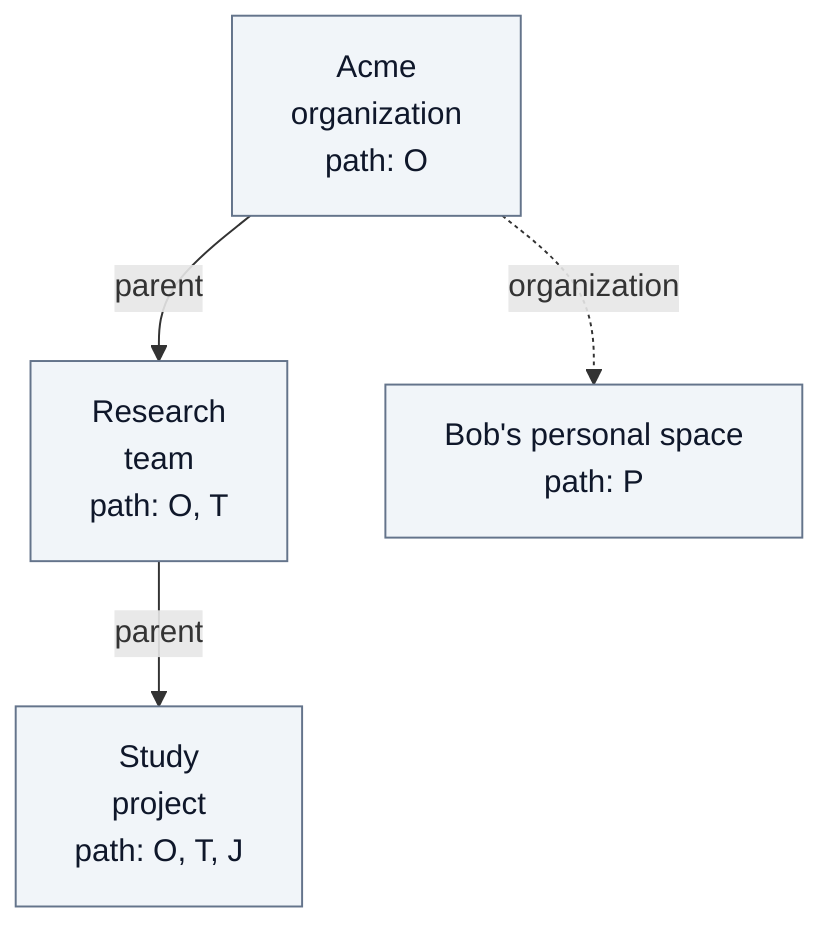

# Reference: organizations, membership and provisioning

Technical companion to [Organizations](04-organizations.md), for Fred developers
and coding assistants. It preserves context resolution, placement, membership,
provisioning and retirement contracts for the Control Plane organization model.
See [Security](03-security.md) for the reader-facing explanation of roles and rights.

## One person, one organization

A Fred instance can host several organizations, but a person belongs to at most one
of them (I23). Before assignment, the person belongs to none. An organization is the
person's business context, not a space selector or a login preference.

| Concept | Meaning |
| --- | --- |
| Identity | The authenticated UID from the configured identity provider, not an email domain or a browser parameter. |
| Organization | The unique organization containing the person's committed direct space roles, including owner and admin roles. |
| Team and project | Selectable workspaces inside that organization, subject to their own permissions. |
| Personal space | A private workspace managed by the same organization; attachment does not create it. |
| Platform role | Authority to administer Fred independently of organization membership; no implicit access to business content. |

Manager reads all pages of canonical OpenFGA direct roles, then resolves their
distinct organization IDs with one SQL query over existing space rows, including
retired rows. Tuples without a SQL row confer no attachment. SQL holds immutable
placement, not a second membership record.
Every granted role counts towards attachment, including governance-only roles;
attachment itself grants no extra permission. The same resolver validates
`/me/spaces`, which subsequently excludes retired spaces from display. An empty
visible list does not free a person from an attachment retained during deletion.
Removing the last role in an
organization removes attachment, subject to the existing dependent-role rules.
Context resolution does not repair or revalidate parent membership prerequisites
for existing grants: those checks run when assigning roles. An isolated direct
project role therefore resolves to its SQL organization in both context and
membership discovery; permission remains an OpenFGA decision.

Bob's provisioning roles attach him to Acme. After authentication and personal CGU,
`GET /me/spaces` returns his authorized memberships within that context. Home
retains its usual dashboard and team/personal navigation at `/home`; the organization
name appears in Profile. Team/project selection uses a space identifier. There is
no organization picker, switch or organization identifier in the landing URL. A supplied identifier never
changes server authority. An explicit invalid space selection shows no space.

Creation, direct grants and ZIP import reject a second organization attachment,
including concurrent attempts. Business reads, authorization probes and mutations
check context as well as OpenFGA permissions. Unattached people receive no business
access; platform-only people retain their authorized administration paths.
Contradictory existing grants cause a conflict, not an arbitrary tenant choice.
Admins can remove unwanted grants using the existing revocation rules;
no data or roles are automatically removed. See [operations](A3-manager-operations.md#organization-conflict-recovery).

## Spaces and memberships

An organization is a root. A team belongs to one organization; a project belongs
to one collective team. A personal space has kind `personal`, one owner, no parent and
no project; its organization manages it. Names are unique among siblings and among
organizations; identically named teams in different organizations remain different
spaces. Placement is immutable.

`SpaceKind` and SQL `space_kind` distinguish `organization`, `team`, `project` and
`personal`. SQL requires `personal_owner` exactly for kind `personal` and forbids
its parent. The owner field identifies the person; OpenFGA remains authoritative
for their grants. Generic space creation refuses `personal`; the dedicated
personal-space operation enforces eligibility and fixed initial member/editor roles.

API creation and ZIP declarations store names in NFC without surrounding whitespace,
then require 1..180 Unicode scalar values without control characters. Inner spaces and
slashes are preserved; these labels are not folder paths. Uniqueness and name resolution
compare this stored form, so names differing only by surrounding whitespace or Unicode
composition collide. Invalid API names return 422, and invalid ZIP
declarations are rejected before external writes. Existing names are not rewritten.

Editor, owner and analyst reach every descendant space; member stays local. An
analyst of an organization therefore sees all its teams and projects, and a
project cannot be hidden from its team's editors, owners or analysts.
Management and content roles remain separate: an owner manages the space
and its descendants and reads none of their content without a content role.

A role on a child requires a direct content role on its parent: a person is a
member of a team before holding a project role, even when an ancestor role already
lets them read the team. A personal space accepts no additional member and inherits
nothing; its organization can revoke its owner's access, and the owner leaves the
organization only after leaving the personal space and removing their remaining organization roles. Every non-personal space
retains an owner.

Personal spaces are available to business owners of an active organization, team
or project in their organization. Technical admins alone, members, editors and
analysts do not qualify. Combining a technical admin role with business ownership
is allowed. First activation creates one private workspace; later openings reuse
it while ownership and personal read authority remain current. Losing the last
owner role hides the space and refuses new Control Plane access without erasing
its data; restoring ownership makes the same space available again. A missing
organization link is refused (409) rather than repaired or duplicated. No personal
space is created by import or organization creation.
The demo makes Alice, Grace, Carl and Marc eligible through their existing owner
roles. See the [personal-space journey](02.1-user-journeys.md#carl-opens-his-personal-space).

SQL stores each space's identity, kind, name, personal owner and immutable placement:
`organization_id` is the root's own ID for an organization, and the containing
organization for every other space. `parent_id` is null for roots and personal
spaces, the organization for a team, and the team for a project. Creation validates
parent kinds and writes these values before publishing matching FGA links and roles;
the SQL transaction commits only after FGA acceptance. Failed commits leave no SQL
attachment even if FGA accepted the tuples.

OpenFGA retains the `parent` links its model evaluates. A personal space has an
`organization` link instead, which no permission uses. Paths are derived from SQL
placement without FGA placement Reads: ancestors then self, or just self for a
personal space. Current permission still requires an OpenFGA Check.

| Scope requested from | Search scope (`space_id` in) |
| --- | --- |
| Research | Acme, Research |
| Study | Acme, Research, Study |
| Study, levels `project` | Study |
| Bob's personal space | Bob's personal space |

The letters stand for canonical space IDs, not display-name paths. This example
introduces Study as a project in Research and assumes Bob's personal-space
eligibility explicitly; neither is created merely by signing in.

A caller may restrict a scope to `organization`, `team`, `project` or `personal`;
levels only remove spaces from it. `team` excludes personal spaces. Retention
selectors use the same strict distinction; selecting both requires both kinds.

Folders classify only and carry no rights. Document metadata inherits its owning
space's authority; read and scope probes use immutable space identifiers.

## Organization supervision

Supervision is a stateless read module inside Control Plane, exposed by two GET
routes in [the HTTP catalogue](A2-manager-contracts.md#organization-supervision-api).
It introduces no process, statistics table, cache or worker and performs no physical
S3/OpenSearch read. Standard `AdmittedUser` admission can refresh the existing local
identity snapshot; the supervision module itself makes no writes.

### Authorization and disclosure boundary

`supervision::authorize` loads an organization, resolves the caller's unique
organization through `spaces::in_organization`, checks retirement, then asks
OpenFGA for `can_administer_organization` on that organization. The model grants this
permission only through `organization_admin`. No platform, owner or content role
substitutes for it. A caller holding several roles is allowed when technical administration is
among them; no content permission is additionally required.

Admission errors retain the shared contract. A missing/foreign organization or
non-organization target gives 404; ambiguous caller context gives 409; a retired
organization gives 409 `space_pending_deletion`; missing technical administration in the matching
context gives 403. After organization authorization, team detail rejects a missing,
foreign or non-team target with 404 and a retired team with 409. A failed OpenFGA
context read, admin Check or grant page gives 503 `dependency_unavailable` without
partial counts. SQL lifecycle is rechecked inside the collection transaction.

Responses expose organization/team UUIDs, collective team names, collection
timestamps and counts.
They contain no document identifiers, names, content, artifact paths, download
links or user identities. Personal space identifiers and names are not returned.
Aggregate values can still reveal resource volumes and activity; access is therefore
restricted to organization governance rather than ordinary content readers.

### Scope and counter definitions

`organization_direct`, `teams_total` and `personal_total` partition resource counts.
Teams include their projects. The organization summary includes every SQL space
with the exact `organization_id`; team detail selects the team and its projects
within that organization. Active metrics and role enumeration exclude retired
spaces. Retired documents remaining in SQL, including those in retired spaces,
contribute only to `pending_purge`. Retired teams are absent from team pages but
their remaining documents contribute to organization-level purge totals.

| Output | Canonical source and counting rule | Meaning and exclusions |
| --- | --- | --- |
| `active_teams` | Active SQL spaces of kind `team` | Excludes personal spaces, projects and retired teams |
| `active.documents`, `active.bytes` | Count and sum of `document.size` where both document and owning space have null `deletion_id` | Original metadata only; no upload reservations or derived bytes |
| `pending_purge` | Remaining document rows retired directly or through their owning space, and their original sizes | Logical pending volume, not physical objects or accumulated deletion receipts |
| `processing` | Latest attempt per active document ordered by `(created_at DESC, id DESC)`, grouped by pending/running status and stage | Absent pairs mean zero; no worker-health inference |
| `failed_documents` | Latest attempt is failed | Historical failures replaced by another attempt do not count |
| `published.documents`, `chunks`, `vectors` | Unique succeeded attempt per active document; committed column sums | Independent of latest attempt; no sum of generations, extracted fragments or physical index query |
| `published.tabular_datasets` | Count of `datasets/*.parquet` paths in successful manifests, aggregated before joining document counts | Published artifacts, not CSV filenames or persistent SQL tables |
| `known_rows`, `datasets_with_unknown_rows`, `total_rows` | Rows are attributable only when a successful manifest has exactly one Parquet and nonnull rows | Multiple Parquet artifacts or null rows make those datasets unknown; total is null if any are unknown. No dataset means zero; known zero remains zero |
| `distinct_users`, `direct_roles` | All direct OpenFGA grants on active scoped spaces; distinct subjects and distinct `(subject, space, role)` assignments | All five canonical roles; omitted roles mean zero. No effective/inherited roles, SQL-owner-derived grants or IdP active-account inference |

Distinct users are unioned, not summed across roles or compartments. Team role
counts include direct grants on its projects but not inherited organization grants.
Personal member/editor assignments are read from OpenFGA like other grants.
Ingestion refuses reprocessing after success; independent publication selection
does not introduce a new reprocessing capability.

### Pagination, freshness and implementation trace

Team pages are UUID-ascending, at most 100 items. `after` is exclusive; reading
101 rows determines `next_cursor`, null at the end. Organization totals and active
team count ignore the cursor. Pagination is exhaustive on unchanged data; a
concurrent creation below the cursor requires restarting the traversal.

Grouped SQL reads share one REPEATABLE READ READ ONLY transaction. It ends before
grant enumeration. Collection timestamps bound observations, not an atomic
SQL/OpenFGA snapshot; concurrent mutations can change visibility between reads.
There is no distributed lock or consistency repair. The
[read budget](09-quality.md#organization-supervision-read-budget) separates SQL
and OpenFGA costs and cardinalities.

Source trace: [handlers and aggregation](../../apps/control-plane/src/supervision/mod.rs),
[wire models](../../apps/control-plane/src/supervision/models.rs),
[SQL snapshot](../../apps/control-plane/src/supervision/store.rs),
[publication aggregation](../../apps/control-plane/src/supervision/counts.sql),
and [paginated direct grants](../../apps/control-plane/src/fga.rs) (`grants_on`,
`read_keys`, `concurrently`). Regression scenarios are defined in
[organization_console.rs](../../apps/control-plane/tests/support/organization_console.rs)
by the three `supervision_*` tests; source references are not execution evidence.

### Supervision UI

`/admin/supervision` is an organization area inside the existing frontend layout.
Its navigation entry precedes Features. The shared
[access provider](../../apps/frontend/src/rework/core/hooks/useOrganizationSupervisionAccess.tsx)
resolves the organization through `/me/spaces` and calls `/authorize/space` with
`administer_organization`; neither platform roles nor membership role names establish
permission. The page applies the same decision for direct URL access. ManagerArea
admits this independently guarded route for mixed platform/organization roles.
No content role or selected team is required.

The [page](../../apps/frontend/src/rework/components/pages/OrganizationSupervisionPage/OrganizationSupervisionPage.tsx)
uses the generated RTK summary and detail hooks through the existing enhancement
module. Query keys retain organization, cursor and team. A context change remounts
the page, discarding cursor and detail selection; `currentData` prevents reuse of
another query's values. A failed read displays an error, not zero counts, and
hides the affected values. A detected authorization refusal also withdraws the
shared permission decision. Successful-load dates come from successful RTK results.

Refresh and window focus recheck context and permission before metric subscriptions
resume and refetch, including an open detail. There is no supervision polling;
organization-owner navigation polling is disabled on this route. The team table
uses previous/next cursor navigation without global sorting or numbered pages.
Organization totals come directly from the same summary response, independently
of its team page. Detail collection timestamps remain separate.

[SupervisionCountsView](../../apps/frontend/src/rework/components/pages/OrganizationSupervisionPage/SupervisionCountsView.tsx)
shares the presentation between totals, compartments and the team drawer. A compact
summary exposes organization metrics and activity states; a three-row table compares
resource compartments. Complementary counts and direct roles remain available in
collapsible sections. The team drawer uses the same compact summary. It keeps
purge, failed attempts, publications and direct assignments distinct; unknown row
totals show their known subtotal and number of datasets without an attributable
row count. Personal spaces remain aggregated. Existing PageHeader, StatusBadge,
DataTable, Disclosure, InlineDrawer, navigation, buttons and formatters provide the
UI controls, with French and English translations.

## Platform organization owneristration

The platform registry exposes active organizations, independently of content
membership, in pages of at most 100 names/identifiers. Only admitted platform admins
can list or create them. The form searches candidates after two characters and
lets the platform admin select each contact independently. Keycloak searches the realm;
the local OIDC directory searches personal profiles already observed during
authenticated onboarding, before or after consent, by literal case-insensitive prefix
of username, first name, last name or email. HTTP creation resolves the exact existing owner/admin
usernames and writes those two direct roles, with no implicit member grant. One
account may hold both roles. Name uniqueness and each nominee's single organization
attachment are rechecked under the platform lock before guarded publication.
Retired organizations reserve their name until cleanup, and are absent from the list.
Organization creation does not create a personal space.

## Provisioning people and spaces

The ZIP explicitly declares identities, organizations, teams, projects and roles.
An empty projects array is valid. The [declaration contract](A2-manager-contracts.md#provisioning-declarations)
is the exact wire reference; the [user journey](02.1-user-journeys.md#from-an-empty-platform-to-an-organizations-first-user)
shows its observable effects.

Whole-bundle preflight rejects predictable errors before provisioning writes,
including contradictory organization assignments, noncanonical usernames and known
effective-email conflicts for new identities. Existing attachments are checked again
after capturing the guards before publishing each organization subtree. Usernames are never silently normalized.
Organizations resolve by root name, teams by organization/name and projects by
team/name. Existing identity fields, passwords, committed space IDs and undeclared
roles are preserved. Requested grants are repaired; no content role or CGU
acceptance is invented. A new organization declares at least one owner and one
admin, possibly the same person; organization admin is refused on teams and projects. Import
requires a platform admin, authenticated once at admission and rechecked before each
write; bearer expiry after admission does not interrupt it.

Keycloak, PostgreSQL and OpenFGA do not share a transaction. An error can leave
created identities or acknowledged grants; replay follows correction of the cause
and never reuses rolled-back space IDs. A successful report counts resolved and
created identities, committed reconciled spaces and acknowledged grants. HTTP 200
means reconciliation completes. The [import sequence](A1-manager-runtime.md#authenticated-provisioning-import)
details these boundaries.

## Leaving, deleting and transferring ownership

A platform admin retires a project, an ordinary team with its projects, or an
organization with all ordinary and personal descendants. Retirement closes access
immediately; physical cleanup follows the configured delay. Accounts, consent and
platform roles survive. Document-bearing scopes are refused before any retirement.

SQL stores the operation, retired row IDs and an immutable root-parent snapshot
for recovery and pending name reservation. This snapshot never authorizes access.
Names remain reserved while their rows are pending, even after FGA link removal.
Overlapping parent/child requests conflict; replay of the same UUID returns its
receipt. Cleanup removes descendants before parents, retaining rows until external
references are absent. SQL parent/organization foreign keys also prevent removing
a parent while a child row remains. Missing FGA links are not repaired by the SQL
placement copy; a child omitted from FGA discovery can therefore prevent cleanup
of its parent until the inconsistent state is resolved. [Runtime](A1-manager-runtime.md#space-deletion-lifecycle)
and [operations](A3-manager-operations.md#space-deletion-lifecycle) describe execution.

