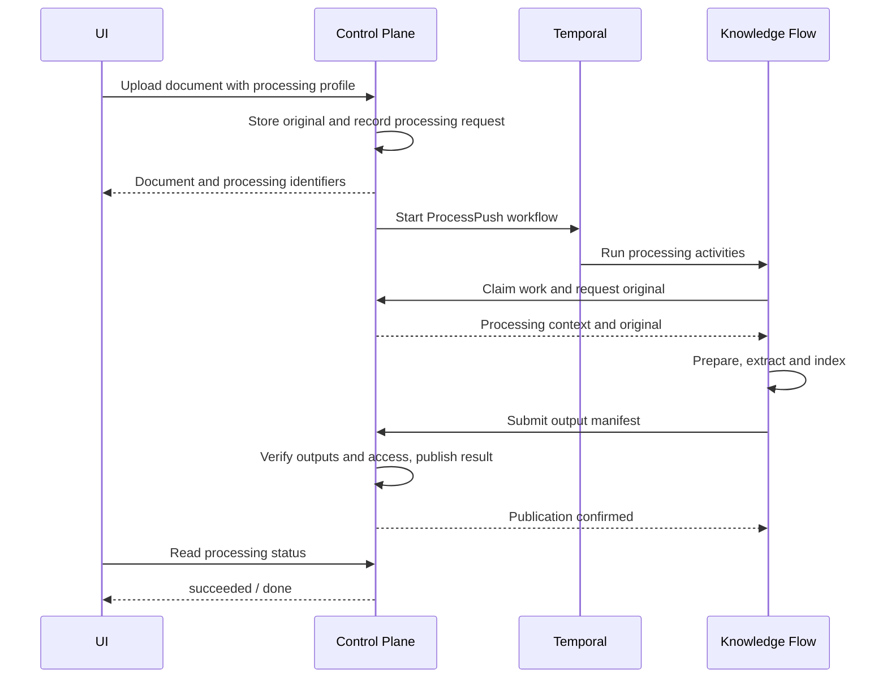
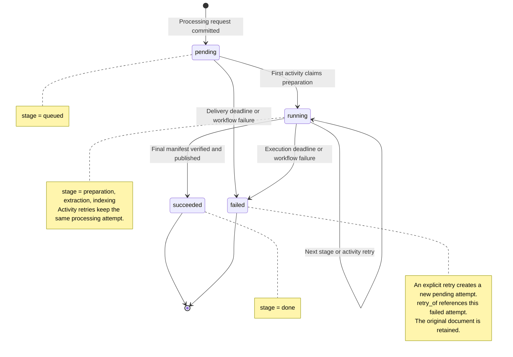

# Reference: document storage and processing

Technical companion to [Documents and knowledge](05-documents.md), for Fred
developers and coding assistants. It preserves storage layout, upload and retry
contracts, processing states, publication and cleanup mechanisms for the
Control Plane document path. The [document journey trace](A4-document-journey.md)
provides a concrete example and read-only inspection commands. The final section
maps the separate [conversation-document implementation](#documents-authored-in-a-conversation).

## Classification and content ownership

A space owns its folder tree, document registry and stored originals. Manager owns
their identity, storage lifecycle and processing receipts. Knowledge Flow workers
own extraction and output algorithms. Upload-only requires no ingestion service;
optional processing dispatches the existing `ProcessPush` workflow through Temporal.
Control Plane owns document placement; Knowledge Flow has no separate tag catalog.

`document` retains identity and placement, `document_content` immutable bytes,
and `document.current_content_id` the current primary content. Processing binds
to an exact content row; `document.published_generation` selects the visible
derived result. `document_current` is the existing joined read view.

A folder has one immutable space and at most one parent in that space. Paths
contain UUIDs, not display names. Renaming changes one label without rewriting
descendants or permissions. Sibling folder names are unique. Document placement
is immutable and its folder belongs to the same space.

## Authority

The owning space is the authorization boundary. Folders and documents have no
individual grants or permission lists. Increasing their number adds no role rows.
Folder depth is limited to 15 independently of the space hierarchy.

Human requests require personal admission, a direct role in the space's organization
and current space authority. Members and effective editors/analysts read; effective
editors write. Admin and owner titles confer no content access. Personal
spaces inherit no organization or team authority. The
[action/role matrix](A7-action-role-matrix.md) defines these distinctions.

A directory's write decision enables existing controls but reserves no right.
Mutations recheck in the SQL transaction holding the organization lock.
Uploads do so twice: when reserving quota/name and when publishing verified content.
Token expiry and current CGU acceptance are rechecked at both boundaries. Request
body and object-storage IO take place outside that lock.

The separate [managed-mirror admission](#managed-mirror-admission) binds a source
worker to a durable run and destination, without giving it a person's roles.

## Navigation and folder lifecycle

Resources uses one combined page of immediate folders and published documents,
plus the requested directory's ancestors, exact matching total and write decision.
Rows, ancestors and total share a read-only repeatable-read SQL snapshot; the
write decision is a separate Control Plane permission evaluation before that transaction. Pages default to 50 rows and
contain at most 200, with folders first, name/date/size sorting and an identity
tie-breaker. Folders have no aggregate size and use name order for size sorting.
Search is a literal case-insensitive substring over the whole current directory.
Separate requests are live views; concurrent changes can shift offset boundaries.

Folder creation/rename stores labels in NFC without surrounding whitespace, then
accepts 1..255 Unicode scalar values and rejects separators and controls. Sibling
uniqueness compares that stored form among active siblings. Placement stays fixed.
The folder deletion implementation now uses the existing lifecycle receipt:
[`Lifecycle::accept_folder`](../../apps/control-plane/src/lifecycle/store.rs)
retires the selected subtree atomically under the exclusive organization guard.
Live documents or pending uploads refuse retirement; documents already retired
keep their own receipt and deadline. `empty_only` additionally refuses live child
folders. Multiple selected roots remain independent.

`DELETE /folders/{id}` returns the durable receipt (202 accepted, 200 on replay
after purge). Active reads and destination checks exclude retired folder IDs;
recreating the same sibling name allocates a new UUID and UUID-based path.
The old receipt cannot target this new folder. The
[folder retirement migration](../../apps/control-plane/migrations/0026_folder_retirement.sql)
extends the existing target-kind constraint and indexes all upload states by
folder; it reuses the existing live-name uniqueness and folder/document indexes.

[`cleanup::batch`](../../apps/control-plane/src/lifecycle/cleanup.rs) purges up to
1,000 eligible leaf folders per visit, only from the operation's manifest. It
waits for document rows, child folders and uncertain or uncleaned uploads to go.
Failed uploads are removed only after storage cleanup is confirmed. Parent folder
and space jobs preserve earlier folder jobs' ownership and retention; retries
never resolve a target by name. Space retirement still refuses stored documents
and pending uploads. Shared content guards and post-lock destination checks stop
waiting uploads, creates, renames and moves from reviving a retired target.

These are implementation contracts awaiting deployed acceptance. Regression
sources cover [SQL lifecycle and parent/child ownership](../../apps/control-plane/tests/support/folder_deletion.rs),
[concurrent HTTP waiters](../../apps/control-plane/tests/integration.rs) and
[recreation followed by original-file purge](../../apps/control-plane/tests/support/document_storage.rs).

## Creating an original

An editor selects files in the existing drawer, including drop and nested-folder
destinations. Each upload targets a named manager folder. The advisory preflight
reports current conflicts and quota; the server makes the final decision under
the organization lock. The drawer starts nonconflicting files and retains conflicts
for explicit skipping. Replacement is visibly unavailable. Each file has an
independent outcome, so one failure does not undo another successful upload.

The server accepts one multipart file per request, up to the configured ceiling
and never above 100 MiB. It streams to a private temporary file with bounded
concurrency, idle and total deadlines, while measuring actual bytes and SHA-256.
The filename is NFC-normalized, case-sensitive and 1..255 Unicode scalar values;
path separators and controls are refused. Filename and reported MIME type are
metadata. The filename is the last object-key component; the complete UTF-8 key
is limited to 1,024 bytes. Neither filename nor MIME is a trusted content type.

One SQL transaction reserves the destination name and bytes in `document_upload`.
Personal and organization spaces have their own quota; a team and its projects
share the team's quota. Published bytes plus pending reservations count toward
the limit. A name conflict returns 409 without overwriting an existing original.
Concurrent requests cannot overdraw shared quota or claim the same name.

After commit, manager writes a new immutable object with `If-None-Match: *` and checks
its complete bytes, length and SHA-256 by reading it back. Only then can the second
guarded transaction publish its `document` row and terminal `stored` receipt.
Publication failure leaves no visible document. Originals are immutable (I25).

## Physical object layout

Originals and derived artifacts share one configured S3 bucket:

```text
<bucket>/  # app-content-documents in k3d
  <content_id>/input/<original_filename>
  <document_id>/output/<installation_id>/<processing_id>/<generation_id>/<artifact>
```

Original and derived configurations require the same endpoint, bucket and prefix.
An optional single-label `prefix` precedes both document roots; the factory uses
an empty prefix. `installation_id` is the persisted `document_storage.namespace`.
The original also carries S3 metadata `fred-installation=<installation_id>`:
cleanup never deletes an unknown or foreign installation's object. The document
UUID equals its first content/upload ID. A replacement allocates a new content
and upload ID while retaining the document identity; the request key is separate.
Read `document_content.object_key` for the exact key. SQL records the storage binding and
refuses changed coordinates at startup. Knowledge Flow owns no catalog tables or Alembic migrations.

Generation directories below `output` are the justified layout difference:
retries and stale activities cannot overwrite the published artifacts. A new
attempt restores the preceding stage by replacing the final generation segment.
Original paths and the bucket name need no rename for this layout.

`Acme`, `Research` and `Papers` are display names, never S3 path components. The
folder UUID/path lives in PostgreSQL and the worker descriptor, not the object
key. Derived generations isolate activity attempts. `generation` and `artifact`
store their committed output inventory; the manifest is assembled from these rows.
`document.published_generation` selects the published inventory. There is no
required S3 `manifest.json`. Artifact presence alone is not publication.

The source definitions are [original keys](../../apps/control-plane/src/documents/upload.rs)
and [upload identity](../../apps/control-plane/src/documents/upload.rs),
[derived prefixes](../../apps/control-plane/src/processing/store.rs), and
[generation artifact storage](../../apps/knowledge-flow-worker/knowledge_flow_worker/features/manager_processing/artifacts.py).
The [document journey](02.2-document-journey.md) gives the user-facing PDF example;
its [technical annex](A4-document-journey.md) provides read-only inspection steps.

## Receipts, retries and cleanup

`Idempotency-Key` is a request UUID scoped to the authenticated actor. The journal
binds it to destination, canonical name, size, digest and optional processing profile. Repeating a stored upload
returns the same document ID; different bound content conflicts. Pending work
returns a conflict with a receipt location and retry delay. A terminal failed
attempt needs a new key linked by `retry_of`; only one successor can win.

The import panel observes the actor's durable receipts and distinguishes stored,
pending, failed and temporarily unknown results. Navigation retains active files
in memory. Reload restores receipts; resending after reload requires file selection
and a receipt check first. A token refresh preserves session identity. Changing
accounts clears held files and isolates cache/results. Files queued before dispatch
can be cancelled; this does not delete a document. Acknowledging or superseding a
terminal failure prevents its return after local browser state is lost.

The API's independent cleanup loop expires abandoned reservations, deletes failed
attempt objects and scans its persisted object namespace in bounded pages. SQL
claims coordinate replicas; retries retain progress and back off. Every inventory
candidate is checked against published and pending SQL state before deletion.
Repeated scans recover a late Put after an earlier Delete. SQL unavailability
prevents deletion; an excessive failed-object backlog refuses new uploads.
Acknowledged stored receipts remain available for idempotency. Cleaned failed
receipts expire after the configured retention period.

## Finding and downloading

After storage, the existing table displays filename, size, file-type icon and real
creation date. Reload finds the same identity. Statistics and quota use manager's
registry and reservations. Storage and processing have separate outcomes; neither
implies search/chat availability. With processing configured, existing row/bulk
processing actions and the upload drawer's fast/medium/rich choices use manager.
Replacement, document deletion and bulk ZIP remain unavailable. The separate
knowledge-base consumer retains its existing service bindings.

Individual download checks current read permission and streams the original with
bounded server buffers and deadlines. It forces attachment, octet-stream,
`nosniff` and private/no-store headers. A missing object or inconsistent declared
length fails before the response; corruption discovered while streaming aborts
the body. The browser checks the final length and keeps at most one original Blob,
bounded by the 100 MiB ceiling. No presigned public URL or content conversion is
involved.

See the [Resources journey](02.1-user-journeys.md#bob-opens-resources),
[request costs](09-quality.md#original-storage-costs-and-failure-evidence),
[runtime](A1-manager-runtime.md#original-storage) and
[operations](A3-manager-operations.md#original-storage).

## Processing a stored original

### Component interactions

Successful processing of an upload with a selected profile:



Storage operations and intermediate stage callbacks are detailed in the
[document journey annex](A4-document-journey.md#follow-the-document).

### Processing attempt states

These are the persisted `status` values for one attempt:



State definitions: [models.rs](../../apps/control-plane/src/processing/models.rs).
Transitions: [admission and claims](../../apps/control-plane/src/processing/store.rs),
[publication](../../apps/control-plane/src/processing/publication.rs),
[dispatch and deadlines](../../apps/control-plane/src/processing/dispatch.rs).

### Processing behavior

An upload with a profile publishes the original and its processing intent in one
transaction. An editor can also process a stored-only document or explicitly retry
a failed attempt without another file transfer. One active attempt and one linked
successor per failure prevent competing starts. Each attempt freezes its source
content, publication snapshot, Python policy and profile settings. Original quota
is charged once. Public admission still refuses a document with a successful
attempt; the schema's ability to retain several successes does not expose
reprocessing or replacement to users.

The [processing-content migration](../../apps/control-plane/migrations/0036_document_processing_content.sql)
prepares those internal transitions. `content_id` and `expected_content_id` are
non-null, immutable references to content owned by the same document.
`expected_generation_id` is a nullable compare-and-swap snapshot, not a foreign
key that retains an obsolete generation. Workers read the key, size and digest
of `content_id`, independently of the document's current content.

A replacement candidate reuses `document_upload`: its `stored` receipt keeps
positive growth reserved until processing becomes terminal. Successful publication
changes current content and generation atomically only if both expected values
still match. Failure retains the previous publication, releases the reservation
and schedules candidate cleanup. The managed-mirror boundary below consumes this
foundation; human source-replacement admission remains unavailable.

The dispatcher, a background task of `control-plane serve`, is woken when an
admission commits and otherwise polls. It leases due SQL intents, never-delivered
ones first, releases database locks, then starts `ProcessPush` with bounded
concurrency using unchanged `PipelineDefinition` and `FileToProcess` payloads.
It describes uncertain submissions before retrying, rejects duplicate workflow
identities, describes running work again every two minutes and expires
queued/running work within configured deadlines. Temporal
history contains references and orchestration metadata, never files or credentials.

KF activities require a Control Plane processing source reference. They stream an authorized original, run the existing extraction and
output processors, and stage immutable derived artifacts and generation-scoped
vectors in separate stores. Native Word/ODT/PowerPoint previews use the existing
Office-to-PDF converter in the supervised extraction process. CSV/Excel use the
existing tabular processors with attempt-local
[`LocalTabularArtifacts`](../../apps/knowledge-flow-worker/knowledge_flow_worker/features/manager_processing/persistence.py).
Vector projections use OpenSearch or pgvector.

Preparation, extraction and indexing claim monotonically fenced generations.
Manager verifies artifact sizes/hashes before the final guarded transaction checks
current actor access and CGU and publishes the content/generation pair. A stale activity cannot
replace a committed stage or terminal outcome. Cleanup journals bounded vector
identifiers and objects, repeats sweeps for late writes, and preserves current originals
and published generations of active documents. Content used or expected by an
active processing attempt is also protected. Superseding a publication rearms
the previous generation's cleanup, including one already marked cleaned after
its excess vector ordinals were removed. Once processing is terminal and
all its leases have expired for 60 seconds, purging a retired document removes
all its vectors and all its derived objects for the installation, never the
original. A cleanup report whose mode does not match the document's retirement
state is rejected. Failure retains the original and a safe stage/error.

Resources and the import panel read persisted summaries, including after reload.
Existing File/Raw preview modes read authenticated manager endpoints, with native
PDF range support. Raw previews cap browser text at 8 MiB; protected local images
use authenticated Blob URLs. Remote images, active HTML, diagrams and local links
cannot bypass those controls. Published previews require current read authority.

## Managed-mirror admission

The organization Owner registers a dedicated collector in Administration > Features >
Knowledge Bases and authorizes its published definitions. Space Owners create
collections through the existing Knowledge Bases page. See the
[deployment procedure](08-operations.md#organization-owned-applications-and-knowledge-bases). A mirror occupies
one dedicated root folder in a space. Readers use the ordinary document catalogue
and content authorization. Human uploads, child folders and manual changes to the
managed source are refused; pausing collection retains readable content.

The [KB admission module](../../apps/control-plane/src/knowledge_bases/mod.rs)
reuses capability offers and organization/local policy. An explicitly bound workload
publishes its definitions; a space Owner configures an instance and admits a run.
`kb_service` binds one organization and workload identity; a definition key is
unique within that service, so separate deployments can publish the same software.
`kb_definition` binds source ownership and its field declaration, `kb_instance`
binds immutable configuration and placement, and `kb_run` records admitted scope
and durable delivery. `kb_source_document` relates a source key to the existing
document identity. These tables carry collection facts, not another document store
or permission graph.

SQL permits only one active run per instance. Dispatch uses leased SQL claims and
the existing Temporal delivery mechanism. A run freezes its destination and
configuration; pausing the instance affects later admissions. A terminal run cannot
submit new source mutations, while document processing already admitted can finish.
Deleted destinations remain unavailable. Configuration stores credential references
approved for that organization-owned worker; the worker resolves environment values in memory.
Removing an approved reference blocks subsequent admissions using it.
Secrets do not enter the SQL configuration or Temporal input/history.

The [source document boundary](../../apps/control-plane/src/knowledge_bases/documents.rs)
reuses quota reservations, immutable content, upload receipts and processing.
Replacement keeps the current publication until the new content and generation
commit together. The recorded source version advances only with that publication;
failed processing remains retryable and does not mark a source version synchronized.
Source withdrawal uses the existing document retirement and physical cleanup path.

The [SDK](../../libs/fred-sdk/fred_sdk/knowledge_base/) selects the explicit Weaver
protocol for this boundary. WebDAV collection compares the complete source inventory
with the paged SQL mapping, verifies the downloaded source version and submits
explicit withdrawals. A partial inventory or an include/exclude filter cannot by
itself prove that a source file disappeared. No connector-local catalogue decides
which documents belong to the mirror.

## Documents authored in a conversation

Implementation references for [conversation documents](05-documents.md#55-documents-authored-in-a-conversation).

| Conversation storage | Implementation entry |
| --- | --- |
| Deep workspace and explicit publication tools | [`ConversationFilesystemService`](../../libs/fred-runtime/fred_runtime/conversation_filesystem.py) and [`ConversationFilesMiddleware`](../../libs/fred-runtime/fred_runtime/deep/conversation_files.py) |
| Direct working-file reads | Workspace routes in [`agent_app.py`](../../libs/fred-runtime/fred_runtime/app/agent_app.py) reuse [`authorize_history_read`](../../libs/fred-runtime/fred_runtime/app/history_access.py) before listing or reading the `scratchpad` namespace; `.deep` is inaccessible. Object metadata supplies size and last modification, without a new SQL catalogue. |
| Conversation file panel and text preview | [`conversationFiles.ts`](../../apps/frontend/src/rework/features/conversationFiles.ts) routes the generated runtime contract to the pod selected by Control Plane's session metadata; [`SessionAttachmentsDrawer`](../../apps/frontend/src/rework/components/shared/molecules/SessionAttachmentsDrawer/SessionAttachmentsDrawer.tsx) and the shared [`DocumentViewer`](../../apps/frontend/src/rework/components/shared/organisms/DocumentViewer/DocumentViewer.tsx) show workspace files alongside catalogue deliverables and attachments. |
| Runtime adapter to the Control Plane catalogue | [`FredWorkspaceFs`](../../libs/fred-runtime/fred_runtime/integrations/v2_runtime/adapters.py) |
| Catalogue, upload receipts and conversation-bound reads | [`documents/conversation.rs`](../../apps/control-plane/src/documents/conversation.rs); [storage contract](../../apps/control-plane/README.md#conversation-file-catalogue) |
| Object erasure before final metadata removal | [`lifecycle/cleanup.rs`](../../apps/control-plane/src/lifecycle/cleanup.rs), [`documents/cleanup.rs`](../../apps/control-plane/src/documents/cleanup.rs) and runtime [`session_fence.py`](../../libs/fred-runtime/fred_runtime/runtime_support/session_fence.py) |
| Space-owned Wiki, file copies and arbitration | [Wiki schema](../../apps/control-plane/migrations/0015_team_wiki.sql), [files and arbitration](../../apps/control-plane/migrations/0041_wiki_files_and_arbitration.sql); [`wiki/files.rs`](../../apps/control-plane/src/wiki/files.rs) copies a conversation output through the upload journal |

Acceptance clears the proposed parent in the same transaction as publication
([migration 0043](../../apps/control-plane/migrations/0043_wiki_accepted_parent.sql),
[`wiki/store.rs`](../../apps/control-plane/src/wiki/store.rs)). Accepted content
belongs to its entry at its current placement; deleting a former parent cannot
remove it or its retained history. Pending creations still cascade with their
destination. Content, author, agent and validation facts remain immutable.

The pure [`fred-wiki`](../../libs/fred-wiki/src/lib.rs) library implements the
page-format layer of Fred's [pinned OKF 0.3 profile](https://github.com/open-knowledge-format/open-knowledge-format/blob/527e81aff55992be21507e97004286789126f88c/SPEC.md).
Only the [`wiki/format.rs`](../../apps/control-plane/src/wiki/format.rs) HTTP bridge
and [`wiki/index_pg.rs`](../../apps/control-plane/src/wiki/index_pg.rs) projection
adapter import it in Control Plane. Catalogue selection, access and publication stay
format-agnostic; the library has no IO or clock access.
It uses [`oneyaml::Document`](https://docs.rs/oneyaml/1.2.0/oneyaml/) for strict YAML
Core reading and lossless editing; Skills keeps its existing package validator and
YAML dependency. Fred's delimiter handling only retains the header/body boundaries.

Reading retains unknown mapping entries and imported types. Native validation is a
separate operation: it accepts Fred's type vocabulary and a missing type, limits
descriptions to 300 Unicode scalar values on one line, and rejects catalogue-derived
fields with field paths. Editing uses the retained document directly: untouched
scalars, including very large numbers, keep their original text and type; the body
stays byte-identical. An edit that would indirectly change other values through a
shared anchor is refused. Whole-page size and NUL checks match the existing
catalogue constraints. The document keeps aliases as references. Before typed reads,
the engine checks its untrusted-input depth, node and byte budgets through Serde's
`IgnoredAny`, without building another value tree. This also bounds repeated reads
of escaped strings through aliases.

Trust uses caller-supplied generation and verification facts, never authority read
from an imported page. Only current confirmations contribute; a present generation
without a usable timestamp cannot establish a current confirmation. Freshness uses
the supplied review deadline and time: an absent deadline makes no promise and an
invalid deadline is not fresh. Scoped fixtures exercise these pure contracts,
including YAML Core numeric resolution, unchanged scalar spelling and alias edits.
They establish neither a deployed Wiki journey nor bundle conformance.

Wiki search is implemented as a rebuildable PostgreSQL projection. The
`team_wiki` capability consumes it through `TeamWikiPort.search` and
`TeamWikiAdapter` in both read and propose modes: ten results per call, optional
type/tag filters and server-owned continuation. Each response refreshes the shared
tree once to expose readable title paths; unresolved hits are omitted with a notice.
The prompt encourages search before reading, retains the title index, and directs
prepared proposals to the existing confirmation card without a prior prose question.
These are tool and guidance contracts, not guaranteed model behavior or deployed
acceptance; no Wiki search UI is implemented. The transaction-bound `WikiIndex` port in
[`wiki/mod.rs`](../../apps/control-plane/src/wiki/mod.rs) receives catalogue facts
from publication and metadata changes; projection failure rolls back the write.
[Migration 0049](../../apps/control-plane/migrations/0049_wiki_search.sql) reuses the
typed page key and cascading deletion, excluding files and rules structurally.
`index_document` extracts authored fields without IO. Nonconforming stored pages
remain findable as raw, untyped text. Built-in French and English configurations
weight titles/aliases above descriptions/tags/read guidance, then bodies; no
extension is required.

Search uses the existing Wiki read admission and delegated-conversation checks.
The adapter ranks at most 201 retained identities (the last detects truncation),
then supplies at most three times the requested limit of candidates. The catalogue
confirms their space, ordinary-page kind and current revision in one query, preserving
rank order. Only the selected hits (at most the requested limit) receive excerpts
from a third index read, matched by page and revision. A publication between these
READ COMMITTED reads can drop a hit; it never mixes a newer excerpt with older
revision metadata. The warning count alone is not evidence of corruption.
Offsets count consumed candidates, not hits, and stop at 200 with `truncated` when
more matches exist. Pagination has no snapshot guarantee across concurrent writes.
Ranking still examines matching rows; the retained-candidate bound is not a bound
on all PostgreSQL work. Excerpts use contextual `ts_headline` fragments without
highlight markers and are capped at 300 characters. PostgreSQL may remove source
HTML tags; consumers must display the result as text, never Markdown or HTML.
The exact-match tag filter accepts at most 100 Unicode characters; larger values
return a field-qualified 422 error.

Initialization and API startup call the same reconcile loop. Each transaction
locks one active space using the existing Wiki writer lock with `SKIP LOCKED`,
then the catalogue reloads up to 100 current pages. Another writer waits only for
that batch. A separate stale-work probe distinguishes contention from completion;
batches release their locks/connections before a cancellable delay. Retired spaces
are left to existing lifecycle deletion. Upserts cannot lower the index version,
and a newer version logs a warning and ends reconciliation successfully. Other
initialization errors remain fatal. The supervised API startup task retries failures
every five seconds without stopping HTTP, then waits for shutdown after success;
shutdown cancels active work and delays. No periodic scheduler or deletion sweep
runs it. A write bypassing projection after the last startup
pass remains absent or unconfirmed until its next edit or reconciliation.
The disposable `wiki_search` integration fixtures establish backend behavior;
they do not establish a deployed search journey or measured production capacity.

The page detail retains complete source and revision identity for runtime pagination,
plus authored fields, raw body and an opaque frontmatter prefix. Human authoring uses
MDXEditor's native source mode for the complete document and its shared prose plugins
for the body in Visual mode, where type, description and tags are edited separately.
The non-persisting `prepare_wiki_document` operation reuses `wiki/format.rs` to validate
source and apply only changed properties through the library's lossless editor. This
keeps YAML interpretation on the server and preserves unexposed properties. Visual
normalization is compared using the reader's shared Markdown syntax; content that
would change meaning stays in source. Changing mode remounts the editor and resets
its undo history. Existing content writes still own publication and revision conflicts; preparation creates no
revision. A conflict reload takes source, properties and base revision from one snapshot.
A header closed at EOF gains only the line separator needed before a new body.
Rules and files have no native format view; rules keep their existing write path.

Detail parsing and draft preparation run after releasing catalogue transactions;
tree, history and proposal queues are not bulk-parsed. New text and immutable candidates
selected for restore, submit or accept must satisfy the native contract before mutation,
including the agent type requirement from trusted provenance. Stored text that does not
conform has no format view, only its field-path `format_error`, and stays readable as
`content_md`. Invalid headers and unknown types stay repairable in source; writes remain
refused until the native contract is satisfied. Nothing is repaired or migrated
automatically. Publication timestamps are not confirmations: verification remains empty,
trust unverified, and no generation claim is synthesized. These API/editor contracts have
scoped automated checks; integrated live acceptance belongs to the user.

Workspace previews render text literally and limit the displayed beginning to
256 KiB; downloads retain the full bytes. Lists refresh when the panel opens and
after a turn ends. These are current working files, not immutable revisions.

The `scratchpad` and `.deep` byte and file-count limits are independent soft
limits. Each write or edit recounts the namespace from object storage; no usage
cache survives the operation, and a failed recount refuses the mutation.
The process-local namespace lock stays with an admitted mutation until it really
finishes, including after caller cancellation. The turn lease does not drain
outstanding object writes, and the erasure fence tracks their completion without
reserving quota. Cross-process writes can therefore overshoot a limit; subsequent
checks observe the excess but do not automatically remove files.

The scoped runtime tests in [`test_weaver_history_access.py`](../../libs/fred-runtime/tests/test_weaver_history_access.py)
cover Deep writes, direct reads, foreign-user refusal, revocation and path
isolation. Frontend tests cover routing, refresh, preview and attachment
coexistence; these checks do not constitute deployed journey acceptance.

<!-- generated: source-map apps/control-plane/src/wiki/lifecycle.rs::purge -->
| Implementation anchor | Responsibility declared in source |
| --- | --- |
| [`lifecycle.rs::purge`](../../apps/control-plane/src/wiki/lifecycle.rs#L11) | Returns true after a bounded batch, asking the existing receipt to resume. Drafts go with their conversation (cascade); this purges a retired space's Wiki. |
<!-- end generated -->

The document editor below belongs to the Agent Pod capability and its frontend
integration; it is separate from Deep's workspace and delivered-file catalogue.

| Concern | Implementation entry |
| --- | --- |
| Agent writing and revision; stored content | [`capability.py`](../../libs/capabilities/fred-capability-writable-document/fred_capability_writable_document/capability.py) and [`store.py`](../../libs/capabilities/fred-capability-writable-document/fred_capability_writable_document/store.py) in `fred-capability-writable-document` |
| Authorized download and Word conversion | [`router.py`](../../libs/capabilities/fred-capability-writable-document/fred_capability_writable_document/router.py) and [`docx_export.py`](../../libs/capabilities/fred-capability-writable-document/fred_capability_writable_document/docx_export.py) in the same package |
| Editor, launcher and conversation files | Frontend [`useWritableDocuments.ts`](../../apps/frontend/src/rework/features/capabilities/writable_document/useWritableDocuments.ts) merges the persisted list and live snapshots by document identity and timestamp; [`plugin.ts`](../../apps/frontend/src/rework/features/capabilities/writable_document/plugin.ts) contributes the drawer entries through the existing UI plugin index. |
| Opening and export from conversation files | [`useWritableDocumentFiles.tsx`](../../apps/frontend/src/rework/features/capabilities/writable_document/useWritableDocumentFiles.tsx) reuses editor selection, side-panel requests and authenticated downloads. Listing creates no copy or Control Plane catalogue entry. |
| Conversation files to Wiki | [`ConversationFilesWikiDialog.tsx`](../../apps/frontend/src/rework/features/teamWiki/ConversationFilesWikiDialog.tsx) shares a selection to one existing or inline-created page with independent retry receipts. [`wiki/files.rs`](../../apps/control-plane/src/wiki/files.rs) reuses authenticated catalogue/export reads and the upload journal; migrations [0044](../../apps/control-plane/migrations/0044_wiki_writable_document.sql) and [0045](../../apps/control-plane/migrations/0045_wiki_conversation_files.sql) protect source identity and copied bytes. No intermediate conversation output is created. |
| Export behavior and profile fallback | [Capability package README](../../libs/capabilities/fred-capability-writable-document/README.md) |

The Files drawer is the download entry point: editable documents, catalogue files,
workspace text files and HTML previews contribute rows instead of duplicate chat
cards. Selection uses the Resources table and its file icons. Wiki sharing asks
for a destination without a content preview; a failed or pending editor save blocks
its export. HTML previews still export in the browser: they can be downloaded from
the drawer, but have no server-owned export for Wiki publication yet.

### Spreadsheet outputs

The [spreadsheet capability](../../libs/capabilities/fred-capability-spreadsheet/README.md)
reuses its pure workbook, formula and revision engine. Its
[`source.py`](../../libs/capabilities/fred-capability-spreadsheet/fred_capability_spreadsheet/source.py)
embeds a bounded revision specification in the XLSX; decoding checks format,
size and consistency with the rendered workbook. This is data validation, not
an authorization signature.

[`capability.py`](../../libs/capabilities/fred-capability-spreadsheet/fred_capability_spreadsheet/capability.py)
requires the exact source document and content identities for changes. Each
version becomes a separate conversation deliverable through the existing workspace
port. The source content selects one successor path, published only if absent;
a concurrent winner produces a conflict, without implicit rebasing. No separate
SQL state or "last workbook" pointer selects a source. The JSON preview is attached
to the exact primary content and read through Control Plane, not treated as a PDF
preview. These are implementation contracts, not evidence of deployed acceptance.

## PowerPoint Builder data

Storage behind the [PowerPoint journey](02.3-agent-administration.md#4-generate-a-powerpoint-presentation).
SQL names below identify the owning component; bucket names come from deployment
configuration. A shared database or object store does not transfer ownership.

| Data | Owner and SQL record | Binary location |
| --- | --- | --- |
| Uploaded original | Control Plane: `powerpoint_file`, attached to a space, logical pod and optional agent | S3: `<content.prefix>/<file_id>/input/<filename>` |
| Preparation identity, state and result reference | Control Plane: `capability_preparation`; agent link in `agent_instance.preparation_id` | None |
| Common-template settings | Control Plane: `organization_powerpoint_settings`, per organization and logical pod | References the original; no additional file |
| Prepared template and template preview | Pod capability: `cap_ppt_builder_analysis`, identified by `prep:<preparation_id>`; its `job_id` names the published attempt, `template_digest` and `patterns_digest` identify the content | Pod object store: `capabilities/ppt_builder/<preparation_id>/<job_id>/template.pptx` and `patterns.pdf` |
| Template inventory | Pod capability: `inventory_json` in the same row | None |
| Presentation working plan | Pod capability: `cap_ppt_builder_deck_plan`, bound to the conversation and agent | None; `plan_json` in SQL |
| Generated PPTX and PDF preview | Pod runtime: conversation filesystem, owned by the `control_plane.session_metadata` conversation | Pod object store: `conversations/<session_id>/exports/<filename>` |

Control Plane's `content.bucket` and normalized `content.prefix` locate originals.
The pod's `storage.object_store` selects its filesystem backend (S3-compatible
MinIO or GCS in Weaver). The built-in template and inventory are package assets.
Template data is independent of conversation storage; deleting the conversation
removes its exports and cascades to its working plan.

The pod gives the library a store confined to `capabilities/ppt_builder/`, separate
from conversation exports. Object paths are derived from the preparation identity
and `job_id`; SQL retains digests rather than binary content. Readers use the
published attempt and verify its digests. `pending_writes` tracks unfinished object
writes; the worker confirms cleanup only after they have finished and the
preparation's object prefix has been erased. SQL retirement receipts remain to
prevent later attempts from recreating the files.

Structural preparation depends on the immutable original. Descriptive edits and
runtime presentation settings retain that preparation while advancing the agent's
admission revision; Control Plane keeps its result applicability checks aligned.
A different original starts new preparation. An unchanged agent PATCH retries a
failed preparation, retaining pending or ready work; it does not force a successful
analysis to run again. The UI retry sends no unsaved form fields.

Implementation entries:

- [Original storage and resolution](../../apps/control-plane/src/documents/powerpoint.rs),
  [preparation coordination](../../apps/control-plane/src/capability_preparation/mod.rs).
- [Python preparation](../../libs/capabilities/fred-capability-ppt-filler/fred_capability_ppt_filler/builder/preparation.py)
  and [analysis storage](../../libs/capabilities/fred-capability-ppt-filler/fred_capability_ppt_filler/builder/analysis_job.py).
- [Capability object namespace](../../libs/fred-runtime/fred_runtime/capabilities/objects.py)
  and [worker cleanup](../../libs/fred-runtime/fred_runtime/app/preparation_worker.py).
- [Export adapter (`FredWorkspaceFs`)](../../libs/fred-runtime/fred_runtime/integrations/v2_runtime/adapters.py),
  [filesystem](../../libs/fred-runtime/fred_runtime/conversation_filesystem.py)
  and [plan ownership](../../libs/capabilities/fred-capability-ppt-filler/fred_capability_ppt_filler/builder/ppt_builder_migrations/versions/r9e4a5b6c7d8_deck_plan_conversation_ownership.py).
