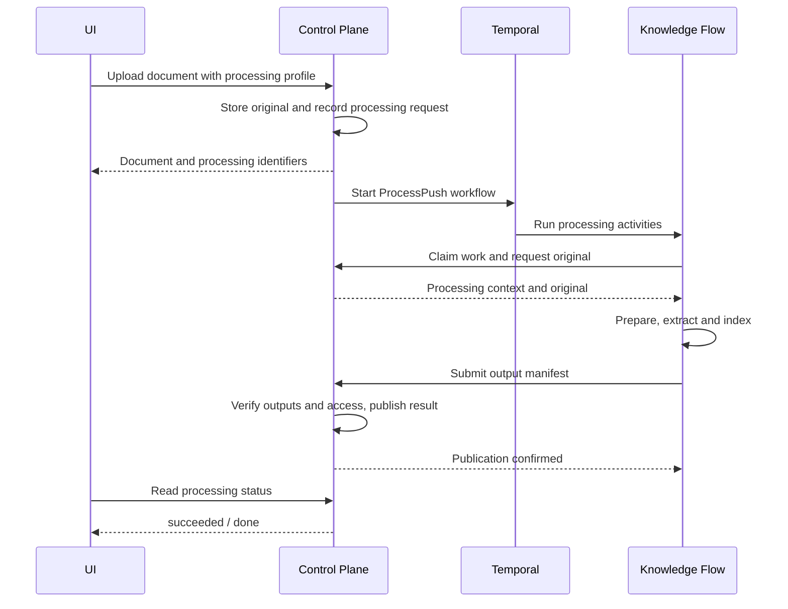
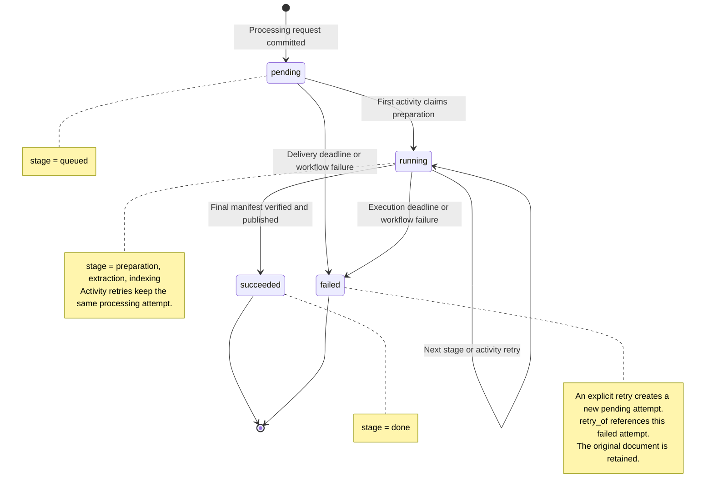

# Reference: document storage and processing

Technical companion to [Documents and knowledge](05-documents.md), for Fred
developers and coding assistants. It preserves storage layout, upload and retry
contracts, processing states, publication and cleanup mechanisms for the
Control Plane document path. The [document journey trace](A4-document-journey.md)
provides a concrete example and read-only inspection commands.

## Classification and content ownership

A space owns its folder tree, document registry and stored originals. Manager owns
their identity, storage lifecycle and processing receipts. Knowledge Flow workers
own extraction and output algorithms. Upload-only requires no ingestion service;
optional processing dispatches the existing `ProcessPush` workflow through Temporal.
Manager folder UUIDs and Knowledge Flow tag UUIDs are distinct identity domains.

A folder has one immutable space and at most one parent in that space. Paths
contain UUIDs, not display names. Renaming changes one label without rewriting
descendants or permissions. Sibling folder names are unique. Document placement
is immutable and its folder belongs to the same space.

## Authority

The owning space is the authorization boundary. Folders and documents have no
OpenFGA grants, parent tuples or individual permission lists. Increasing their
number adds no authorization tuples. Folder depth is limited to 15 independently
of OpenFGA evaluation depth.

Every request requires personal admission, the caller's unique organization and
current space authority. Members and effective editors/analysts read; effective
editors write. Administrator and owner titles confer no content access. Personal
spaces inherit no organization or team authority. The
[action/role matrix](A7-action-role-matrix.md) defines these distinctions.

A directory's write decision enables existing controls but reserves no right.
Mutations recheck after the organization lock and consume an OpenFGA guard revision.
Uploads do so twice: when reserving quota/name and when publishing verified content.
Token expiry and current CGU acceptance are rechecked at both boundaries. Request
body and object-storage IO take place outside that lock.

## Navigation and folder lifecycle

Resources uses one combined page of immediate folders and published documents,
plus the requested directory's ancestors, exact matching total and write decision.
Rows, ancestors and total share a read-only repeatable-read SQL snapshot; the
write decision is a separate OpenFGA Check before that transaction. Pages default to 50 rows and
contain at most 200, with folders first, name/date/size sorting and an identity
tie-breaker. Folders have no aggregate size and use name order for size sorting.
Search is a literal case-insensitive substring over the whole current directory.
Separate requests are live views; concurrent changes can shift offset boundaries.

Folder creation/rename stores labels in NFC without surrounding whitespace, then
accepts 1..255 Unicode scalar values and rejects separators and controls. Sibling
uniqueness compares that stored form. Placement stays fixed. Deletion removes one
selected subtree atomically, but any published document or pending upload below
it refuses the whole operation. Multiple roots are independent, with partial
success reported by the UI. Space retirement likewise refuses stored documents
and pending uploads. A waiting mutation cannot resurrect a deleted target.

## Creating an original

An editor selects files in the existing drawer, including drop and nested-folder
destinations. Each upload targets a named manager folder. The advisory preflight
reports current conflicts and quota; the server makes the final decision under
the organization lock. The drawer starts nonconflicting files and retains conflicts
for explicit skipping. Replacement is visibly unavailable. Each file has an
independent outcome, so one failure does not undo another successful upload.

The server accepts one multipart file per request, up to the configured ceiling
and never above 100 MiB. It streams to a private temporary file with bounded
concurrency, idle and total deadlines, while measuring actual bytes and SHA-256.
The filename is NFC-normalized, case-sensitive and 1..255 Unicode scalar values;
path separators and controls are refused. Filename and reported MIME type are
metadata. The filename is the last object-key component; the complete UTF-8 key
is limited to 1,024 bytes. Neither filename nor MIME is a trusted content type.

One SQL transaction reserves the destination name and bytes in `document_upload`.
Personal and organization spaces have their own quota; a team and its projects
share the team's quota. Published bytes plus pending reservations count toward
the limit. A name conflict returns 409 without overwriting an existing original.
Concurrent requests cannot overdraw shared quota or claim the same name.

After commit, manager writes a new immutable object with `If-None-Match: *` and checks
its complete bytes, length and SHA-256 by reading it back. Only then can the second
guarded transaction publish its `document` row and terminal `stored` receipt.
Publication failure leaves no visible document. Originals are immutable (I25).

## Physical object layout

Manager preserves Swift's documents bucket convention and document-local
`input`/`output` roots. The configured bucket is the full name, not the base name:

```text
<content_storage.bucket_name>-documents/  # app-content-documents in k3d
  <document_id>/input/<original_filename>
  <document_id>/output/<installation_id>/<processing_id>/<generation_id>/<artifact>
<content_storage.bucket_name>-objects/    # unchanged auxiliary store
  <key chosen by an object-store consumer>
```

Original and derived configurations require the same endpoint, bucket and prefix.
An optional single-label `prefix` precedes both document roots; the factory uses
an empty prefix. `installation_id` is the persisted `document_storage.namespace`.
The original also carries S3 metadata `fred-installation=<installation_id>`:
cleanup never deletes an unknown or foreign installation's object. The document
UUID is also its internal upload journal ID; the browser request key is different.
Read `document.object_key` for the exact key. SQL records the storage binding and
refuses changed coordinates at startup. Existing Swift metadata is not imported
merely by pointing manager at its bucket.

Generation directories below `output` are the justified layout difference:
retries and stale activities cannot overwrite the published artifacts. A new
attempt restores the preceding stage by replacing the final generation segment.
Original paths and the bucket name need no rename for this layout.

`TSN`, `fredlab` and `ArxivAi` are display names, never S3 path components. The
folder UUID/path lives in PostgreSQL and the worker descriptor, not the object
key. Derived generations isolate activity attempts. Their manifests live in
`document_processing.generations` and the published `document_processing.manifest`;
there is no required S3 `manifest.json`. Artifact presence alone is not publication.

The source definitions are [original keys](../../apps/control-plane/src/documents/mod.rs)
and [upload identity](../../apps/control-plane/src/documents/upload.rs),
[derived prefixes](../../apps/control-plane/src/processing/store.rs), and
[legacy MinIO storage](../../apps/knowledge-flow-backend/knowledge_flow_backend/core/stores/content/minio_content_store.py).
The [document journey](02.2-document-journey.md) gives the user-facing PDF example;
its [technical annex](A4-document-journey.md) provides read-only inspection steps.

## Receipts, retries and cleanup

`Idempotency-Key` is a request UUID scoped to the authenticated actor. The journal
binds it to destination, canonical name, size, digest and optional processing profile. Repeating a stored upload
returns the same document ID; different bound content conflicts. Pending work
returns a conflict with a receipt location and retry delay. A terminal failed
attempt needs a new key linked by `retry_of`; only one successor can win.

The import panel observes the actor's durable receipts and distinguishes stored,
pending, failed and temporarily unknown results. Navigation retains active files
in memory. Reload restores receipts; resending after reload requires file selection
and a receipt check first. A token refresh preserves session identity. Changing
accounts clears held files and isolates cache/results. Files queued before dispatch
can be cancelled; this does not delete a document. Acknowledging or superseding a
terminal failure prevents its return after local browser state is lost.

The API's independent cleanup loop expires abandoned reservations, deletes failed
attempt objects and scans its persisted object namespace in bounded pages. SQL
claims coordinate replicas; retries retain progress and back off. Every inventory
candidate is checked against published and pending SQL state before deletion.
Repeated scans recover a late Put after an earlier Delete. SQL unavailability
prevents deletion; an excessive failed-object backlog refuses new uploads.
Acknowledged stored receipts remain available for idempotency. Cleaned failed
receipts expire after the configured retention period.

## Finding and downloading

After storage, the existing table displays filename, size, file-type icon and real
creation date. Reload finds the same identity. Statistics and quota use manager's
registry and reservations. Storage and processing have separate outcomes; neither
implies search/chat availability. With processing configured, existing row/bulk
processing actions and the upload drawer's fast/medium/rich choices use manager.
Replacement, document deletion and bulk ZIP remain unavailable. The separate
knowledge-base consumer retains its existing service bindings.

Individual download checks current read permission and streams the original with
bounded server buffers and deadlines. It forces attachment, octet-stream,
`nosniff` and private/no-store headers. A missing object or inconsistent declared
length fails before the response; corruption discovered while streaming aborts
the body. The browser checks the final length and keeps at most one original Blob,
bounded by the 100 MiB ceiling. No presigned public URL or content conversion is
involved.

See the [Resources journey](02.1-user-journeys.md#priya-opens-resources),
[request costs](09-quality.md#original-storage-costs-and-failure-evidence),
[runtime](A1-manager-runtime.md#original-storage) and
[operations](A3-manager-operations.md#original-storage).

## Processing a stored original

### Component interactions

Successful processing of an upload with a selected profile:



Storage operations and intermediate stage callbacks are detailed in the
[document journey annex](A4-document-journey.md#follow-the-document).

### Processing attempt states

These are the persisted `status` values for one attempt:



State definitions: [models.rs](../../apps/control-plane/src/processing/models.rs).
Transitions: [admission and claims](../../apps/control-plane/src/processing/store.rs),
[publication](../../apps/control-plane/src/processing/publication.rs),
[dispatch and deadlines](../../apps/control-plane/src/processing/dispatch.rs).

### Processing behavior

An upload with a profile publishes the original and its processing intent in one
transaction. An editor can also process a stored-only document or explicitly retry
a failed attempt without another file transfer. One active attempt and one linked
successor per failure prevent competing starts. Each attempt freezes the Python
worker's exported policy and profile settings. Original quota is charged once.

The dispatcher, a background task of `control-plane serve`, is woken when an
admission commits and otherwise polls. It leases due SQL intents, never-delivered
ones first, releases database locks, then starts `ProcessPush` with bounded
concurrency using unchanged `PipelineDefinition` and `FileToProcess` payloads.
It describes uncertain submissions before retrying, rejects duplicate workflow
identities, describes running work again every two minutes and expires
queued/running work within configured deadlines. Temporal
history contains references and orchestration metadata, never files or credentials.

The existing KF activities select a manager persistence adapter through the source
reference. They stream an authorized original, run the existing extraction and
output processors, and stage immutable derived artifacts and generation-scoped
vectors in separate stores. Native Word/ODT/PowerPoint previews use the existing
Office-to-PDF converter in the supervised extraction process. CSV/Excel use the
existing tabular processors. No legacy tag, catalog row or task is created.

Preparation, extraction and indexing claim monotonically fenced generations.
Manager verifies artifact sizes/hashes before the final guarded transaction checks
current actor access and CGU and publishes the manifest. A stale activity cannot
replace a committed stage or terminal outcome. Cleanup journals bounded vector
identifiers and objects, repeats sweeps for late writes, and preserves originals
and published generations. Failure retains the original and a safe stage/error.

Resources and the import panel read persisted summaries, including after reload.
Existing File/Raw preview modes read authenticated manager endpoints, with native
PDF range support. Raw previews cap browser text at 8 MiB; protected local images
use authenticated Blob URLs. Remote images, active HTML, diagrams and local links
cannot bypass those controls. Published previews require current read authority.
