# Graphs

Create or repair a Mermaid diagram using this file and the user's source facts.
The instructions and examples here are sufficient without Internet access.
Ask for essential missing information instead of inventing relationships, dates,
measurements or scores. Preserve the intended meaning when repairing a diagram.
Prefer a short list or table when it answers the question more clearly.

## Choose the representation

| What the reader needs to understand | Type |
| --- | --- |
| Steps, decisions or dependencies | Flowchart |
| Messages between participants in order | Sequence diagram |
| States and the events that change them | State diagram |
| Classes, members and their relationships | Class diagram |
| Entities, attributes and cardinalities | Entity relationship diagram |
| Ideas organized around a central topic | Mindmap |
| Events or milestones in chronological order | Timeline |
| Scheduled tasks, durations and dependencies | Gantt chart |
| A few verified parts of one total | Pie chart |
| Verified category comparisons or change over time | XY bar or line chart |
| User activities, actors and supplied experience scores | User journey |
| Git branches, commits and merges | Git graph |

## Write the diagram

Use the matching example below as a starting point. Their values and dates are
illustrative; replace them with supplied facts or actual tool results. Keep
labels short and in the user's language, including accents. Separate stable
identifiers from display labels and use the chosen type's own syntax.

### Flowchart

Use `TD` for top-down or `LR` for left-to-right. Rectangles are activities,
diamonds are decisions, and edge labels describe branches. Quote display labels;
use short IDs in arrows. Avoid the reserved lowercase ID `end`. A `subgraph`
block groups related nodes and closes with `end`.

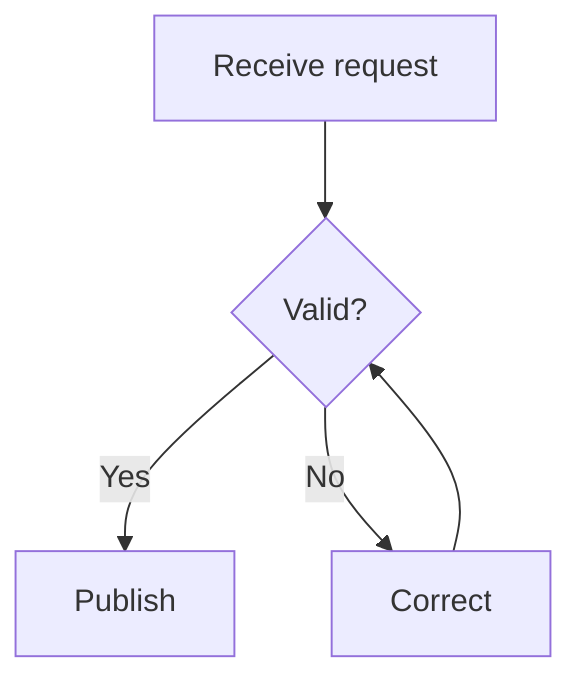

### Sequence diagram

Declare participants and use `as` for display names. `->>` sends a message and
`-->>` represents a reply. Alternatives use `alt` / `else` / `end`; repetition
uses `loop` / `end`.

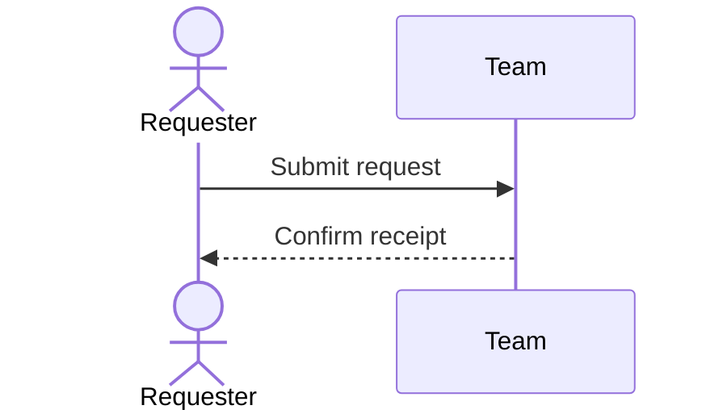

### State diagram

Use `[*]` for a start or end and `: event` on transitions. A state can have a
display label distinct from its ID.

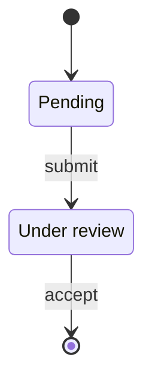

### Class diagram

Put attributes and methods in braces; `+` is public and `-` private. Use `<|--`
for inheritance, `*--` for composition, `o--` for aggregation, `-->` for
association or `..>` for dependency when the source establishes that meaning.

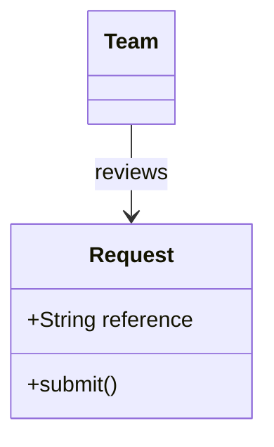

### Entity relationship diagram

Cardinality endpoints use `||` for exactly one, `o|` / `|o` for zero or one,
`o{` / `}o` for zero or more and `|{` / `}|` for one or more. `--` identifies
a relationship and `..` is non-identifying. Attributes are `type name` with
optional `PK`, `FK` or `UK` markers.

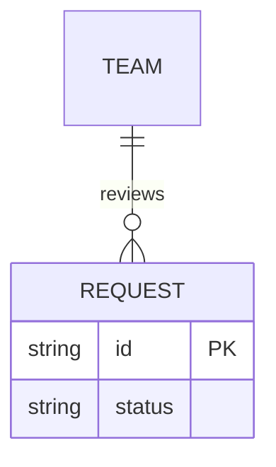

### Mindmap

Indentation defines parentage. Keep one root and consistent sibling indentation.
Use a flowchart when cross-links matter more than the hierarchy.

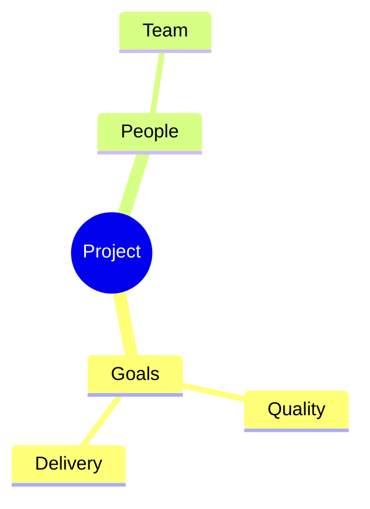

### Timeline

Write `period : event` in chronological order. Periods are labels, not durations;
`section Name` can group subsequent events.

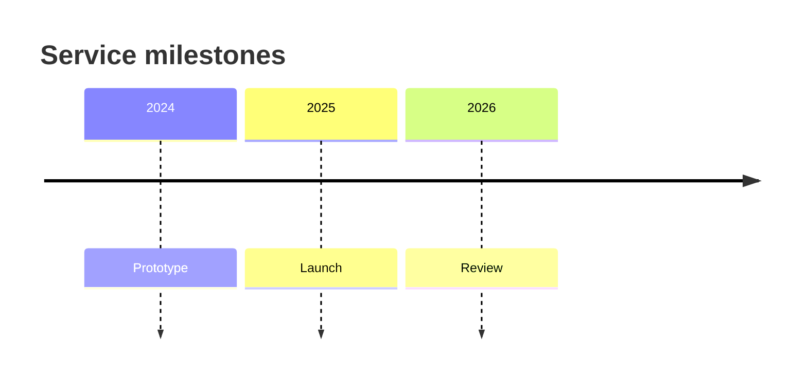

### Gantt chart

Declare `dateFormat`. Tasks use `label :id, start, duration`; `after id` expresses
a dependency. Use known dates or clearly label a proposed schedule.

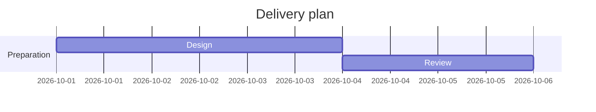

### Pie chart

Use `"Label" : value` for a few positive parts of the same verified total. Omit
zero parts and explain exclusions. Bars are clearer for precise comparisons.

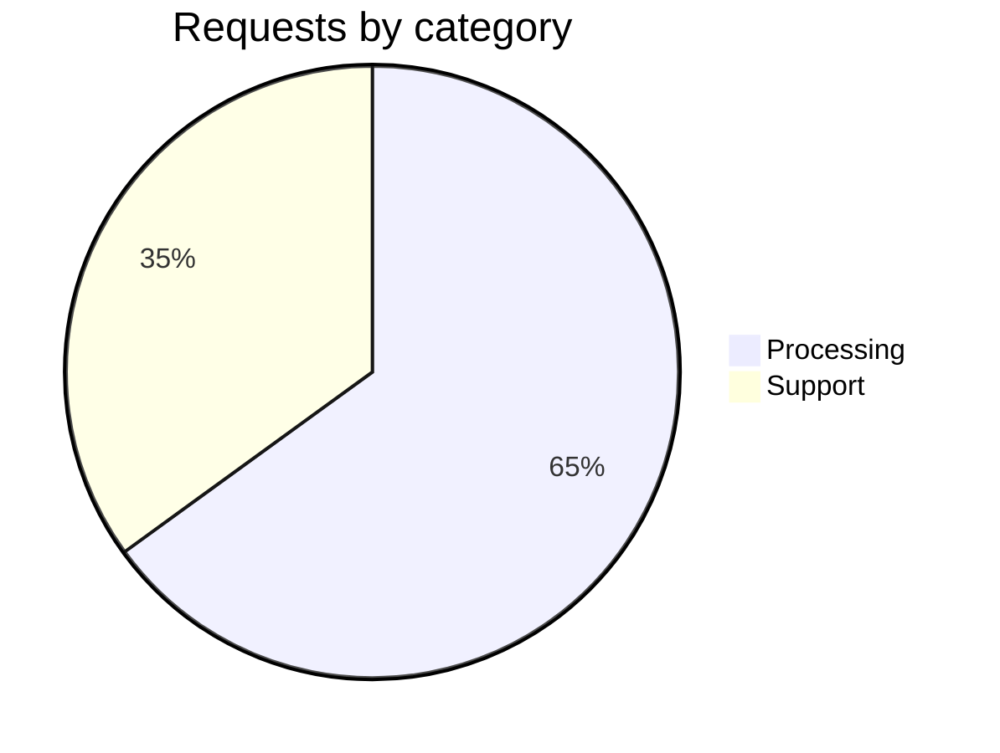

### XY bar or line chart

Align each series with its categories; use `line [...]` for ordered change or
`bar [...]` for comparisons. Label units and use a zero baseline for bars.
A line chart is not a scatter plot. Keep gaps visible; use a table if these
forms cannot represent the data faithfully.

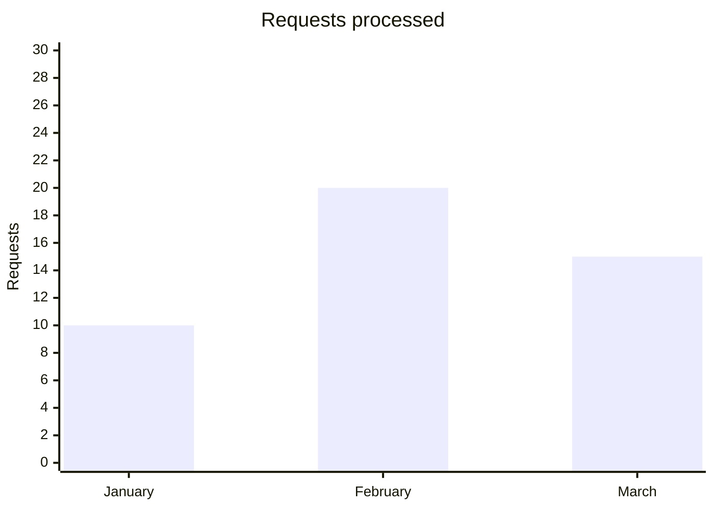

### User journey

Tasks use `Task: score: actor1, actor2`, with scores from 1 to 5. Scores must
come from the source; use a score-free flowchart when they are unavailable.

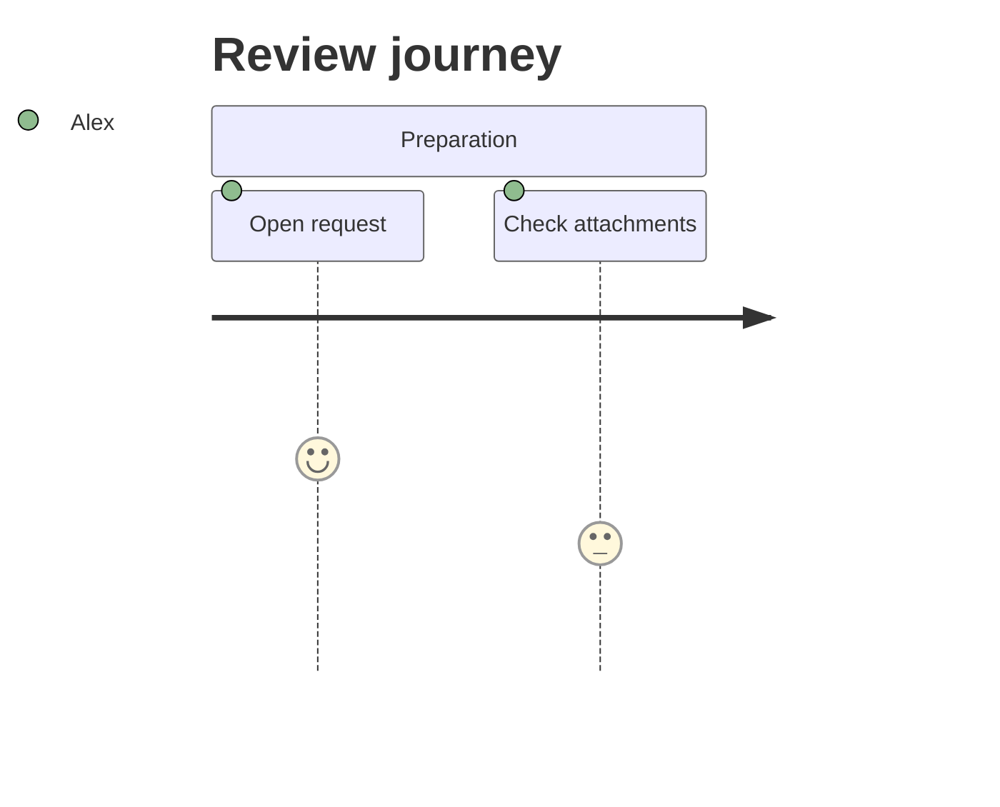

### Git graph

`branch` creates and switches to a branch, `checkout` switches to an existing
branch and `merge` merges another branch into the current one. Preserve actual
ancestry, or identify the graph as a hypothetical workflow.

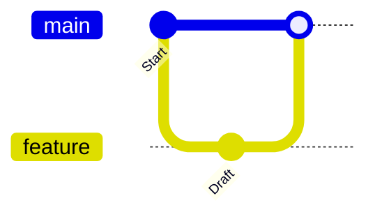

## Check and deliver

- Keep one statement per line, close quotes and blocks, and check every edge,
  cardinality, date and value against its source. Split dense graphs into views.
- Use text and built-in shapes, with the chat's default theme. Diagrams must
  work without remote images, icon packs, scripts, HTML or extra extensions.
- Return a complete fenced `mermaid` block directly in chat, starting with its
  diagram declaration. Mindmaps also use a `mermaid` fence. An HTML artifact
  viewer does not render Mermaid source.
- Introduce the result with a caption about its subject and explain material
  assumptions. Discuss the rendering engine only when the user asks about it.
- The examples use the chat's Mermaid 11.16.1 baseline. Start with these forms
  when fixing imported or advanced syntax. Run a local parser or renderer if
  available and report only checks actually performed; otherwise inspect the
  source and simplify uncertain syntax or offer a table.
