# Syntax and examples

Read the section matching the representation selected in SKILL.md. These are
original syntax examples, not facts about the user's situation. Their numbers,
scores and dates are illustrative; replace them with supported source values.

## Flowchart

Use for processes, decisions and dependencies. Select `TD`/`TB` for top-down,
`LR` for left-to-right, or `RL`/`BT` when the reading direction calls for it.
Use short IDs and quoted labels, including Unicode. Reference IDs in edges.
Lowercase `end` is a reserved parser token; use a descriptive ID instead.

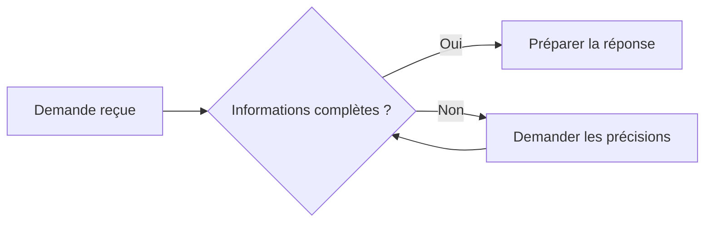

Rectangles describe activities; diamonds describe decisions. Arrow and shape
syntax is specific to flowcharts. Nested subgraphs and other arrow styles exist;
use them only when they add meaning. Keep one declaration or edge per line.

Source: [Flowcharts, Mermaid 11.16.1](https://github.com/mermaid-js/mermaid/blob/mermaid%4011.16.1/packages/mermaid/src/docs/syntax/flowchart.md).

## Sequence diagram

Use for interactions over time, not a static dependency map. Declare participants
before their messages; `as` separates a stable ID from a readable label.
`->>` is a message and `-->>` can represent a reply. Use `alt`/`else`/`end` for
alternatives and `loop`/`end` for repetition when the source establishes them.

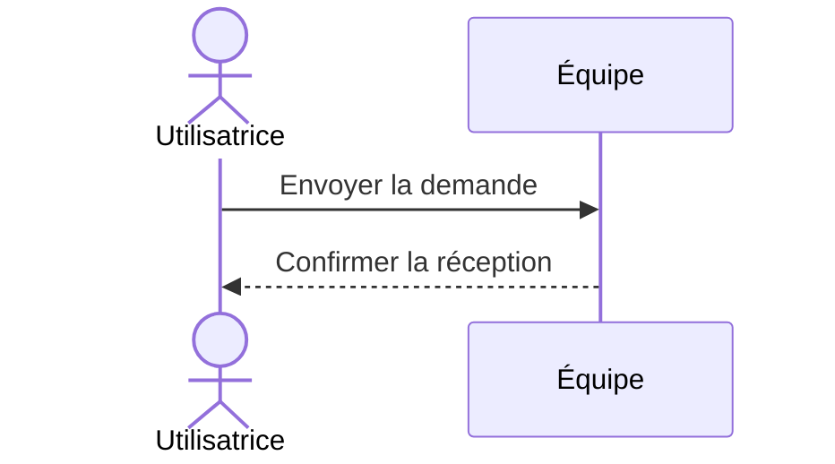

Source: [Sequence diagrams, Mermaid 11.16.1](https://github.com/mermaid-js/mermaid/blob/mermaid%4011.16.1/packages/mermaid/src/docs/syntax/sequenceDiagram.md).

## State diagram

Use for an entity's lifecycle. `[*]` marks a start or end; an arrow describes a
transition. Name the event after `:`. Use `state "Label" as ID` for a display
label distinct from its ID. Composite states use `state ID { ... }`.

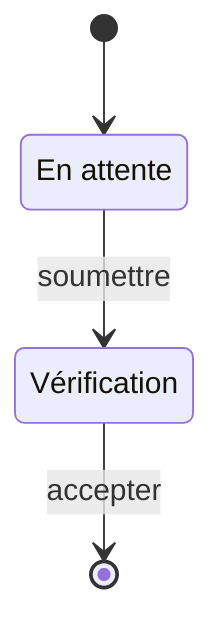

Source: [State diagrams, Mermaid 11.16.1](https://github.com/mermaid-js/mermaid/blob/mermaid%4011.16.1/packages/mermaid/src/docs/syntax/stateDiagram.md).

## Class diagram

Use for class structure and behavior. Put attributes and methods inside braces;
`+` means public, `-` private. Use `<|--` for inheritance, `*--` for composition,
`o--` for aggregation, `-->` for association and `..>` for dependency. Choose a
relationship only when that meaning is established by the source.

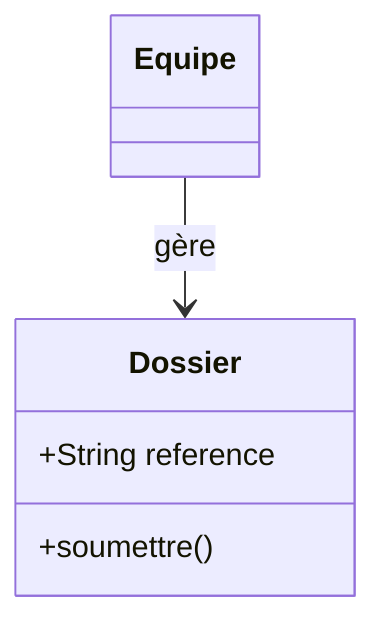

Source: [Class diagrams, Mermaid 11.16.1](https://github.com/mermaid-js/mermaid/blob/mermaid%4011.16.1/packages/mermaid/src/docs/syntax/classDiagram.md).

## Entity relationship diagram

Use for a domain or database model. Mark each endpoint's cardinality: `||`
exactly one, `o|`/`|o` zero or one, `o{`/`}o` zero or more, `|{`/`}|` one or more.
`--` denotes an identifying relationship; `..` a non-identifying relationship.
Attributes have a type, name and optional `PK`, `FK` or `UK` markers. A logical
model need not repeat relationships as foreign-key fields.

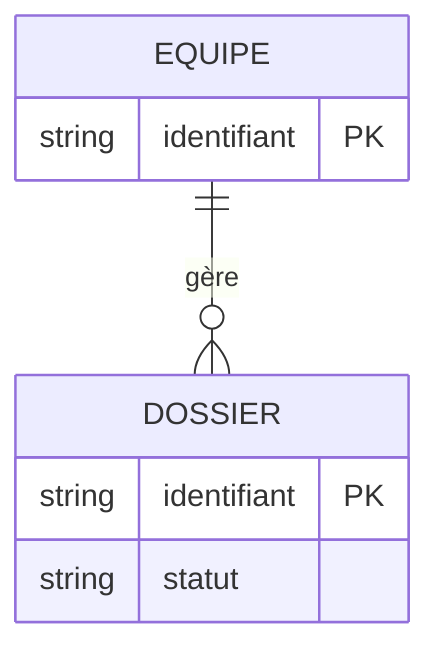

Source: [Entity relationships, Mermaid 11.16.1](https://github.com/mermaid-js/mermaid/blob/mermaid%4011.16.1/packages/mermaid/src/docs/syntax/entityRelationshipDiagram.md).

## Mindmap

Use for a hierarchy of ideas around one root. Indentation establishes parentage;
keep sibling indentation consistent. `root((Label))` gives the root a circle.
Avoid icons requiring extra registration. Use a flowchart if cross-links or
decision paths matter more than hierarchy.

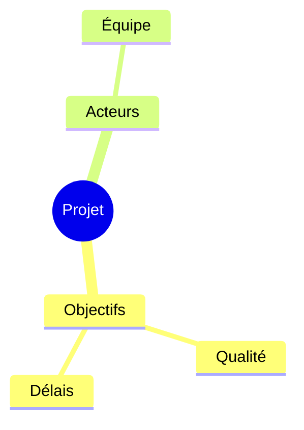

Source: [Mindmaps, Mermaid 11.16.1](https://github.com/mermaid-js/mermaid/blob/mermaid%4011.16.1/packages/mermaid/src/docs/syntax/mindmap.md).

## Timeline

Use for ordered events or milestones, without implying task durations. Write
`period : event`; periods are labels and can be words or dates. Source order is
display order. Optional `section Name` groups subsequent periods.

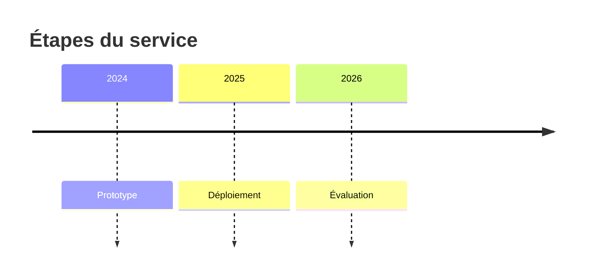

Source: [Timeline, Mermaid 11.16.1](https://github.com/mermaid-js/mermaid/blob/mermaid%4011.16.1/packages/mermaid/src/docs/syntax/timeline.md).

## Gantt chart

Use for a schedule with known dates or durations. Declare the input `dateFormat`.
A task can contain `id, start, duration`; `after id` expresses a dependency.
`section` groups tasks. Distinguish an agreed schedule from an explicitly labeled
proposal; ask for missing dates rather than presenting invented commitments.

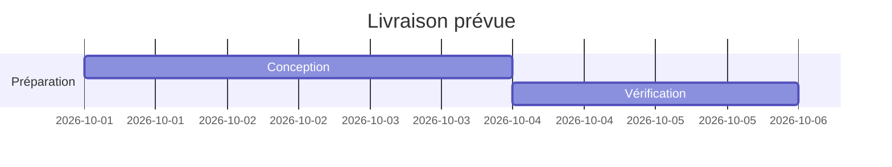

Source: [Gantt charts, Mermaid 11.16.1](https://github.com/mermaid-js/mermaid/blob/mermaid%4011.16.1/packages/mermaid/src/docs/syntax/gantt.md).

## Pie chart

Use for a few positive parts of the same known total. Write `"Label" : value`.
Omit zero-value parts and explain relevant exclusions. Prefer bars or a table
when values are close, many categories exist, or exact comparison matters.

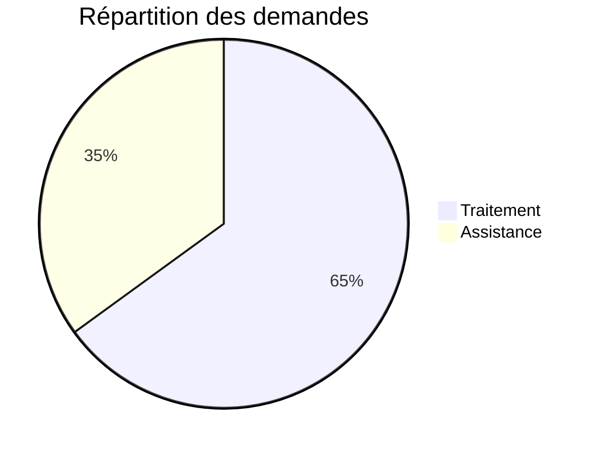

Source: [Pie charts, Mermaid 11.16.1](https://github.com/mermaid-js/mermaid/blob/mermaid%4011.16.1/packages/mermaid/src/docs/syntax/pie.md).

## XY bar or line chart

Use bars for category comparisons and lines for ordered change. The x-axis can
be a category list or numeric range; the y-axis is numeric. `bar [...]` and
`line [...]` declare series. Align every series value with its category, label
units and periods, and use a zero baseline for bars. Do not silently fill gaps
or invent estimates; use a table if the available syntax cannot represent the
data faithfully. A line chart is not a general scatter plot.

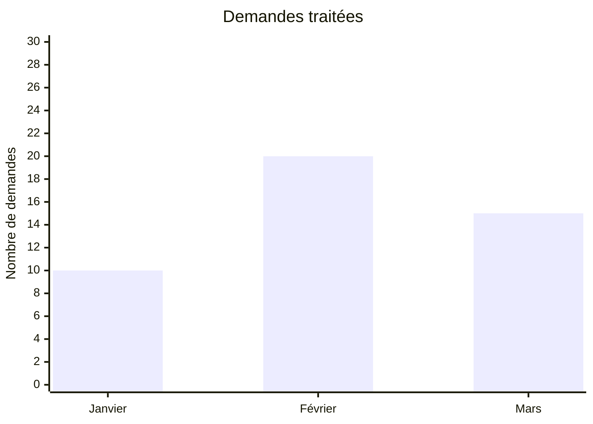

Source: [XY charts, Mermaid 11.16.1](https://github.com/mermaid-js/mermaid/blob/mermaid%4011.16.1/packages/mermaid/src/docs/syntax/xyChart.md).

## User journey

Use for activities involving actors and experience scores. Tasks use
`Task: score: actor1, actor2`, with scores from 1 to 5. `section` groups phases.
Scores need a source; if none exists, ask for them or choose a score-free
flowchart or timeline.

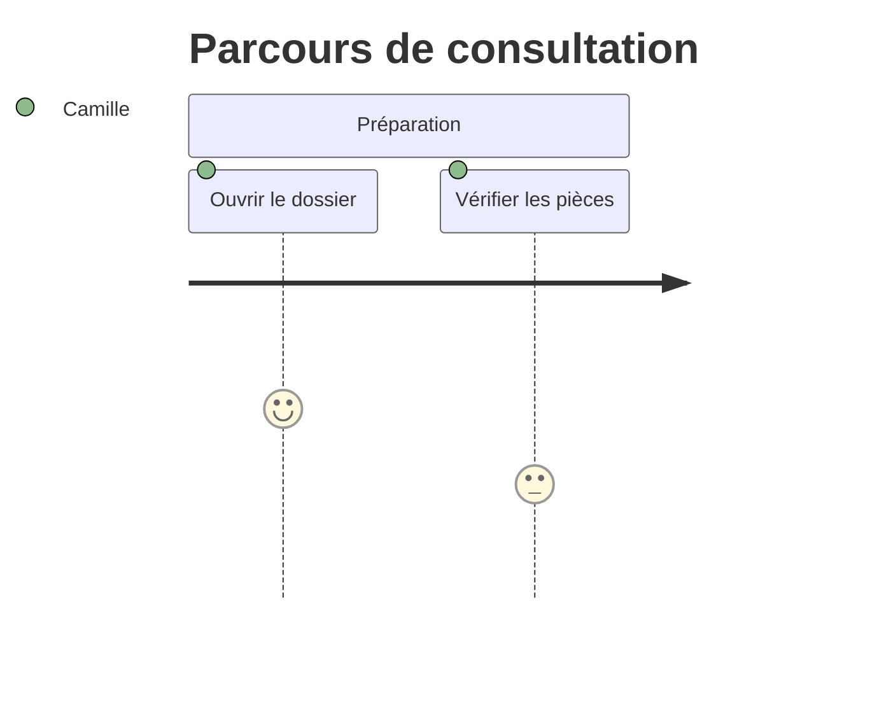

Source: [User journeys, Mermaid 11.16.1](https://github.com/mermaid-js/mermaid/blob/mermaid%4011.16.1/packages/mermaid/src/docs/syntax/userJourney.md).

## Git graph

Use for commits, branches and merges. `commit` records a commit on the current
branch; `branch` creates and switches to a branch; `checkout` switches to an
existing branch; `merge` merges another branch into the current one. Preserve
actual ancestry when describing history. Label hypothetical workflows as such.

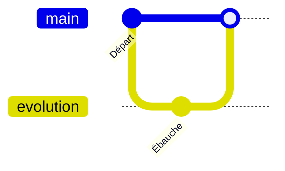

Source: [Git graphs, Mermaid 11.16.1](https://github.com/mermaid-js/mermaid/blob/mermaid%4011.16.1/packages/mermaid/src/docs/syntax/gitgraph.md).
